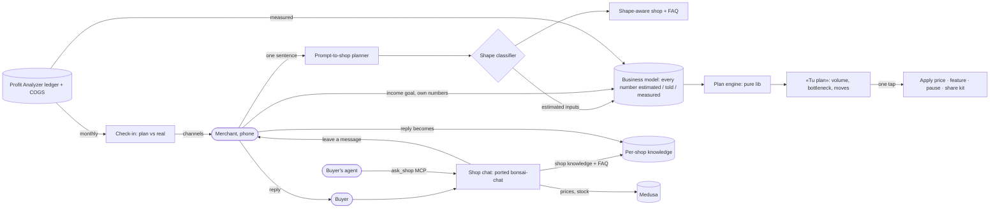
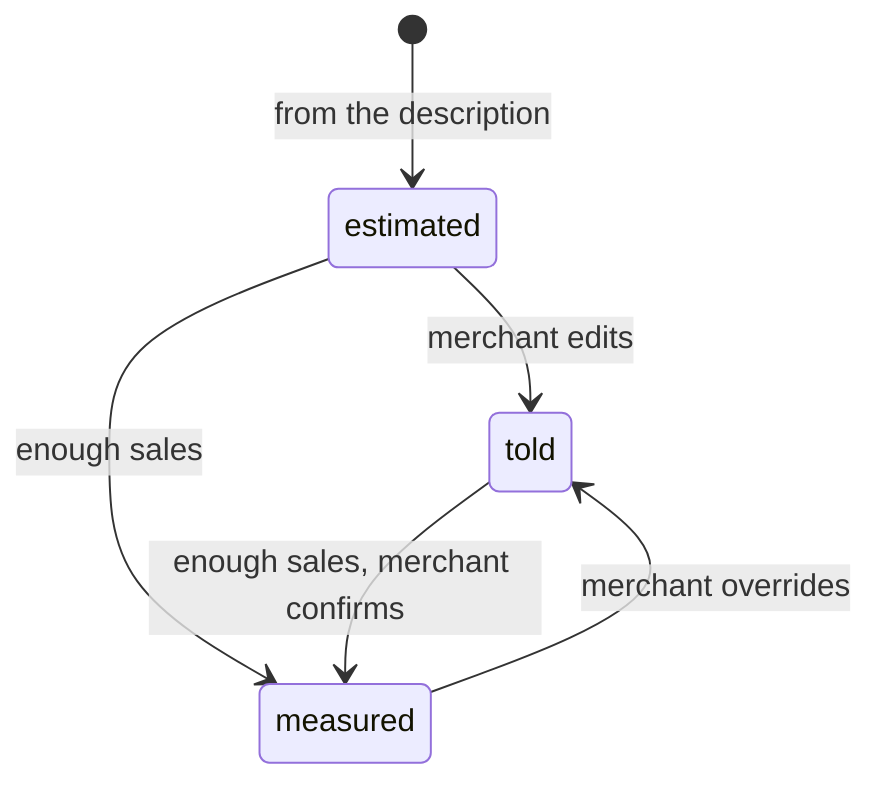

# Pitch — Business infrastructure: describe any business, we set up everything

Moves · Tests: not grounded — no strategy yet

## The ask, as given

> Hi Claude refine business-infrastructure-productize-anything.md seed , appetite is L, full throttle

The seed's own ask (the product owner, 2026-11-02, preparing the YC W27 application):

> a person describes their business, whatever it is, and Miyagi takes care of everything, for humans and for the
> agents that act for them. The aim is to productize anything, no matter what the business is.

> 4. **Financial strategy**: obtain the merchant's current unit economics, or project them for a new business;
> calculate price points; find chokeholds (bottlenecks); model the production function.

Refine answers, verbatim (2026-11-03):

> to be clear, despacho bonsai support is the widget shown on despachobonsai.com , i believe its folder is at
> bonsai-chat in dobby. despacho bonsai has a dashboard and from there i believe a commerce module with a financial
> management or maybe just reporting tool, thats what it meant, not sure if we are on the same page, either way it
> doesnt matter, the idea wa sto see if it was possible to reuse or something from there. a. suggest a target number,
> realistic, theres barely any traffic, b. i did run one and its fantastic, theres one small ui issue, after the user
> submits the prompt to create the shop, if they scroll all the way down they can see the quedatela button, clicking
> it should open a modal i believe or so it appears with the signup form. however, the signup form is expanded below
> the quedatela button and for some reason i couldnt scroll down either on desktop or mobile. Navigating with tabs on
> desktop worked and was able to register a new account and got the shop perfectly created. lets fold that in or deal
> with it however you suggest. Furthermore the plan is aimed at merchants who dont sell products but the idea is for
> everyone, including current merchants, do we calculate and provide their unit economics? do we propose a
> prescriptive financial plan based on their data? im no fully sure we are nailing this one yet

> data and automation meant allowing them to consolidate data sources used by their business (could be a cms, crm, a
> simple excel, quickbooks or other accounting tools) and automation refered to automate the data flows and
> consolidation of their management from a single point. agree that it could be refined on its own

Choices made at refine: services in v1 = financial strategy + AI customer support (same epic); business types = all,
one classifier; charging = free now, price later; the financial plan = one model per shop + a goal-anchored plan +
one-tap moves + a monthly check-in.

### Claims
1. Any business, whatever it is, can describe itself and get the right shop — not only product sellers.
2. It is for everyone, including merchants already selling on Miyagi, not only new ones.
3. Miyagi calculates each merchant's unit economics: measured from their data when they have it, projected when not.
4. Miyagi proposes a prescriptive financial plan from that data: price points, the bottleneck, the production function,
   what to do next.
5. Miyagi answers the business's customers (customer support), reusing the Despacho Bonsai chat widget.
6. It works for humans and for the agents that act for them.
7. The prompt-to-shop signup sheet that cannot be scrolled is fixed.
8. It is free for now; accounting/CFDI, data consolidation + automation and the product methodology are separate bets.

**Teach-back:** yes — "You want every merchant, new or already selling, whatever they sell, to describe their business
and get the right shop, a plan for their money built from their real numbers, and a shop that answers buyers, so that
Miyagi is the business's infrastructure and not only its shop builder. Right?" Confirmed with the financial-plan and
support choices above.

## Problem

Prompt-to-shop (shipped 2026-10-28) turns one sentence into a shop, but it assumes a **product seller**: it always
generates 4–6 product rows and the same cobros/entregas. A cook, a tutor or a maker gets a shop that does not fit how
they sell. And every merchant, new or already selling, is left with the two questions no shop answers:
**what does my month have to sell to pay me, and what do I change to get there?** and **who answers my buyers when
I'm busy?** The Profit Analyzer shows margins after the fact; nothing turns them into a plan.

Present-day facts that shaped this pitch (verified 2026-11-03, not assumed):
- **Despacho Bonsai reuse.** `~/dobby/bonsai-chat` is a working AI chat widget (Gemini on Vertex, answers only from one
  knowledge file per site, `leave_message` + `book_call` tools, Telegram + Resend email to the owner with the
  transcript, per-IP rate limit, origin allow-list, Firestore transcripts, `widget.js` launcher). It is "the shop
  answers" in miniature and is ported, not reinvented. The dashboard's `/api/commerce/financials` is revenue − COGS by
  channel and product: a subset of Miyagi's Profit Analyzer (which also counts fees and shipping), so nothing to take.
  No CFDI/SAT code exists in any repo.
- **Messaging is stamps-only by design** (`lib/stamps.ts`: "No free text"). The chat is its own surface next to it.
- **Prompt-to-shop has one draft ever** (`shop_drafts`: 1 row, kept, 2026-11-03 20:29 UTC: the product owner's own
  walkthrough). No real merchant has used it yet. 60 shops exist; 1 was created in the last 7 days.
- **The keep sheet cannot be scrolled** (the product owner's walkthrough, desktop and phone): «Quedármela» opens the
  sign-up form below the button and the page will not scroll to it; Tab navigation reached it and the shop was created
  correctly. Root cause not yet known; `KeepSheet.tsx` sets `body overflow: hidden` while open, and a `fixed` sheet
  that renders in page flow (an ancestor creating a containing block) would produce exactly this.

## Appetite

**L** — the whole run, split by capability boundary (the rail, then the surface that uses it).
quote: $50–300 (L, n=0, wide)

## Outcome & signal

After this ships, a cook types "vendo comida corrida y tamales los fines de semana en Coyoacán" and sees a shop of
**dishes with pickup and hand delivery**. Next to it is **«Tu plan»**: "Para ganar $15,000 al mes necesitas unos 210
platos. Tu estufa da para 1,000, así que tu límite son los compradores: hoy vendes 60. Sube el tamal a $28, empuja la
comida corrida (la que más deja por hora de estufa) y comparte tu catálogo en 3 grupos de WhatsApp", each move one tap
from the tool that does it. A merchant already selling opens the same «Tu plan» in their dashboard, built from their
real sales and costs. Each month the plan says whether they are on track. A buyer asks the shop's chat "¿hacen pedidos
para 30 personas?" and gets the shop's own answer, or the owner gets the question.

Signal: `p2s_published` (already counted by the prompt-to-shop funnel), carrying the new shape. Target **0 → 4** real
merchants in the 30 days after ship, the pace of the 4 organic signups so far; more needs traffic this bet does not
create. Secondary (not the target): shops with a plan set, and chat questions answered vs handed off.

## Stage-2.5 bucket

**Genuinely new, built on what exists.** Listing types, unit cost on import rows, the Profit Analyzer ledger and
solve-for-price, the prompt-to-shop planner, the share kit and bonsai-chat all exist; the shape classifier, the
business model with provenance, the plan engine and a per-shop chat do not. The keep-sheet fix is a bug (fixed scope).

## Bill of materials (What / Why)

| What | Why |
|---|---|
| Keep-sheet scroll fix (first, own PR) | Every new merchant hits it today; it is the door this bet's target counts |
| Business-shape classifier (first planner call) | One sentence decides products · services · food · made-to-order · rentals/digital |
| Shape-aware generation + defaults | A tutor gets services; food gets pickup + hand delivery, not Correos |
| One business model per shop, every number with its source | estimated (AI) · told by you · measured (sales): the same model serves new and existing shops and firms up over time |
| Model inputs from the description (new) or the ledger (existing) | New shops start estimated; existing shops start measured and are asked only for the gaps |
| The owner's monthly income goal | Anchors the plan in the merchant's own terms, not ours |
| Pure plan engine (`lib/`), never the model | Break-even, required volume, contribution per unit of the bottleneck, the binding constraint; maths a model invents is a confident blank |
| Typed moves with one-tap actions | reprice → existing Apply · push → feature it · pause → catalog pause · share → share kit; a plan you cannot act on is a report |
| AI writes only the explanation | Plain es-MX words over numbers it did not compute |
| Monthly check-in | Plan vs real from the ledger, sent on the merchant's channels; what makes it a plan, not a calculator |
| bonsai-chat ported into Miyagi | Working chat loop, widget, tools and owner alerts; per-shop knowledge instead of one static file |
| Per-shop knowledge + generated FAQ | The shop answers on day one from its own catalog, policies and FAQ |
| `ask_shop` MCP tool | Agents get the same answers (agents are first-class) |
| Handoff: leave a message → merchant answers → buyer email → FAQ | Support that learns; the merchant answers once |

## Scope

**In v1:**
- The keep-sheet scroll fix, merged ahead of the rest.
- Shape classifier + shape-aware catalog, cobros/entregas defaults and copy in prompt-to-shop (MX, es-MX).
- «Tu plan» for every shop: the business model with per-number provenance, built from the description (new) or from
  catalog + COGS + Profit Analyzer ledger (existing, including the shops already on Miyagi); the income goal; the plan
  engine; moves wired to existing actions; a monthly check-in.
- The shop's chat: bonsai-chat's loop and widget ported into the storefront, per-shop knowledge, on the marketplace
  shop page, the product page, custom domains, subdomains and the embed; `ask_shop` on MCP; handoff to the merchant
  with an emailed reply that becomes a FAQ entry.
- All free. No flag (WAYS-OF-WORKING: rollback is `git revert`).

**Out of v1 (no-gos):**
- **CFDI / accounting** — its own spike exists: `spike-cfdi-autopilot`.
- **Data consolidation + automation** (CMS, CRM, Excel, QuickBooks into one place) — its own idea:
  `business-data-consolidation`. «Tu plan» reads only Miyagi's own data plus what the merchant types.
- **Product methodology** (Golden Frijoles for merchants) — not this bet.
- **Cash flow, loans, taxes, payroll** — the model is unit economics + fixed costs + capacity, nothing more.
- **WhatsApp Business API** answering — Meta verification + per-conversation spend; the chat lives on Miyagi surfaces.
- **Free text in buyer–seller messaging** — stamps-only stays; the chat is next to it, never inside it.
- **Automatic changes** — no move applies itself; each is the merchant's explicit tap through the existing action.
- **Pricing for the new services** — free now; a price is its own story once someone uses it.
- **US / English** — MX es-MX only. **Events** as a generated shape — routed to products/services, and said so.
- **Running bonsai-chat as a shared service** — it is ported into the storefront (shops are dynamic, Miyagi left GCP
  for the Oracle VM, data belongs in Supabase not Firestore); bonsai-chat itself keeps serving despachobonsai.com.

## Rabbit holes

- **The model doing arithmetic.** Decided: the model proposes *inputs* only (cost lines, time per unit, capacity,
  fixed costs), schema-validated; `lib/business-plan.ts` computes everything and picks the moves. Reuse the Profit
  Analyzer's solve-for-price formula, never a second one.
- **Provenance collapsing.** Every input carries `estimated | told | measured` and a date. A measured value replaces an
  estimate only with enough sales behind it (the threshold is a named constant with its reason); a merchant's own
  value is never overwritten silently. Missing is a named gap, never $0 (Profit Analyzer rule). Unknown ≠ zero.
- **Which bottleneck binds.** Capacity vs demand is a comparison of two numbers the model holds (capacity per month vs
  required volume vs current volume). When the inputs to decide are missing, the plan says which one to fill instead
  of guessing.
- **Prescriptions that sound like advice we are not entitled to give.** Moves are arithmetic on the merchant's own
  numbers, phrased as options with their effect ("si subes el tamal a $28, ganas $4 más por pieza"), never as
  financial or tax advice; no move touches money outside the shop.
- **A public free-text LLM endpoint.** Prompt injection, spend, abuse. Keep bonsai-chat's guards (rate limit, origin
  check, size caps) and add Turnstile + the daily AI budget pattern. The model sees only this shop's knowledge;
  prices and stock come from Medusa at answer time; "no sé" routes to the handoff.
- **Tenancy.** `getShop()` returns the Medusa seller, whose id is NOT `marketplace_shops.id`: join on the slug
  (LEARNINGS). The shop is resolved server-side from the page, never from the request body. A spec proves shop A's
  chat never answers from shop B.
- **Buyer contact data.** The handoff stores an email (PII). Service-role only; revoke `PUBLIC, anon, authenticated`
  on every new table (Supabase grants everything by default); purge 90 days after the reply.
- **Custom-domain and embed chat.** The widget must load on tenant hosts and inside the embed without breaking the
  white-label shell; origin checks follow the shop's own domains, not a static list.
- **Migrations.** New Supabase tables (business model, plan check-ins, FAQ, chat threads) are applied by the
  orchestrator via MCP, never `db push`; the premise is re-verified at apply time.

## What already exists (reuse, don't rebuild)

- `apps/storefront/app/(shell)/p2s/_components/KeepSheet.tsx` — the sheet to fix (`OwnerCanvas.tsx` renders it).
- `apps/storefront/lib/prompt-to-shop/` — `planner.ts` (injected model call, ordered saves, fallbacks), `blocks.ts`
  (validation through `validateRows`/`validateConfig`), `prompts.ts` + `RESPONSE_SCHEMAS`, `vertex.ts`,
  `allowance.ts` + `ai_allowance`, `turnstile.ts`, `cobros.ts`, `publish.ts`, `funnel.ts` (`p2s_published`),
  `nudges*.ts` + the VM nudge timer (the monthly check-in rides the same scheduler).
- `lib/catalog-import.ts` — `IMPORT_LISTING_TYPES = product | service | rental | digital`; `unit_cost` → variant COGS.
- Profit Analyzer — `lib/profit.ts` (pure margins, named pending pieces), backend ledger `GET /store/sellers/me/profit`
  (native, ML, in-person, payment-link sources), COGS on the Medusa variant, solve-for-price, `lib/profit-bulk-apply.ts`.
- Share kit (catalog link, PDF, Meta feed) — the "grow demand" move's action.
- Seller notification channels (email · push · Telegram per event group) — check-in and handoff delivery.
- `/shop/manage` shell + `lib/setup-guide.ts` — where «Tu plan» lives for existing shops.
- `~/dobby/bonsai-chat` — `server.mjs` (system prompt, Vertex SSE streaming, tool loop, `notify()` via Telegram +
  Resend, rate limit, origin check, body validation) and `public/widget.js` (launcher, SSE client).
- `lib/about-agent.ts` (one source → every agent surface) and `/api/ucp/mcp` for `ask_shop`.
- Embed widget + white-label shell (`ChannelLayout.tsx`) — where the chat must also render.
- UX rails: design tokens + raw-hex guard, es-MX copy completeness, the agent-readability no-JS spec.

## Visuals





```surface
state: plan-success
route: /shop/manage/plan
- head "Tu plan" action "Cambiar meta"
- row "Meta: ganar $15,000 al mes · necesitas ~210 platos"
- row "Tu límite: compradores (vendes 60, tu estufa da para 1,000)"
- row "Sube el tamal a $28 · +$4 por pieza" action "Aplicar"
- row "Empuja la comida corrida · la que más deja por hora de estufa" action "Destacar"
- row "Comparte tu catálogo en 3 grupos" action "Compartir"
- note "Costo del tamal: estimado. Cámbialo por el tuyo."
```

```surface
state: plan-empty
route: /shop/manage/plan
- head "Tu plan"
- input "¿Cuánto quieres ganar al mes?"
- note "Con tus ventas y costos te decimos cuánto vender y qué cambiar."
```

```surface
state: chat-error
route: /s/[slug]
- note "No tengo esa respuesta todavía. Déjanos tu correo y la tienda te escribe."
- input "tu@correo.com" action "Enviar pregunta"
```

## UX heuristics & rails check
- **CI guards covering this surface:** prompt-to-shop `api` specs (planner order, block validation), raw-hex guard,
  es-MX copy completeness, the agent-readability no-JS spec, `e2e/profit.spec.ts`.
- **Audits-lens findings that apply:** none found for these surfaces.
- **Design-language debt:** the keep sheet hand-rolls a bottom sheet; the fix should use the shared sheet/dialog
  primitive if one exists rather than patch a second one.

## Kill-switch / runtime gate (risk:high only — Stage 6b)

**none:** WAYS-OF-WORKING → *Feature flags* (no new flag unless the product owner asks; rollback is `git revert`).
Measured without a flag: `p2s_published` already counts the target and gains the shape parameter.

## Acceptance criteria

**S1 — The door opens, for any business**
1. (bug, high: sign-up) Reproduced at phone and desktop sizes: «Quedármela» opens the sign-up as a sheet over the
   canvas, fully scrollable, Google and email both completable; root cause named; a browser regression spec seen red
   on the broken code. Merged as its own PR first.
2. Describing a tutor, a cook, a maker, a reseller and a rental yields the matching shape, shown and changeable with
   one tap (regenerates the catalog).
3. Services generate as `service` rows; food gets pickup + hand delivery on and Correos off; copy matches the shape;
   kept shops create exactly those listing types and settings; every row still passes `validateRows`; a model failure
   falls back per shape. `p2s_published` carries the shape.

**S2 — One business model per shop**
4. The model holds unit cost lines, time per unit, monthly capacity, fixed monthly costs and the income goal, each
   with `estimated | told | measured` and a date; a pure lib with specs (missing ≠ 0, override rules).
5. New shops: the canvas shows the model's inputs from the description, every figure marked «estimado», editable;
   on keep, unit cost lands as variant COGS and the model is saved with the shop.
6. Existing shops (including the ones already on Miyagi): the model is seeded from catalog, COGS and the ledger;
   only the gaps are asked.

**S3 — «Tu plan»: what to sell, what to change**
7. Given the goal, the plan shows required monthly volume, break-even, the binding constraint (capacity vs demand)
   and, when inputs are missing, which one to fill.
8. Moves are typed and ranked (reprice · push the best earner per unit of the bottleneck · pause a loss-maker ·
   share); each opens its existing action and nothing applies without the merchant's tap.
9. The explanation is written by the model over computed numbers only; a spec proves no figure in the text is absent
   from the engine's output.
10. Monthly check-in: plan vs real from the ledger, delivered on the merchant's chosen channels, scheduled on the VM
    timer.

**S4 — The shop answers**
11. bonsai-chat's loop and widget run inside the storefront, grounded on per-shop knowledge (catalog, policies,
    cobros, entregas, FAQ); a FAQ is generated at describe and editable in the canvas and `/shop/manage`.
12. The chat renders on the shop page, the product page, custom domains, subdomains and the embed; prices and stock
    come from Medusa; anything else is «no sé». A spec proves shop A's chat never answers from shop B.
13. `ask_shop` is on the MCP server and in the manifest; rate limit, origin check, Turnstile and the daily budget hold.

**S5 — Handoff that learns**
14. «No sé» offers to leave an email; the merchant is alerted on their channels with the transcript and replies in
    `/shop/manage`; the buyer gets the reply by email; one tap saves it as a FAQ entry; stored emails purge 90 days
    after the reply.

Smoke walkthroughs (Daniel, phone): one per sprint, written at sprint close; S3's includes a real existing shop.

## Open risks / research
- No real merchant has used prompt-to-shop yet; this bet widens a door that has just opened. S1.1 removes the one
  known blocker first.
- Measured inputs need sales; most shops have few. The plan must be useful on estimates and say so plainly.
- Vertex cost per describe grows by two calls (shape, model inputs) plus chat traffic; the daily budget caps it.
- Answer quality depends on per-shop knowledge: a thin shop says «no sé» more, which routes to the owner by design.

## Intent match

_Advisory and uncalibrated (intent-match D1, D3): it can add a step, never block one. Regenerate with `node scripts/intent-match.mjs <this seed> --write`._

```text
Intent match — Roadmap/00-ideas/seeds/business-infrastructure-productize-anything.md
  coverage in   0.94  (8 claims)
  coverage out  0.87  (14 criteria)
  clarity       0.73  (14 criteria)
  teach-back    1.00  (yes)
  agreement     pending  (the optional reader at the architecture lock)
  why story     0.82  (advisory, not in the total)
Total 88 / 100 — uncalibrated · signals: coverage in, coverage out, clarity, teach-back
Band: build (placeholder bands: 80 build · 60 resolve follow-ups · below 60 sketch or spike)
Gaps: none
```

<!-- intent-match: {"coverage_in":0.941,"coverage_out":0.87,"clarity":0.728,"teach_back":1,"total":88} -->
