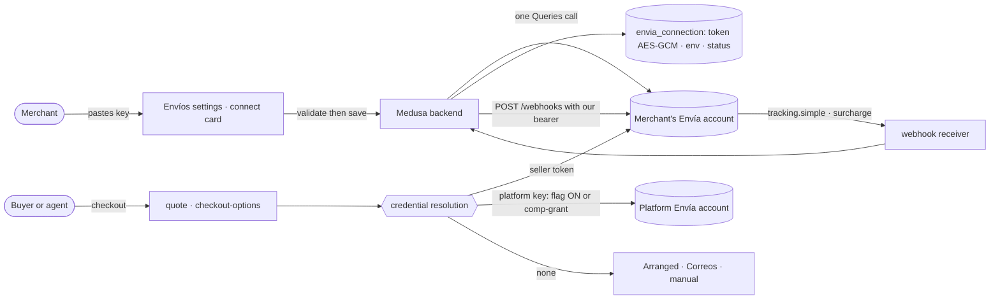
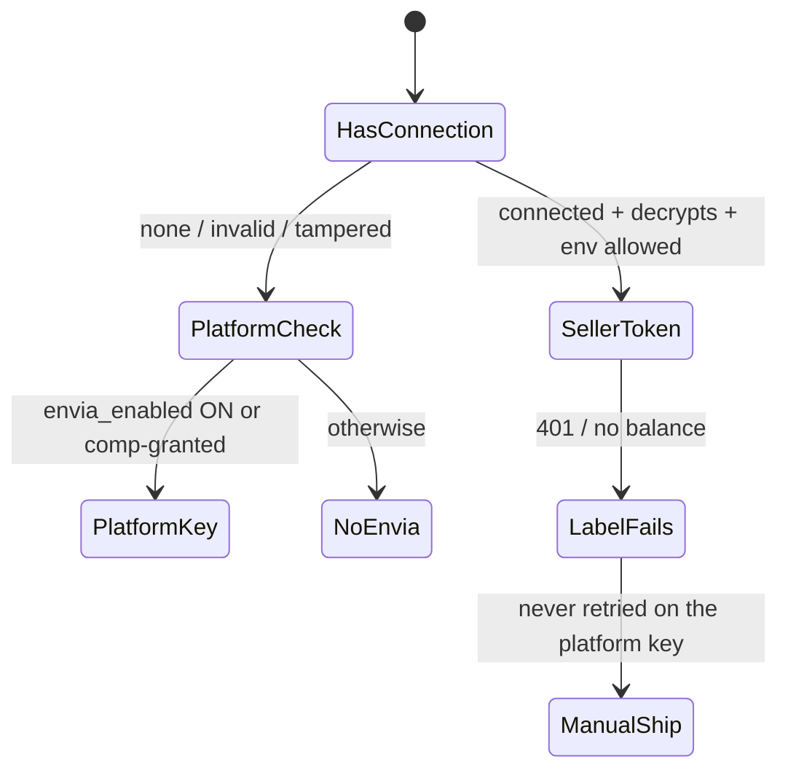

# Pitch — BYO Envía connect

Moves · Tests: not grounded — no strategy yet

> **Decided already:** the [BYO Envía spike](spike-envia-byo.md) (Daniel-approved 2026-07-08) chose the **hybrid**
> model — the merchant's own Envía account as the scalable tier, the admin comp-grant for hand-picked shops, arranged
> delivery or Correos for everyone else — and stays on Envía (Pakke is the named fallback). This pitch builds that
> decision. Where it differs from the spike, it says so.

## The ask, as given

> 5. im on the fence, the thing is that if i fund envia, i would be responsible for the overall as opposite to
> merchants opening their own envia (or whatever other provider we could find, a la stripe connect or how we have
> mercadopago) whre they are responsible. If we can find a way to do that, lets do it

> merged, lets now do e3

> (Plan questions, 2026-10-27) Flag: No flag · Test tokens: Only test shops · Appetite: M

### Claims
1. Merchants open and fund their own shipping account; the platform doesn't fund Envía.
2. The merchant, not the platform, is responsible for their shipping account and its money.
3. It feels like connecting Mercado Pago or Stripe: the merchant connects, we route through their account.
4. Envía is the provider (the spike chose it); another provider stays possible later.
5. No feature flag; rollback is a git revert.
6. Only shops marked as test shops can connect an Envía sandbox token.

**Teach-back:** yes — "You want a merchant to connect their own Envía account, the way they connect Mercado Pago,
so their quotes, labels and tracking run on their account and their balance, and we never hold or front their
shipping money. Right?" (Daniel approved this in July and answered the three plan questions that follow from it.)

## Problem

Envía is fully integrated (client, fulfillment provider, CP-first address UX, tracking webhooks) and **off**:
`shipping.envia_enabled` stays OFF because turning it on means the platform pays for every label. Only hand-picked
shops ride our account through the comp-grant. Everyone else gets arranged delivery or Correos económico, so most
shops can't print a carrier label. T1's pitch is "vende, cobra y envía" with its own negotiated freight; ours can be
true without funding anything, because Envía issues self-serve per-account API tokens. The connect slice was decided
in July and never built.

## Appetite

**M** — three capability sprints (WAYS-OF-WORKING → *Betting & appetite*). Fixed appetite, variable scope: if it runs
out, cut the surcharge notice and the prompt-to-shop chooser option first (the Envíos settings connect is enough),
never the encryption, the resolution seam or webhook tracking.

quote: $20–120 (M, n=1, wide)

## Outcome & signal

**After this ships:** in `/shop/manage/settings` → Envíos, a merchant taps «Conecta tu cuenta de Envía», follows a
three-step visual guide (create a free account → top up your balance → copy your API key, each with a deep link),
pastes the key, taps «Probar conexión» and sees «Conectada ✓». From then on their buyers get live carrier quotes at
checkout from the merchant's own rates, the merchant prints labels paid from their own Envía balance, and tracking
updates arrive by themselves. If the key goes bad or the balance runs out, the merchant sees a plain es-MX message
naming their Envía account as the fix, and the order can still ship manually. The prompt-to-shop delivery chooser
offers «Paquetería con tu cuenta Envía».

**How Daniel tests it:** each sprint's smoke walkthrough; the label steps use a **test shop** with an Envía sandbox
key (no real money), and one real-label run on a production key is owed by name.

**Measured by:** connected shops, labels printed through a seller token and tracking events received per connected
shop, from backend logs (no new analytics surface); the platform's own Envía balance spends nothing on BYO labels.

## Stage-2.5 bucket

**Genuinely new seam on a fully built integration.** Quotes, labels, tracking and the gate exist; what's new is a
per-seller credential, choosing whose token pays for each call, registering tracking on the merchant's account, and
the connect experience.

## Bill of materials (What / Why)

| What | Why |
|---|---|
| `envia_connection` model in the seller module: token (AES-256-GCM), environment, status, timestamps | A credential is commerce-owned (AGENTS #1) and never belongs in seller `metadata`, which reaches API surfaces |
| Validate-then-save route + write-only token | A bad key is never stored; a stored key is never shown again |
| One pure **credential resolution** seam (seller token → platform key → none) | Exactly one place decides who pays for a label; truth table under spec |
| `envia-client.ts` takes a per-call token and environment | Every quote and label call can run on the merchant's account |
| Thread it through quote, label, checkout-options and the fulfillment provider | Buyers, sellers and agents all get the merchant's rates |
| Retire the frontend's legacy direct-Envía label path | Seller tokens never leave the backend |
| Register the tracking webhook on the merchant's account at connect, with our own per-connection auth | Tracking works without the merchant touching Envía's developer settings |
| Plain es-MX errors (invalid key, insufficient balance, revoked) with the manual-ship fallback | No dead ends; the merchant knows the fix is in their own account |
| Admin «Tienda de prueba» toggle allowing an Envía sandbox key; labels marked PRUEBA | Daniel can smoke-test labels without paying (Decision) |
| Connect screen: three-step visual guide with deep links | Envía has no OAuth; pasting a key has to feel as easy as connecting Mercado Pago |
| «Paquetería con tu cuenta Envía» in the prompt-to-shop delivery chooser | Screen 6 of the merchant journey becomes true |

## Scope

**In v1:**
- Per-seller Envía connection (production keys; sandbox keys only for shops an admin marks as test shops), encrypted
  at rest, validated before save, write-only after, disconnect any time.
- The credential resolution order: **connected seller token → platform key (platform flag ON or comp-granted shop) →
  no Envía** (arranged delivery / Correos / manual carrier, exactly as today).
- Quotes, checkout options, labels and tracking through the merchant's account; agents inherit it server-side.
- Tracking webhook registered on the merchant's account at connect and removed at disconnect.
- The connect experience in Envíos settings and the prompt-to-shop delivery chooser.
- Surcharge events (overweight, return to origin) from the merchant's account shown to the merchant as a notice.

**Out of v1 (no-gos):**
- **No platform funding, markup or settlement** (rejected in the spike).
- **No second provider** (Pakke, EnvíoClick) — the model carries a `provider` value, only Envía is built.
- **No MCP tool that accepts a raw token** (a key in chat would reach model providers' logs); agents can at most
  deep-link to the connect screen.
- **No feature flag** (Daniel, 2026-10-27; supersedes the spike's `shipping.envia_byo_enabled`). Rollback is
  `git revert`; `shipping.envia_enabled` and the comp-grant keep their meaning, unchanged.
- **No change to the platform account** or the comp-granted shops' behaviour.
- **No balance display or top-ups inside Miyagi** in v1 (deep link to Envía instead).
- **No US** (`/us` shops use their own rails).

## Rabbit holes

1. **The credential must never leak.** The token is stored only encrypted (reuse `encryptToken`/`decryptToken` from
   `modules/mercadolibre/_utils.ts`, hoisted to a shared backend lib), never logged, never returned by any route,
   never in seller `metadata`, never read by the frontend. A tampered ciphertext decrypts to `''` and is treated as
   disconnected: **fail closed to the fallback, never to the platform key**.
2. **Resolution order is the money decision.** Seller connected and valid → seller token. Else platform key only if
   `shipping.envia_enabled` is ON or the shop is comp-granted. Else no Envía. A connected seller whose key fails at
   label time must **not** silently retry on the platform key. One pure function, a full truth-table spec, each row
   observed red under a mutation.
3. **Every seam, not the ones we remember.** Backend `POST /store/envia/rates`, `sellers/[slug]/checkout-options`,
   `carts/[id]/start-checkout`, `sellers/me/orders/[id]/ship`, `modules/fulfillment-envia/service.ts`,
   `lib/ml-fulfillment-apply.ts`, `lib/profit-ledger-write.ts` (label cost), and the frontend
   `app/api/orders/[id]/ship` legacy branch. The locking pass **sweeps every importer of `envia-client`** (a claim of
   centralisation is unguarded until swept — team memory) and lists them in the epic.
4. **The legacy frontend label path.** `app/api/orders/[id]/ship` still calls Envía directly for legacy Supabase
   orders. Seller tokens can't reach it, so it's retired (Medusa orders already proxy to the backend). The locking
   pass counts live legacy orders that are unshipped; any left ship manually.
5. **Webhooks live on the merchant's account.** Envía's API registers webhooks per token (`POST /webhooks`,
   `tracking.simple` type 3, `surcharge` type 5). Where the HMAC signing secret comes from is undocumented, so each
   registration sets **our own per-connection bearer** in the webhook's `Authorization`, and the receiver matches it
   to the connection before trusting a payload. Dedupe on `X-Webhook-Id`; answer 2xx within 5 s. Disconnect
   deactivates the webhook. The locking pass confirms this on a sandbox account.
6. **Sandbox vs production.** Envía keys work only in the environment that minted them and the hosts differ. The
   connection stores its environment; validation tries production, and sandbox only for a shop with the admin test
   flag; a sandbox shop's labels and buyer emails say PRUEBA. A real shop can never hold a sandbox key.
7. **Where the shipping money goes.** The buyer pays the quoted shipping into the merchant's own payment rail
   (Stripe direct charge, Mercado Pago, SPEI to their CLABE); the merchant pays Envía from their balance. The locking
   pass confirms the cart's shipping line reaches the seller under every method, so no platform money is touched.
8. **Validation is a real call.** «Probar conexión» makes one cheap authenticated Envía Queries call; a failure
   saves nothing. Rate-limit it per seller (a `LimitKey`) so the field can't be used to probe keys.
9. **Medusa migration.** A new model means a Medusa migration in `apps/backend`; the locking pass confirms how
   Medusa migrations run on the Oracle VM deploy before S1 merges (orchestrator-owned, backend deploys first).
10. **Insufficient balance at label time.** Map Envía's balance and auth errors in `mapEnviaError` to es-MX copy
    naming the merchant's account («Tu cuenta de Envía no tiene saldo suficiente. Recárgala en envia.com y vuelve a
    intentarlo, o envía con paquetería manual.»); the order stays shippable manually.

## What already exists (reuse, don't rebuild)

| Primitive | Where | Use |
|---|---|---|
| Envía client | `apps/backend/src/modules/fulfillment-envia/envia-client.ts` (`quoteShipments`, `createShipment`, `mapEnviaError`; `apiKey()` reads `ENVIA_API_KEY`) | Gains a per-call token + environment |
| Fulfillment provider | `apps/backend/src/modules/fulfillment-envia/service.ts` | Receives the resolved credential |
| Kill-switch seam | `apps/backend/src/lib/envia-killswitch.ts` (`enviaKillGate`, fallback messages) | Extended into the credential resolution |
| Comp-grant | `seller.metadata.envia_grant`, `apps/backend/src/api/internal/sellers/[id]/grant`, frontend `lib/envia-grant.ts`, admin tenants | Unchanged tier; the test-shop toggle follows the same admin pattern |
| Token encryption | `apps/backend/src/modules/mercadolibre/_utils.ts` (`encryptToken`, `decryptToken`, AES-256-GCM) | Hoisted to a shared backend lib |
| Connection model precedent | the Mercado Libre connection model in `modules/mercadolibre/models` | `envia_connection` shape |
| Quote / ship routes | `store/envia/rates`, `sellers/[slug]/checkout-options`, `carts/[id]/start-checkout`, `sellers/me/orders/[id]/ship` | Threaded |
| Tracking receivers | frontend `app/api/webhooks/envia` → backend `store/envia/tracking-update` (internal secret) | Learn per-connection auth |
| Envíos settings | `app/(shell)/shop/manage/settings/_sections/Envios.tsx` (origin address, Envía/Correos toggles) | The connect card |
| Label cost in the ledger | `lib/profit-ledger.ts` (`parseEnviaLabelCost`) | Still records the merchant's label cost |
| Rate limits | backend + `lib/ratelimit.ts` | The validate call |
| Prompt-to-shop chooser | E1 S5.1 (`/sell/armar/cobros`) | Gains the Envía option |

**AGENTS rules check:** the credential is commerce data in Medusa (rule 1), never Supabase (rule 2); agents get
per-seller quotes and labels server-side with no token in any MCP tool (rule 3); Clerk unchanged (rule 4); es-MX copy
(rule 5).

## Visuals

**System context**



**Credential resolution (the money decision)**



**Screens (one block per state)**

```surface
state: connect-idle
route: /shop/manage/settings (Envíos)
- card "Paquetería con tu cuenta Envía"
- line "Tú pagas tus guías desde tu saldo en Envía. Nosotros no tocamos ese dinero."
- three steps with icons: 1 "Crea tu cuenta gratis" (link) · 2 "Recarga tu saldo" (link) · 3 "Copia tu clave API" (link to Developer → API Keys)
- field "Pega tu clave API" + action primary "Probar conexión"
```

```surface
state: connect-validating
route: /shop/manage/settings (Envíos)
- button shows "Probando…"; field locked
```

```surface
state: connect-error
route: /shop/manage/settings (Envíos)
- inline "Esa clave no funcionó. Revisa que sea de producción y vuelve a pegarla." · nothing saved
```

```surface
state: connected
route: /shop/manage/settings (Envíos)
- "Conectada ✓" + "Clave ••••" + "Revisada el 27 oct"
- actions "Cambiar clave" · "Desconectar"
- test shop only: badge "PRUEBA · sandbox"
```

```surface
state: label-error-balance
route: /shop/manage/orders/[id]
- "Tu cuenta de Envía no tiene saldo suficiente. Recárgala en envia.com y vuelve a intentarlo."
- action secondary "Enviar con paquetería manual"
```

```surface
state: chooser-envia
route: /sell/armar/cobros
- delivery option "Paquetería con tu cuenta Envía" with carrier logos → opens the connect sheet
```

## UX heuristics & rails check
- **CI guards covering this surface:** the backend money-path CI gate (real Postgres + HTTP + a real cart — the quote
  and start-checkout seams run there), backend unit specs on `envia-killswitch`, the frontend Playwright `api`
  project, the emoji and Tailwind JIT guards, es-MX copy completeness.
- **Audits-lens findings that apply:** the seller-portal onboarding audit's jargon finding — "API key" is
  unavoidable, so the guide names it once with a screenshot-style illustration and plain words around it.
- **Design-language debt:** `Envios.tsx` is 668 lines of mixed concerns; the connect card is its own component
  using the shared `Card` / `Button` / `StatusBadge` and Iconoir.

## Kill-switch / runtime gate (risk:high only — Stage 6b)

**None — Daniel's call (2026-10-27).** The July spike planned `shipping.envia_byo_enabled`; the current
WAYS-OF-WORKING says no new flags unless the product owner names one, and Daniel chose not to. Rollback is
`git revert`. The blast radius is limited to shops that connect; a failing seller key falls back to manual shipping,
never to platform money. `shipping.envia_enabled` (OFF) and the comp-grant are untouched.

## Decisions at plan time (Daniel, 2026-10-27)

- **No flag** (supersedes the spike's `shipping.envia_byo_enabled`).
- **Sandbox keys only for test shops** an admin marks; their labels say PRUEBA. Real shops: production keys only.
- **Appetite M**, three sprints.

## Slices

| Sprint | Capability | Stories (risk) |
|---|---|---|
| **S1 · The connection** | A merchant's key is validated, stored encrypted and resolvable | S1.1 `envia_connection` model + shared AES-GCM lib + Medusa migration (high) · S1.2 validate-then-save / disconnect routes, write-only, rate-limited (high) · S1.3 pure credential resolution seam + truth-table spec (high) · S1.4 admin «Tienda de prueba» toggle + sandbox environment (high) |
| **S2 · Ship on their account** | Quotes, labels and tracking run on the merchant's token | S2.1 `envia-client` per-call token + environment; quote and checkout-options threaded (high) · S2.2 label path + fulfillment provider + profit ledger threaded; legacy frontend path retired (high) · S2.3 webhook registration at connect/disconnect + per-connection receiver auth + surcharge notice (high) · S2.4 es-MX error mapping + manual-ship fallback (high) |
| **S3 · Connect like Mercado Pago** | The merchant experience | S3.1 Envíos connect card with the three-step guide (low) · S3.2 «Paquetería con tu cuenta Envía» in the prompt-to-shop delivery chooser (low) · S3.3 agent parity specs + the connect deep link in the agent setup sheet (low) |

## Acceptance criteria

- **S1** — Saving a valid production key stores only ciphertext (a DB read shows no plaintext) and returns no token;
  an invalid key saves nothing and returns the es-MX error; disconnect clears the token at once; a tampered
  ciphertext resolves to "no seller token"; the resolution truth table (connected/valid × env allowed × platform flag
  × comp-grant) has a row per case, each observed red under a mutation, and a failing seller token never resolves to
  the platform key; a sandbox key is refused for a shop without the test flag and accepted with it; the validate route
  is rate-limited per seller.
- **S2** — A connected shop's checkout shows rates from its own Envía account (sandbox for the test shop); a label
  prints on its account and the profit ledger records its cost; the platform account shows no new label; a
  disconnected or unconnected shop behaves exactly as today; tracking updates for a connected shop's label arrive and
  move the order; a webhook without the right per-connection bearer is rejected; an insufficient-balance or revoked-key
  label error shows the es-MX message and the manual-ship path; no route, log line or MCP response contains a token
  (a spec greps responses for the fixture token).
- **S3** — On a phone, the connect card shows the three steps with working deep links, «Probar conexión» shows
  progress, success and error states; the prompt-to-shop chooser offers the Envía option and opens the same connect
  sheet; an agent quoting or shipping for a connected shop gets the seller-rate shapes, and no MCP tool takes a token.

**QA stage per sprint:** backend unit specs on the resolution seam and encryption (each observed red); backend
integration specs through the money-path CI gate for quote and start-checkout; frontend `api` specs for the settings
proxy and token-never-returned; a sandbox walkthrough per sprint on the test shop; **one real production label owed
to Daniel by name**.

## Open risks / research

- **Envía webhook auth:** the docs (read 2026-10-27, <https://docs.envia.com/docs/webhooks>) document per-token
  registration and `X-Webhook-*` signed types, but not the signing secret's source; the locking pass confirms the
  per-connection bearer on a sandbox account. Sources: <https://docs.envia.com/docs/authentication>,
  <https://docs.envia.com/reference/createwebhook>.
- **No OAuth** at Envía (re-checked 2026-10-27): connecting is pasting a key, by design.
- **Medusa migrations on the VM** — how they run at deploy is confirmed before S1 merges.
- **Legacy Supabase orders** still using the direct path — counted at the locking pass.

## Intent match

_Advisory and uncalibrated (intent-match D1, D3): it can add a step, never block one. Regenerate with `node scripts/intent-match.mjs <this seed> --write`._

```text
Intent match — Roadmap/00-ideas/seeds/envia-byo-connect.md
  coverage in   0.90  (6 claims)
  coverage out  0.85  (3 criteria)
  clarity       0.85  (3 criteria)
  teach-back    1.00  (yes)
  agreement     pending  (the optional reader at the architecture lock)
  why story     0.70  (advisory, not in the total)
Total 90 / 100 — uncalibrated · signals: coverage in, coverage out, clarity, teach-back
Band: build (placeholder bands: 80 build · 60 resolve follow-ups · below 60 sketch or spike)
Gaps: none
```

<!-- intent-match: {"coverage_in":0.902,"coverage_out":0.847,"clarity":0.846,"teach_back":1,"total":90} -->
