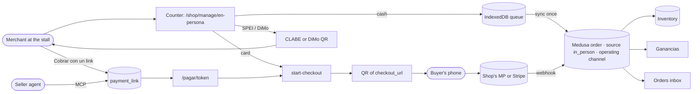
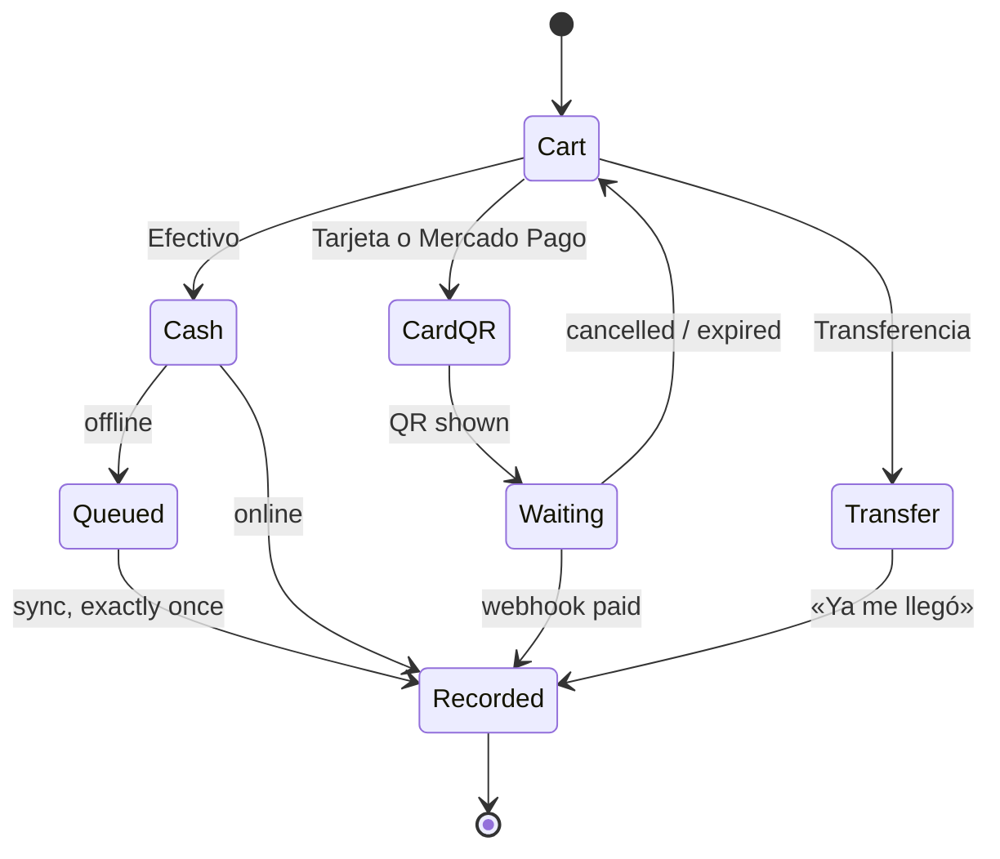

# Pitch — In person: POS-lite and payment links

Moves · Tests: not grounded — no strategy yet

> **Source:** the v2 T1 strategy review (<https://claude.ai/artifact/7cAUeEp16jVNLigE9tkUVj>), section 8 (Despacho
> Bonsai's POS: *port the UX, rebuild the core*), section 9 (parity: POS and payment links) and section 10 (E5 · In
> person, medium, money path).

## The ask, as given

> Lets check the POS from despachobonsai project folder added, same for Catalog links, shareable pdfs. any other
> commerce capabilities from there we could bring over?

> refeine e5

> (Plan questions, 2026-10-27) Card: QR on their phone · Pay links: Products or any amount · Offline: Cash sales
> offline · Appetite: L

### Claims
1. A point of sale, brought over from Despacho Bonsai's POS.
2. Payment links, as T1 has.
3. In-person card payments by a QR the buyer pays on their own phone; card terminals later.
4. Payment links can charge catalog products or any amount with a concept.
5. Cash sales keep working offline and sync exactly once.
6. In-person sales count in stock, orders and Ganancias, unlike Despacho's POS.

**Teach-back:** yes — "You want a merchant to ring up a sale on their phone at the stall — cash, transfer or a QR the
buyer pays on their own phone — and to send a payment link for products or any amount, with every sale landing in
Miyagi's orders, stock and margins, even when the signal drops for cash. Right?" (Daniel approved the review's POS
verdict and answered the four plan questions that follow from it.)

## Problem

A micro-merchant's sales mostly happen at a stall, a market or in a WhatsApp chat. Miyagi only sees the ones that go
through the online checkout, so stock drifts, Ganancias undercounts, and the merchant keeps a notebook. T1 includes a
POS and standalone payment links on every plan. Despacho Bonsai had a good POS **UX** (a phone product grid, cash
tendered and change, an IndexedDB offline queue with an idempotent `client_id`), but its core was wrong: "card" only
recorded a sale with no charge, orders went to a separate `commerce_pos_orders` table outside Medusa so stock never
decremented, and prices were in USD. The digital-payments bill (approved by Diputados on 2026-10-06, pending in the
Senate) also points micro-merchants toward accepting a QR or link at the counter.

## Appetite

**L** — four capability sprints (WAYS-OF-WORKING → *Betting & appetite*), with an architecture-locking pass first.
Fixed appetite, variable scope: if it runs out, cut multi-use payment links and the buyer receipt first, never
exactly-once sync, the stock decrement or the payment confirmation.

quote: $50–300 (L, n=0, wide)

## Outcome & signal

**After this ships:** in the seller portal, «Vender en persona» opens a counter on the phone:
1. Search or tap products, see the total, and pick how the buyer pays:
   - **Efectivo:** enter what they handed over, see the change, done (works without signal; syncs later, once).
   - **Tarjeta o Mercado Pago:** a QR the buyer scans and pays on their own phone through the shop's existing checkout,
     and the counter turns green when it's paid.
   - **Transferencia:** the shop's CLABE or DiMo QR, then the merchant confirms they got it.
2. Every sale is a real Medusa order on the shop's own channel: stock goes down and Ganancias counts it.

Separately, «Cobrar con un link» makes a link for catalog products or for any amount with a concept («Anticipo pastel
de boda · $800»). It can be shared by WhatsApp, as a QR or as a short link, and is paid through the same checkout.
Seller agents can make links too.

**How Daniel tests it:** each sprint's smoke walkthrough on a phone; the card/QR and link payments are owed to Daniel by
name in test mode, plus one real low-value charge.

**Measured by:** Medusa orders by `metadata.source` (`in_person`, `payment_link`) per shop, from the orders inbox and
Ganancias; no new analytics surface.

## Stage-2.5 bucket

**Genuinely new surface on existing rails.** The payment rails (Mercado Pago preferences, Stripe Checkout Sessions on
the seller's account, SPEI, DiMo, cash), the manual-payment state machine, the per-shop operating sales channel,
inventory, Ganancias and short links all exist. New: the counter, in-person order creation, the offline queue, the
payment-link object and its pay page.

## Bill of materials (What / Why)

| What | Why |
|---|---|
| A pure counter cart (lines, totals, change) | The arithmetic is tested without a phone or a network |
| In-person order creation, idempotent on a client id, on the shop's operating channel | One real Medusa order per sale — stock, Ganancias and agents see it; a retry never doubles it |
| Counter screen «Vender en persona» | Despacho's good UX, on our components, phone first |
| QR card payment through the shop's existing checkout link | Card acceptance with no hardware and no new rail |
| SPEI / DiMo at the counter + seller confirmation | Transfers people already use, on the existing manual-payment states |
| An IndexedDB queue for cash sales, synced exactly once | Stalls and markets lose signal |
| Oversell on sync recorded and flagged, never dropped | An offline sale already happened; the stock must say so |
| A `payment_link` object in Medusa (products or free amount, single or multi use, expiry) | T1-parity payment links that are real commerce objects |
| A public pay page that turns a link into a cart on the existing checkout | No new checkout; every payment method already works |
| Links UI + shares + an MCP tool | Merchants and their agents send links where buyers are |
| Orders inbox + Ganancias show the source; no self-notification spam | The merchant sees counter and link sales beside online ones |

## Scope

**In v1:**
- MX shops, MXN, es-MX; phone first.
- Counter: product search/grid, quantities, total, cash with change, QR card payment (Mercado Pago or Stripe,
  whichever the shop has), SPEI and DiMo with confirmation; every sale a Medusa order with `metadata.source:
  in_person` on the shop's operating sales channel, stock decremented.
- Offline: **cash only**, queued on the device, synced exactly once; oversells flagged.
- Payment links: catalog products (one or more) or a free amount with a concept; single-use by default, multi-use
  optional; expiry; status (pending, paid, expired, cancelled); WhatsApp, QR and `mschz.org` sharing; MCP tools.
- An optional buyer receipt by WhatsApp or email.

**Out of v1 (no-gos):**
- **No card terminals** (Mercado Pago Point is later).
- **No new payment rail** and no platform commission: money goes into the shop's own accounts as today.
- **No CFDI** on in-person sales (the CFDI spike).
- **No new sales channel per shop** (see rabbit hole 7), no multi-register or staff accounts, no shifts or cash-drawer
  reconciliation.
- **No barcode scanning** in v1.
- **No US / USD.**
- **No feature flag** (WAYS-OF-WORKING default; rollback is `git revert`).

## Rabbit holes

1. **Exactly once.** Every counter sale carries a device-generated `client_id`; the backend enforces uniqueness with a
   **database constraint** (an idempotency row or unique metadata index), never a read-then-write. A replayed sync or
   a double tap returns the first order. Validate → claim → apply (team memory).
2. **Stock.** Online in-person orders go through Medusa's inventory like a checkout order. Offline cash sales already
   happened: at sync they must be recorded even if stock is now short, so the sync path decrements without the
   availability check (the `ml-order-materialize.ts` precedent composes `createOrdersStep` to skip it) and flags the
   order «Vendiste más de lo que tenías en inventario» for the merchant. The locking pass picks the exact workflow
   composition against the installed `@medusajs/core-flows`.
3. **Who the buyer is.** A walk-in buyer has no Clerk account; orders omit `customer_id` (ML precedent) and may carry
   an optional phone or email for the receipt. Never create Clerk users for walk-ins.
4. **QR card payments wait on a webhook.** The counter creates a cart and runs `start-checkout` for the shop's Mercado
   Pago or Stripe provider, shows `checkout_url` as a QR, and waits for the order to become paid via the existing
   webhooks (MP IPN, Stripe). It must handle the buyer abandoning, an expired session, and the merchant cancelling, and
   never mark paid on a client signal.
5. **Transfers are confirmed by the merchant.** SPEI/DiMo reuse `lib/manual-payment-state.ts`: the counter shows the
   CLABE or DiMo QR, the merchant taps «Ya me llegó», which captures the payment; nothing is auto-confirmed.
6. **Free-amount links.** A «cobro libre» becomes a Medusa custom line item (title = concept, unit price = amount,
   no variant); the locking pass confirms Medusa v2's custom-line-item path in a cart and through each payment
   provider. Ganancias records revenue with no COGS. Amount limits (min/max) are validated server-side.
7. **No new sales channel.** Sales-channel membership decides buyability, and every channel writer is guarded by the
   `sales-channel-writers.ts` registry spec. A per-shop «En persona» channel would mean relinking every product. In-person
   and link orders use the shop's **existing operating channel** and carry `metadata.source`; the review's "a channel
   like ML" becomes a source tag. The locking pass confirms the operating channel exists for every shop that can sell.
8. **Payment link state.** A `payment_link` is commerce data, so it's a Medusa model (rule 1), with a random
   unguessable token, `uses: single | multi`, `expires_at`, and status updated by the order's payment. A single-use
   link that's paid shows «Ya se pagó» to the next opener; a multi-use product link creates a fresh cart each time.
9. **Notifications.** The merchant doesn't need a "new order" email for a sale they rang up themselves; the
   in-person source suppresses seller self-notifications while keeping everything else (Ganancias, inbox). Buyer
   receipts are opt-in per sale. Remember the learning: never `fetch()` our own authed route from the server.
10. **Offline storage.** IndexedDB only on the counter page; the queue survives reloads; a sale is removed from it only
    after the backend returns its order; an unsynced queue shows a visible count. The PWA/service-worker scope is
    checked so this doesn't regress navigation (team memory: a PWA-nav regression shipped once).
11. **Money-path CI.** The backend money-path CI gate (real Postgres + HTTP + a real cart) gets in-person and link
    cases; Redis-specific behaviour stays ungated, so idempotency must not rely on Redis.

## What already exists (reuse, don't rebuild)

| Primitive | Where | Use |
|---|---|---|
| Payment providers | `apps/backend/src/modules/payment-{mercadopago,stripe-connect,spei,manual-mx,cash,manual}` | Every counter and link payment |
| Checkout start | `api/store/carts/[id]/start-checkout` (MP Preference / Stripe Checkout Session → `checkout_url`) | The QR and the pay page |
| Manual-payment states | `lib/manual-payment-state.ts` (frontend) + backend normalizer, `report-payment` | SPEI / DiMo / cash |
| Operating sales channel | the owned-shop-operating-channel epic; `lib/sales-channel-writers.ts` registry | Where in-person orders live |
| Order creation without the availability check | `lib/ml-order-materialize.ts` (`createOrdersStep`) | Offline sync |
| Orders inbox + detail | `app/(shell)/shop/manage/orders/*` | Source badge and filter |
| Ganancias | `apps/backend/src/modules/profit`, `lib/profit-ledger*.ts` | Counts every sale |
| Short links + QR | `lib/shortlink.ts`, `qrcode` | Link sharing |
| WhatsApp share | `lib/share-link.ts` | Link and receipt sharing |
| Despacho POS UX | `despachobonsai/app/dashboard/commerce/pos/PosClient.tsx` (grid, tendered/change, IndexedDB queue, `client_id`) | Reference for the counter; nothing ported verbatim |
| MCP server | `app/api/ucp/mcp/route.ts` | Payment-link tools |

**AGENTS rules check:** orders, stock, payments and payment links in Medusa (rule 1); nothing in Supabase (rule 2);
seller agents create and list links via MCP (rule 3); Clerk unchanged, walk-ins get no account (rule 4); es-MX (rule 5).

## Visuals

**System context**



**A counter sale**



**Screens (one block per state)**

```surface
state: counter-cart
route: /shop/manage/en-persona
- search + product grid (photo, name, price, stock left)
- cart sheet: lines with − / +, total
- actions: "Efectivo" · "Tarjeta o Mercado Pago" · "Transferencia"
- offline: banner "Sin señal: puedes cobrar en efectivo. Se guarda y se sube después." + "2 ventas por subir"
```

```surface
state: counter-cash
route: /shop/manage/en-persona
- "¿Con cuánto te pagan?" amount pad · "Cambio: $45"
- action primary "Listo" → "Venta registrada" + optional "Mandar recibo por WhatsApp"
```

```surface
state: counter-card-waiting
route: /shop/manage/en-persona
- big QR + "Que lo escanee con su celular y pague ahí"
- "Esperando el pago…" → green "Pagado ✓"
- action secondary "Cancelar"
```

```surface
state: counter-transfer
route: /shop/manage/en-persona
- CLABE (copy) or DiMo QR + amount
- action primary "Ya me llegó"
```

```surface
state: link-create
route: /shop/manage/cobros
- toggle "Productos" | "Cobro libre"
- cobro libre: "Concepto" + "Monto"; productos: pick from catalog
- options: "Un solo pago" (default) / "Varios pagos" · "Vence en" 7 días
- result: link + "Compartir por WhatsApp" + QR + status
```

```surface
state: pay-page
route: /pagar/[token]
- shop name + logo, concept or products, amount
- the shop's payment methods → existing checkout
- paid single-use: "Este cobro ya se pagó." · expired: "Este link ya venció. Pídele uno nuevo a la tienda."
```

## UX heuristics & rails check
- **CI guards covering this surface:** the backend money-path CI gate (extended with in-person and link cases), the
  sales-channel-writers registry spec (must stay green: no new channel writer), frontend Playwright `api` project,
  emoji and Tailwind JIT guards, es-MX copy completeness, the client-JS diet budget (the counter is a heavy client
  page — justify its budget).
- **Audits-lens findings that apply:** none found for POS.
- **Design-language debt:** none inherited; the counter uses shared `Card` / `Button` / `StatusBadge`, Iconoir, large
  touch targets.

## Kill-switch / runtime gate (risk:high only — Stage 6b)

**None — carve-out.** WAYS-OF-WORKING → *Feature flags — OFF by default*: no flag unless the product owner names one;
rollback is `git revert`. The money risk is bounded by reusing the existing payment rails and webhooks unchanged; the
new code creates orders and links, it never moves money itself.

## Decisions at plan time (Daniel, 2026-10-27)

- **Card at the counter = a QR the buyer pays on their own phone**; Mercado Pago Point terminals later.
- **Payment links charge catalog products or any amount** with a concept.
- **Cash sales work offline**, synced exactly once; QR, transfers and links need a connection.
- **Appetite L.**

## Slices

| Sprint | Capability | Stories (risk) |
|---|---|---|
| **S1 · Counter and cash** | Ring up a cash sale as a real Medusa order | S1.1 pure counter cart: lines, totals, change (low) · S1.2 in-person order route: idempotent client id, operating channel, `source: in_person`, stock, cash paid (high) · S1.3 «Vender en persona» counter screen (low) |
| **S2 · QR and transfers** | Card by QR, SPEI and DiMo at the counter | S2.1 QR card payment through the shop's checkout + wait for the webhook (high) · S2.2 SPEI / DiMo at the counter + «Ya me llegó» capture (high) · S2.3 inbox + Ganancias source, no self-notifications, optional buyer receipt (low) |
| **S3 · Offline cash** | Sell without signal | S3.1 IndexedDB queue + exactly-once sync (high) · S3.2 oversell on sync: recorded and flagged (high) |
| **S4 · Payment links** | Charge anyone, anywhere | S4.1 `payment_link` model + create/cancel routes (high) · S4.2 `/pagar/[token]` → cart → existing checkout; free amount as a custom line (high) · S4.3 «Cobrar con un link» UI + shares + statuses (low) · S4.4 MCP payment-link tools for seller agents (low) |

## Acceptance criteria

- **S1** — A cash sale of two products creates exactly one Medusa order on the shop's operating channel with
  `source: in_person`, the cash payment captured, stock down by the quantities and a Ganancias row; replaying the same
  `client_id` returns the same order (spec, concurrent replay included); change is computed correctly (pure spec,
  observed red under a mutation); the counter works at 375 px; another seller's product can't be added (spec).
- **S2** — Choosing card shows a QR of the shop's own checkout; paying it in test mode turns the counter green only
  after the webhook marks the order paid; cancelling or expiry leaves no paid order; SPEI/DiMo shows the shop's CLABE or
  DiMo QR and «Ya me llegó» captures; in-person orders show a source badge and filter in the inbox and appear in
  Ganancias; the merchant gets no "new order" email for their own counter sale; a buyer receipt goes only when asked.
- **S3** — With the network off, three cash sales queue with a visible count, survive a reload, and sync to exactly
  three orders when back online (no duplicates on a flaky reconnect, spec-covered); a synced sale of an item that sold
  out meanwhile is recorded and flagged, never dropped.
- **S4** — A free-amount link «Anticipo · $800» opens a pay page with the shop's methods and, paid in test mode,
  becomes one paid order with a custom line and marks the link paid; the next opener sees «Este cobro ya se pagó»; an
  expired link says so; a multi-use product link creates a fresh cart per opener; tokens are unguessable and a
  cancelled link can't be paid; an agent can create and list links for its own shop only.

**QA stage per sprint:** pure specs on the counter cart, idempotency decision, sync queue and link state (each observed
red under a mutation); backend integration specs through the money-path CI gate for in-person orders, QR checkout and
link payments; a phone smoke per sprint; **the test-mode card QR and link payments and one real low-value charge are
owed to Daniel by name**.

## Open risks / research

- **Medusa v2 custom line items** through each payment provider — confirmed at the locking pass.
- **The workflow composition** for offline sync without the availability check — confirmed against the installed
  `@medusajs/core-flows` at the locking pass.
- **Every shop that can sell has an operating channel** — checked live at the locking pass.
- **The digital-payments bill** (Diputados 2026-10-06, Senate pending) is context, not a requirement; re-check its text
  before any public copy mentions it.

## Intent match

_Advisory and uncalibrated (intent-match D1, D3): it can add a step, never block one. Regenerate with `node scripts/intent-match.mjs <this seed> --write`._

```text
Intent match — Roadmap/00-ideas/seeds/in-person-sales.md
  coverage in   0.96  (6 claims)
  coverage out  0.90  (4 criteria)
  clarity       0.90  (4 criteria)
  teach-back    1.00  (yes)
  agreement     pending  (the optional reader at the architecture lock)
  why story     0.73  (advisory, not in the total)
Total 94 / 100 — uncalibrated · signals: coverage in, coverage out, clarity, teach-back
Band: build (placeholder bands: 80 build · 60 resolve follow-ups · below 60 sketch or spike)
Gaps: none
```

<!-- intent-match: {"coverage_in":0.962,"coverage_out":0.9,"clarity":0.901,"teach_back":1,"total":94} -->
