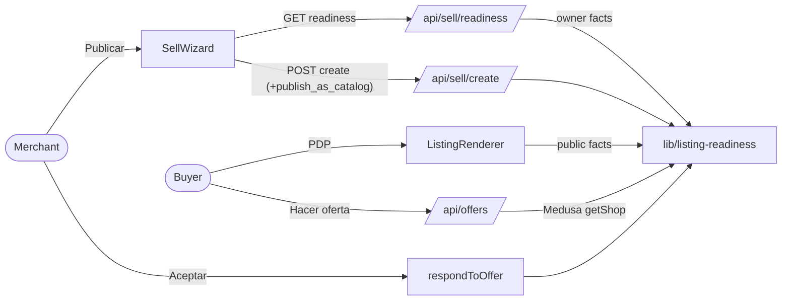

# Pitch — Guided listing readiness

Moves · Tests: not grounded — no strategy yet

## The ask, as given

> i want to see whats the heuristic and suggested long term action for Offers on shops with no payment method. Whats the use case of allowing users to publish products weith no payment method configured if they are not going to be purchasable? this sounds to me like UX/UI work on streamlining plisting creations with all thats required, all guided as usual. I think right now its not obvious for merchants all of the conditions we have.

> yes refine it and implement it, we are optimizing ceremony, so be lean, and also implement the quick win as part of the epic as it will all be done in one go

### Claims
1. A clear heuristic for when a product (and an offer on it) can be bought.
2. Offers on shops that cannot collect stop dead-ending.
3. Publishing without payment is either justified (a use case) or guided away.
4. Listing creation shows everything required, guided, so the conditions are obvious to merchants.
5. The quick win (the create-path gate + offer gate) ships inside the same epic, one run, lean ceremony.

**Teach-back:** yes — "You want a merchant to never publish a product a buyer can't pay for without knowing it, and buyers to never be offered a buy/offer path that dead-ends. Right?"

## Problem
Reported live 2026-11-11 (promoter training, `miel-verduras`): a merchant published a product, a buyer made an offer, the
merchant accepted it, and nobody could pay — the shop had no payment method. Medusa view, 2026-11-12: **12/20 claimed
shops have no payment method; 3 of the 5 shops with live products cannot take money.** The rule exists
(`deriveCheckoutViability`) but only on activation and MCP — **not on `POST /api/sell/create`**, the new-listing form —
and four copies of "can this shop sell?" have drifted (CLABE-length vs `configured`, arranged delivery counted in one
and not another). Offers are never gated.

## Appetite
M — one epic-mode run, two sprints.
quote: $27–40 (M, n=3, p25–p75)

## Outcome & signal
A product is either **buyable online** or **«Solo catálogo»** — never silently unbuyable. Daniel can test: publish a
product on a shop with no payment method → the form shows what is missing, offers an inline fix, or an explicit
«Publicar como catálogo»; the published catalog listing shows «Escríbele» and no Comprar/Ofertar; the seller cannot
accept an offer until they can collect.

**The heuristic (D1):** a `product` listing sells online iff the shop takes ≥1 payment method (card, Mercado Pago,
bank transfer, DiMo) AND has a delivery path (shipping or pickup — or arranged delivery with a manual method). Price,
claim, pause and market stay where they already are (`resolveCommerceReadiness`, claim checks, pause). Anything else is
**catalog**. Non-product types (service, inmueble, auto, event…) stay exempt — they are contact-capable by design.
**Offers** require that the shop can collect.

**Why allow catalog at all:** contact-to-buy is a real Mexican micro-merchant pattern (sell by chat/WhatsApp), a
merchant may load products before connecting payment, and promoter preview shops exist before the merchant does. The
fix is that it becomes a **choice**, not an accident.

## Stage-2.5 bucket
light-enhancement on existing primitives — the rule, the chooser and the guide exist; they are not wired together.

## Bill of materials (What / Why)

| What | Why |
|---|---|
| `lib/listing-readiness.ts` — one pure rule + owner/public fact readers | Four drifting copies → one; every door asks the same question |
| Create-path gate with an explicit `publish_as_catalog` acknowledgement | The door the trainee used had no gate |
| Same acknowledgement on single activate | Re-activating a catalog listing must not be harder than creating one |
| Offer gate (create + seller accept/counter), reading MEDUSA | Offers dead-ended; the Supabase mirror lacks bank-transfer config |
| PDP: no «Hacer oferta» when the shop can't collect | A buyer should never start a path that can't finish |
| `GET /api/sell/readiness` + wizard panel embedding `CobrosChooser` | Guided fix in place, before Publicar, reusing the shipped chooser |
| Panel banner «Tu tienda aún no puede cobrar» + «Solo catálogo» badges | The state stays visible after publish |
| Setup guide: payments step can't be hidden while products are live | The guide was dismissible exactly when it mattered |

## Scope
**In v1:** everything in the table.
**Out of v1 (no-gos):** a persisted per-listing `sale_mode` field (catalog is derived live — connecting payment makes
the products buyable with no extra step); MCP `publish_as_catalog` (agents keep the strict gate they already have);
bulk activate acknowledgement (stays strict); delivery facts on the public PDP readiness; US-specific rules; any new
feature flag (AGENTS operating posture — the gate is the product, rollback is a revert).

## Rabbit holes
- **Two stores (D2).** Owner pages read private settings (CLABE); public surfaces read the sanitized projection
  (`bank_transfer.configured`). The rule takes normalized facts; two readers produce them. Never read payment
  readiness from the Supabase mirror (`shop-settings-live-in-two-stores`).
- **Fail-open today (D3).** `checkCheckoutViability` allows publish when Medusa is unreachable. Keep fail-open for
  *publish* (an outage must not block a merchant; the listing just shows catalog until readable) but fail CLOSED for
  *offers* (money path) — 503 "no pudimos verificar", never "accepted".
- **Derived, not stored (D4).** «Solo catálogo» is computed from shop state at read time; the acknowledgement only
  unlocks the publish. Don't add a column.

## What already exists (reuse, don't rebuild)
- `lib/checkout-viability.ts` `deriveCheckoutViability` (the rule, arranged-aware) — becomes a wrapper over the seam.
- `lib/listing-status.ts` `checkCheckoutViability` + `setListingStatus` (activate gate) — reads owner facts.
- `lib/seller-products.ts` `listingActivationBlock` (MCP copy) — delegates to the seam.
- `lib/public-shop-commerce.ts` `publicShopPaymentAvailability` / `shopAcceptsAnyPayment` — the public reader.
- `lib/commerce-readiness.ts` `resolveCommerceReadiness` — price/currency/market, unchanged.
- `app/(shell)/p2s/_components/CobrosChooser.tsx` + `lib/prompt-to-shop/cobros.ts` `readChooserState` — inline fix.
- `lib/offer-respond.ts` `respondToOffer` — shared by web + MCP, one gate covers both.
- `app/api/offers/route.ts` — offer create.
- `lib/setup-guide.ts` / `SetupGuideCard.tsx` — the 5-step guide.
- `app/(shell)/shop/manage/catalogo/CatalogTable.tsx` — badges.

## Visuals



```surface
state: wizard-readiness-error
route: /sell
- head "Antes de publicar"
- list "✓ Entrega" "✗ Cobro — tus clientes no podrán pagar en línea"
- action "Activar cobros aquí" (CobrosChooser inline)
- action "Publicar como catálogo — los clientes te escriben"
```

## UX heuristics & rails check
- **CI guards covering this surface:** api-project specs (`e2e/*.spec.ts`), `next build` route types, lint.
- Copy is es-MX, polished (Daniel 11-03); log new strings in the copy bank if one exists for the surface.

## Stories (two sprints, one run)
**S1 — One rule, every door (high).**
- S1.1 `lib/listing-readiness.ts`: pure rule + `ownerShopFacts(meta)` + `publicShopFacts(meta)`; `deriveCheckoutViability`, `listingActivationBlock`, `checkCheckoutViability`, `shopAcceptsAnyPayment` delegate. Spec: rule table + each wrapper agrees.
- S1.2 Create gate: `POST /api/sell/create` refuses an unready `product` with 422 `{ code: 'LISTING_NOT_READY', missing }` unless `publish_as_catalog: true`; activate PATCH accepts the same flag. Spec on the decision seam + a door sweep.
- S1.3 Offer gate: offer create and seller accept/counter refuse when the shop cannot collect (Medusa read, fail closed); PDP hides «Hacer oferta» and the island's offer button. Spec.
**S2 — Guided and visible (low/medium).**
- S2.1 `GET /api/sell/readiness` (owner-authed) + wizard panel before Publicar: checklist, inline `CobrosChooser`, «Publicar como catálogo».
- S2.2 Panel banner + «Solo catálogo» badges + setup guide not hideable while payments missing and products live.

## Flags
Measure: none (pre-launch, one user; read the target by hand). Safety: no flag — AGENTS operating posture forbids new flags unless asked; rollback = revert.

## QA
Pure specs on `lib/listing-readiness.ts` + door sweep; `next build`; full api project vs a `main` baseline; each new spec seen red. **Browser smoke owed to Daniel:** the sprint walkthroughs (publish on a no-payment shop; inline fix; catalog publish; offer refusal).
