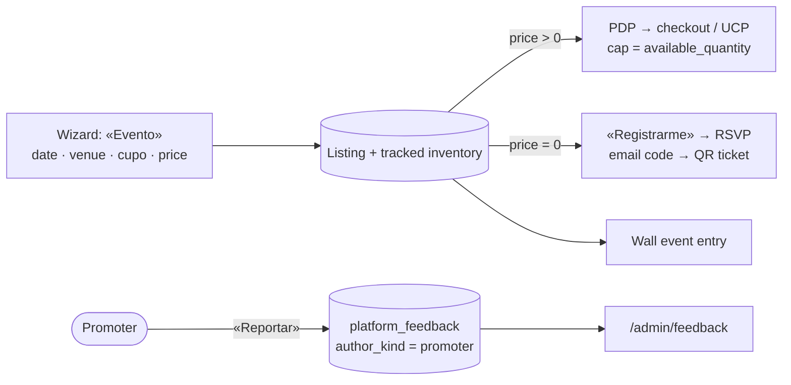

# Pitch — Merchant panel gaps the promoter kit surfaced

Moves · Tests: not grounded — no strategy yet

## The ask, as given

> Daniel's notes while reviewing the promoter field kit, 2026-11-11, kept in this seed's raw version: seat limits for
> events and services (a play, an experience); «an event is just another product, free or paid»; Comparte is
> unreachable, move share/PDF/Meta into Canales and keep the agent connection in one home; decide where the promoters'
> daily discovery reports land so they are counted, not just read in WhatsApp. Refine asked on 2026-11-11: «refine the
> seeds: own-shop-positioning.md and merchant-features-surfaced-by-promoter-kit.md».

### Claims
1. A merchant can set how many seats an event has, and it cannot oversell.
2. An event is one thing in the wizard, free or paid; the separate Eventos system goes away.
3. Comparte's share link, catalog PDF and Meta feed live in Canales; the agent connection has one home.
4. Promoter field reports land somewhere countable.

**Teach-back:** yes — "You want the panel to handle an event business properly and stop hiding the share tools, and
the promoters' reports to be counted, so that a promoter can set one up in one visit. Right?" (Recut confirmed by
Daniel 2026-11-11: the «undersold» copy moved to `own-shop-positioning`. Eventos: one «Evento» in the wizard.)

## Problem

All read on storefront `main` (`b7a4862`) and the live DB, 2026-11-11:

1. **No seat limit.** A paid event is a digital or service listing with the optional «Detalles del evento» block
   (`EVENT_FIELDS`, `app/(shell)/sell/AttrsSection.tsx:76`). The wizard asks «Cantidad disponible» only when
   `listingType === 'product'` (`SellWizard.tsx:1073`). So an event's inventory is untracked. The buyer selector then
   caps at `MAX_TICKETS_PER_ORDER = 20` per order (`lib/ticket-quantity.ts`), with no total. A 40-seat play sells 400.
2. **Two event systems.** `/shop/manage/eventos` writes `marketplace_events` (free RSVP, its own `capacity`, email
   verification, QR tickets via `lib/event-tickets.ts`), and the Wall's event entries reference it by slug. Paid events
   are listings. Live: **0 events, 0 registrations**, so folding needs no data migration.
3. **Comparte is unreachable.** `/shop/manage/comparte` has no entry in `lib/seller-nav.ts`. Only the business-plan
   engine links to it (`lib/business-plan/engine.ts:216,223,226`). `ConnectAgentPanel` renders in three places:
   Comparte, Configuración › Agentes, and `/sell/setup`.
4. **No field loop.** `send_feedback` (MCP) writes `platform_feedback`, shown at `/admin/feedback`. Live: **0 rows**.
   Its CHECK allows `author_kind` seller, partner or agent, so there is no promoter author yet. Promoters report in
   WhatsApp.

## Appetite

**M.** Three sprints. S1 alone fixes the oversell, the one defect that costs a merchant money. If the Evento fold
outgrows its sprint, ship the wizard entry with seats and leave the RSVP re-keying for later. The appetite stays M.
quote: $27–40 (M, n=3, p25–p75)

## Outcome & signal

- A merchant creates «Obra de teatro, 40 lugares» from the wizard. The 41st ticket cannot be bought on the PDP,
  `/checkout` or UCP checkout.
- «Evento» is one choice in the wizard. A $0 Evento shows «Registrarme» and issues the existing QR ticket. A paid Evento
  goes through checkout. The Eventos page is gone from the panel.
- Canales shows the catalog link, the PDF and the Meta feed. The agent connection appears only in Configuración ›
  Agentes and in first-run setup.
- A promoter sends a report from their panel in under a minute, and it appears in `/admin/feedback` tagged promoter.

## Stage-2.5 bucket

- **Seats:** light enhancement. The cap math and the checkout reads of `available_quantity` exist. What is missing is
  the input and tracked inventory on event listings.
- **One Evento:** genuinely new in the wizard, built on two existing systems.
- **Comparte into Canales:** light. The tiles exist; they move.
- **Field loop:** light. The table, admin page and MCP tool exist. They need a promoter author and a form.

## Bill of materials (What / Why)

| What | Why |
|---|---|
| «Cupo» field for event listings → tracked Medusa inventory | Stops oversell, the money defect |
| «Evento» listing type (date, venue, seats, price ≥ 0) | Daniel: an event is just another product |
| $0 Evento → the existing RSVP registration + QR ticket, keyed to the listing | No $0 Medusa checkout |
| Retire `/shop/manage/eventos` from the nav; redirect to the catalog | One system, not two |
| Wall event entries reference the listing | The Wall must keep rendering events |
| Comparte tiles move into Canales (`/shop/manage/canal-propio`); `/comparte` redirects there | Reachable share tools |
| `ConnectAgentPanel` only in Agentes and `/sell/setup` | One home |
| Promoter «Reportar» form in `/promotor/cerrar` → `platform_feedback` with `author_kind = 'promoter'` | Counted, not lost in WhatsApp |

## Scope

**In v1:**
- **S1 · Seats (high).** A «Cupo» input on any listing with the event block (wizard plus edit). Creating or editing it
  sets tracked inventory on the variant. The PDP, `/checkout` and UCP checkout already cap on `available_quantity`.
  The MCP listing tools accept `capacity` too, for agent parity.
- **S2 · One Evento (high).** Add the «Evento» wizard type. A $0 Evento uses the RSVP path, re-keyed from
  `marketplace_events.id` to the listing. Remove Eventos from `SELLER_NAV` and redirect `/shop/manage/eventos`.
  Re-point the Wall's event kind to the listing.
- **S3 · Canales and the field loop (low).** Comparte's three tiles move into Canales, `/comparte` redirects there, the
  engine links are updated and the duplicate agent panel is removed. Add a promoter «Reportar» form; the
  `author_kind` CHECK gains `'promoter'`, a migration the orchestrator applies.

**Out of v1 (no-gos):**
- No capacity for services that book through Cal.com. Cal.com already enforces it.
- No reserved or numbered seating, no ticket tiers, no waitlist.
- No per-order cap below the seat count (deferred in epic 10, still deferred).
- No site copy. That is `own-shop-positioning`.
- No new feature flags (operating posture). `events.quantity_enabled` is already ON and stays.
- No tracker page for field reports. `/admin/feedback` is the page.

## Rabbit holes

- **Inventory on create is the high-risk seam.** Check how `product` listings get tracked inventory today (via
  `lib/listings.ts` reads of `manage_inventory`). Reuse that exact write path for event listings; don't invent a second
  one. Cover create, edit and an agent-created listing. An admission proof must match what is consumed (LEARNINGS):
  the cap must read the same variant the cart buys.
- **Editing seats after sales.** Lowering «Cupo» below tickets sold is refused (decided 2026-11-11), never negative.
- **Re-keying RSVP.** 0 rows today, but re-verify the count at apply time, not at plan time (LEARNINGS). The migration is
  the orchestrator's; the builder never applies it.
- **The Wall reference.** Wall entries store a reference, never a copy. If the event kind changes its target, the
  validator and `lib/wall/resolve.ts` must change together, or an entry silently disappears.
- **Redirects are invisible to a passing spec** (LEARNINGS). Assert the `/comparte` and `/eventos` redirect targets
  explicitly.
- **A CHECK constraint is the contract.** Without the `author_kind` migration, the promoter form fails at insert. Build
  the form only after the CHECK change is applied live.

## What already exists (reuse, don't rebuild)

- `lib/ticket-quantity.ts` (`ticketQuantityCap`), `lib/event-listing.ts` (`readEventDetails`), `EventBuyBox.tsx`,
  and the checkout and UCP `isEventListing` gates.
- `lib/listings.ts`: the `manage_inventory` / `available_quantity` projection.
- `lib/events.ts`, `lib/events-seller.ts`, `lib/event-tickets.ts`, `lib/event-ticket-state.ts`: RSVP, verification
  and QR tickets.
- `lib/wall/*`: Wall kinds, validator and resolver.
- `app/(shell)/shop/manage/comparte/ComparteClient.tsx` (share tiles), `/shop/manage/canal-propio` (Canales),
  `components/ConnectAgentPanel`, `lib/seller-nav.ts`.
- `platform_feedback`, `/admin/feedback`, MCP `send_feedback`; the promoter panel at `/promotor/cerrar`.

## Visuals



```surface
state: wizard-evento-idle
route: /sell
- head "¿Qué vas a vender?" action "Evento"
- field "Fecha" "Hora" "Recinto" "Dirección"
- field "Cupo" hint "Cuántos lugares hay en total. Al llenarse, se marca como agotado."
- field "Precio" hint "Pon $0 si la entrada es gratis: tus invitados se registran con su correo."
```

## UX heuristics & rails check
- **CI guards covering this surface:** `share-kit-catalog`, `share-kit-feed`, `seller-share-market-urls`,
  `market-route-population`, `business-plan-engine` (pins the `/comparte` href; update it), the seller-nav breadcrumb
  fs-guard, the money-path CI gate (real Postgres and a real cart) for S1.
- **Audits-lens findings that apply:** none checked yet. The locking pass reads `Roadmap/00-ideas/audits/`.
- **Design-language debt:** `AttrsSection`'s event block uses raw `purple-200`/`purple-50` classes. Move it to tokens
  when S2 touches the block.

## Flags (Stage 6b)
- **Measure:** no flag. Operating posture, no new flags unless asked. The signal is read from the DB: event listings
  with tracked inventory, and promoter rows in `platform_feedback`.
- **Safety:** no new kill switch. S1 rides the existing ON `events.quantity_enabled`. Carve-out: the oversell is the
  live defect, so a switch that brings it back has no use.

## Acceptance criteria
- **S1 (high):** an event listing created with Cupo 40 shows 40 available. A 41st ticket is refused on the PDP,
  `/checkout` and UCP checkout. Lowering Cupo below tickets sold is refused. An MCP-created event honours `capacity`. A
  money-path spec is seen red once by removing the inventory write.
- **S2 (high):** «Evento» appears in the wizard. A $0 Evento registers by email and issues a QR ticket. A paid Evento
  checks out. The Eventos nav entry is gone and `/shop/manage/eventos` redirects. A Wall event entry still renders.
- **S3 (low):** Canales shows the three share tiles. `/shop/manage/comparte` redirects to Canales.
  `ConnectAgentPanel` is imported only by Agentes and `/sell/setup`. A promoter report appears in `/admin/feedback`
  labelled promoter.
- **Every sprint** closes with a phone walkthrough owed to Daniel. S1 and S2 include a real ticket purchase (money
  step, by name).

## Open risks / research
- **Order against `own-shop-positioning`:** independent. Run S1 first; the oversell is live.
- **Locking pass to confirm:** whether `createSellerProductViaInternal` already accepts a stock quantity for non-product
  types, which would shrink S1 to the input plus validation.

## Intent match

_Advisory and uncalibrated (intent-match D1, D3): it can add a step, never block one. Regenerate with `node scripts/intent-match.mjs <this seed> --write`._

```text
Intent match — Roadmap/00-ideas/seeds/merchant-features-surfaced-by-promoter-kit.md
  coverage in   0.97  (4 claims)
  coverage out  0.87  (4 criteria)
  clarity       0.86  (4 criteria)
  teach-back    1.00  (yes)
  agreement     pending  (the optional reader at the architecture lock)
  why story     0.70  (advisory, not in the total)
Total 92 / 100 — uncalibrated · signals: coverage in, coverage out, clarity, teach-back
Band: build (placeholder bands: 80 build · 60 resolve follow-ups · below 60 sketch or spike)
Gaps: none
```

<!-- intent-match: {"coverage_in":0.968,"coverage_out":0.87,"clarity":0.857,"teach_back":1,"total":92} -->
