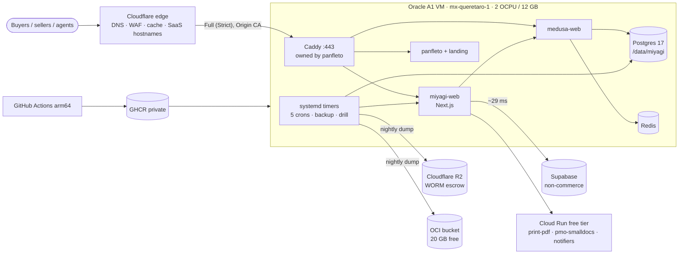

# Pitch — Miyagi on the Oracle VM

Moves · Tests: not grounded — no strategy yet

## The ask, as given

> i just got an oracle vm free tier which is pretty generous. I want you to explore how to migrate over
> there. It has two projects already. Both can be moved no problem if we need more room for miyagi sánchez.
> The vm has been used by a project of my own you can find one folder up in dobby/fluxonline its a cusytom
> miniflux. In there you can find the history and learn how to connect to the vm and explore its resources
> as needed.

> i have it pay as you go, but yes stay on the always free. for db backups, could we mirror in supabase
> maybe just to keep an alternative or whats the suggestion? everything else looks good. Please dont forget
> to remind me to delete projects unused now on gcloud so they arent billed on the next cycle, albeit if
> needed, we can leverage the also always free tier on either gcp account if any of the individual services
> would fit or would overall help with the general infra movement we are doing here. So yes go ahead and
> lets refine this as a proper epic, measure whats needed and change configs as required on either cloud.

### Claims
1. Move Miyagi Sánchez onto the Oracle VM (`panfleto-prod`), staying inside Always Free.
2. The two existing projects on the VM (panfleto, aomx) may be moved out if Miyagi needs the room.
3. DB backups get a real alternative copy (Supabase mirror floated; ask for the recommendation).
4. Use GCP's Always Free tier for any individual service that fits there.
5. Remind Daniel to delete unused GCP projects before the next billing cycle.
6. Measure what is actually needed, and change config on either cloud as required.

**Teach-back:** yes — "You want Miyagi's always-on stack on the free Oracle VM, with backups that live
somewhere else and GCP shrunk to what its free tier covers, so the platform costs ~nothing to keep running
pre-launch. Right?" (answered 2026-10-15: R2 + OCI backups, retire staging, short maintenance window.)

## Problem

Pre-launch, one user, yet Miyagi pays for an always-on GCP footprint sized for a live marketplace:
`medusa-web` and `miyagi-web` at `min-instances=1` (1 vCPU / 1 GiB each), Cloud SQL `medusa-pg`
(db-g1-small), Memorystore Redis (BASIC 1 GB), an external ALB + Cloud Armor + static IP, a VPC
connector, a staging Medusa, and ~92 GB of images in Artifact Registry. Meanwhile an Oracle A1 VM
Daniel already pays nothing for sits at load 0.00 with 9.7 GB of free RAM.

**Measured 2026-10-15 (30 days, Cloud Monitoring, hourly p99):**

| Service | CPU p99 (of 1 vCPU) avg / p95 / max | Mem p99 (of limit) avg / p95 / max | Requests (30d) |
|---|---|---|---|
| `medusa-web` | 21% / 43% / 61% | 45% / 53% / 62% of 1 GiB | ~100k |
| `miyagi-web` | 4% / 18% / 37% | 65% / **93% / 100%** of 1 GiB | ~146k |
| `medusa-web-staging` | — | — | **19** |
| Cloud SQL `medusa-pg` | 16% / 24% / 51% | 44% / 47% / 95% (of 1.7 GB) | 16 avg / 44 max connections |
| Redis | — | **~9 MB used of 1 GB** | — |

DB on disk: **~280 MB**. Billable instance time ≈ 1 instance each for the two `min=1` services.

**The Oracle side (measured 2026-10-15):** tenancy limits are exactly the Always Free ceilings —
A1 **2 OCPU / 12 GB, fully allocated to `panfleto-prod`** (no second A1 VM is possible), 200 GB block
(100 used), 20 GB object storage. Inside the VM: aarch64, 2 cores, 11 GiB RAM with **9.7 GiB available**,
load average 0.00, `/` 36 GB free, `/data` 45 GB free. Running today: panfleto (caddy, miniflux, landing,
postgres — ~1 GB, mostly Postgres `shared_buffers`) and aomx (ingest + postgres, ~70 MB, mem-capped).
Caddy owns :80/:443. Region `mx-queretaro-1`. From the VM, Supabase answers a TCP connect in ~29 ms.

**So it fits — with headroom, not slack.** Miyagi's steady state is ~0.3 core and ~3–3.5 GB; the
constraint is that 2 shared ARM cores have no burst. Panfleto and aomx **stay** — moving them buys nothing.

## Appetite
**M** — one wave: an orchestrator session + builders + review rounds. Three sprints (rail → cutover →
teardown; S1.1, the missing Medusa offsite backup, ships first and on its own); if the rail sprint eats the appetite, the cutover waits — it never ships half-built.

quote: $20–120 (M, n=0, wide)

## Outcome & signal
- `miyagisanchez.com`, `*.miyagisanchez.com`, `api.`, `mschz.org`, `cname.`/`gcp.` and every tenant custom
  hostname are served from the Oracle VM through Cloudflare; GCP serves none of them.
- A real checkout (the money-path smoke) completes on the VM; Stripe + Clerk webhooks land.
- The Medusa DB is dumped nightly to **R2 (offsite, WORM)** and to the **OCI bucket**, and one restore drill
  on the VM has been seen to work.
- `miyagisanchez-prod` holds only scale-to-zero services inside Cloud Run's free tier.
- Daniel has a dated list of GCP projects/resources to delete, with what each still bills.

## Stage-2.5 bucket
**genuinely-new** (as a host) on **light-enhancement** rails: panfleto already proved the exact pattern
on this VM (CI-built arm64 image → registry → `update.sh` pull, Caddy in front, nightly `pg_dump` to a bucket).

## Bill of materials (What / Why)

| What | Why |
|---|---|
| `deploy/oci/` compose in `medusa-bonsai`: medusa, web, postgres 17, redis 7 | the always-on stack, on the free box |
| arm64 image builds in GitHub Actions → GHCR (private) | never compile Next on the 2 shared cores |
| VM pulls by sha, `update.sh`-style, with a read-only GHCR token | rollback = restart, not rebuild |
| Caddy `import` of a Miyagi site file + shared docker network | one owner of :443, panfleto untouched |
| Cloudflare Origin CA cert on Caddy for Miyagi hosts (Full Strict) | wildcard + SaaS hosts without HTTP-01 |
| systemd timers for the 5 `/api/cron/*` jobs | Cloud Scheduler only gives 3 free jobs |
| `db-backup.sh` `medusa` target + OCI copy, as a VM timer | Cloud SQL PITR is gone; offsite copy is the point |
| Weekly restore drill into a throwaway PG container | a backup never restored is a hope |
| Container mem limits: web 1.5G, medusa 1.25G, pg 1.5G, redis 128M | protect panfleto; `miyagi-web` hits 1 GiB today |
| Leave `print-pdf`, `pmo-smalldocs`, notifiers on Cloud Run | public + shared-secret, scale-to-zero, fits the free tier |
| Retire `medusa-web-staging` | 19 req/30d; previews + money-path CI cover it |

## Scope
**In v1:**
- **S1 — The rail (dark):** the compose stack, arm64 builds, the pull-deploy, Caddy/TLS, timers, backups,
  restore drill — all running on the VM against a **restored copy of prod**, on a shadow hostname
  (`oci.miyagisanchez.com`, Cloudflare-proxied), nothing user-facing moved.
- **S2 — The cutover:** rehearsal dump/restore (timed), the write freeze, final dump with the identical-dump
  diff, restore, cert/SNI check at the new origin, then the Cloudflare origin flip of **every** host the
  ALB's access logs show (grouped by `Host`), webhooks verified, money-path smoke. GCP stays warm as rollback.
- **S3 — The teardown:** as soon as S2's money-path smoke passes (no waiting period — Daniel, 2026-10-15), delete (not disable) the GCP heavy parts and
  staging, keep the free-tier services, Artifact Registry cleanup policy, docs + memory updated, and the
  GCP-projects reminder list handed to Daniel.

**Out of v1 (no-gos):**
- Moving panfleto or aomx off the VM.
- Point-in-time recovery (WAL archiving / wal-g). Revisit when there are real orders.
- A Supabase mirror of the Medusa DB (see *Open risks*: it would be a second vendor, a 500 MB cap and a
  pausing project, for a copy R2 already gives us).
- Moving Supabase itself (the open `spike-supabase-colocation` is **re-framed by this epic**: compute moves
  to Querétaro; that spike's question should be re-asked after S2, not answered inside it).
- Zero-downtime replication; a second Oracle region; any change to tenant-owned DNS.
- Deleting any GCP project or resource Daniel did not list (the teardown is his, story S3.4).

## Rabbit holes
1. **ARM64 is a new architecture for both images.** `sharp`'s libvips is the known killer (an `npm` repair
   once left `/api/img` 500ing for 8 days, build green — MEMORY). Acceptance is a **real `/api/img` 200 on
   the VM**, not a green build. Medusa's native deps (`@swc`, `bcrypt`/argon if present) likewise.
2. **NEXT_PUBLIC build args.** A manual image build without them cannot boot (LEARNINGS, gcp-account-migration
   (7)). The GitHub Actions build must carry the same args `cloudbuild.yaml` passes today — derive them from
   that file, never retype.
3. **Cloudflare-for-SaaS custom hostnames and SNI.** Today the ALB answers tenant hostnames behind the
   fallback origin `cname.`; Caddy must present a valid cert for whatever SNI Cloudflare sends. Prove it with
   `openssl s_client -connect 159.54.158.4:443 -servername <host>` for each host family **before** DNS moves
   (LEARNINGS (10)), re-run until green.
4. **Every host, not the hosts we remember.** Group the ALB's request logs by `Host` for 7 days before the flip;
   the cutover list is that output (LEARNINGS (9) — `mschz.org`, `cname.`, `gcp.` were missed last time).
   The flip scripts (`infra/gcp/cloudflare-*.mjs`) must resolve the **target** origin, not default to the source
   (LEARNINGS (3)).
5. **Secrets.** ~25 env vars live in GCP Secret Manager. They move to a root-only `deploy/oci/.env` on the VM
   (panfleto's pattern), written by a script that reads Secret Manager **as the operator** — never from
   `.env.local` (the 2026-07-13 outage). Assert by booting, not by listing (LEARNINGS (11)).
6. **Redis semantics are ungated** (MEMORY: the money-path CI gate does not cover Redis). Medusa's event bus,
   workflow engine and locking all point at Redis; the S1 smoke must exercise an order through to a
   subscriber firing.
7. **The 2-core ceiling.** No autoscaling: a traffic spike now queues instead of adding instances. Cap Medusa
   and Next with container `cpus:` so Postgres keeps a share, and record the measured p95 latency on the VM
   vs Cloud Run before the flip.
8. **Shared box, shared Caddy.** Miyagi must not edit panfleto's `Caddyfile` beyond one `import` line, and
   must not restart panfleto's containers. Docker network: an external `edge` network both stacks join.
9. **The money path's own config:** Stripe webhook endpoints and Clerk are addressed by hostname, so they
   follow DNS — verify one delivery of each after the flip, don't assume.

## What already exists (reuse, don't rebuild)
- **The VM pattern:** `../fluxonline/deploy/` — `docker-compose.yml` (Caddy-only ports, state on `/data`),
  `update.sh` (pull-by-sha deploy, `.env.bak`), `backup.sh` + `panfleto-backup.{service,timer}` (instance-
  principal upload to an OCI bucket, no keys on host), `allow-my-ip.sh` (SSH rule follows a rotating IP).
- **The backup rail:** `infra/gcp/backups/db-backup.sh` (`pg_dump -Fc | gzip → rclone → R2`, size + remote-
  size verification, Telegram alert) and `BACKUPS.md`. Add a `medusa` target; the image is `postgres:17-alpine`
  + rclone, both multi-arch. **Today's job still runs `BACKUP_TARGETS=supabase,neon` — the live Medusa DB has
  no offsite copy at all.** Fix that first, in S1.
- **Build config:** `apps/miyagisanchez/cloudbuild.yaml` and `apps/backend/cloudbuild.yaml` (the build args and
  the deploy shape to mirror); the frontend `Dockerfile` (standalone + sharp).
- **Cloudflare tooling:** `infra/gcp/cloudflare-origin-cert.mjs`, `cloudflare-cutover-flip.mjs`
  (`--domain`, `--extra-hosts`), `cloudflare-saas-fallback-provision.mjs`, `cloudflare-cache-provision.mjs`.
- **Cron routes:** the 5 `frontend-*` Cloud Scheduler jobs → `/api/cron/{launchpad-campaigns,
  merchant-lifecycle-sweep,order-autoconfirm,print-pending,domain-lapse-sweep}`; same URLs, called by a timer.
- **Side services that stay:** `print-pdf` and `pmo-smalldocs` are `ingress=all`, `allUsers` invoker, guarded by
  a shared secret (`lib/print-pdf-client.ts` → `PRINT_PDF_URL` / `PRINT_PDF_SECRET`) — no GCP identity needed
  from the VM.
- **Smokes:** the money-path CI gate, `golden-frijoles:smoke` / `scripts/live-smoke.mjs`, the nightly browser smoke.

## Visuals



```mermaid
sequenceDiagram
  participant D as Daniel
  participant G as GCP (live)
  participant V as Oracle VM
  participant CF as Cloudflare
  Note over V: S1 — stack running dark on oci.miyagisanchez.com
  V->>G: rehearsal dump → restore, timed (the window = the measured time)
  D->>G: write freeze (Medusa kill switch off)
  G->>V: final dump → restore; row-count diff vs rehearsal
  V->>V: openssl SNI check per host family, until green
  D->>CF: flip origin for every Host the ALB logs show
  D->>V: money-path smoke · Stripe + Clerk webhook seen
  Note over G: rollback only until the S2 smoke passes (flip back = one script)
  D->>G: S3 — delete heavy parts (not disable)
```

## UX heuristics & rails check
- **CI guards covering this surface:** the money-path CI gate (real Postgres + HTTP + a real cart), both app
  repos' `ci.yml`, the nightly browser smoke. **Gap: Redis behaviour is ungated** (rabbit hole 6).
- **Audits-lens findings that apply:** none — no UI change.
- **Design-language debt:** none.

## Kill-switch / runtime gate (risk:high only — Stage 6b)
**Carve-out — no flag.** Nothing in the product changes; the rollback is infrastructural and already
one command: flip the Cloudflare origin back to the warm GCP ALB (`cloudflare-cutover-flip.mjs` with the GCP
target). It stays live until S2's smoke passes; S3 starts right after (no waiting period, Daniel 2026-10-15). The write freeze uses Medusa's existing
kill switch, as the Neon→Cloud SQL cutover did.

## Acceptance criteria

**S1 — The rail (dark)** · risk high
- 1.1 `db-backup.sh` gains a `medusa` target; the **current** GCP job runs `BACKUP_TARGETS=supabase,medusa`
  (neon retired); one dump of the live Medusa DB is verified in R2. *(Do this first — it's a gap today.)*
- 1.2 GitHub Actions builds `linux/arm64` images for both apps into private GHCR, tagged by sha, with the same
  build args as `cloudbuild.yaml` (derived, spec-asserted).
- 1.3 `deploy/oci/` compose + `update.sh` bring up medusa, web, postgres, redis on `/data/miyagi` with mem/cpu
  limits; panfleto's containers keep running throughout (`docker ps` before/after).
- 1.4 Caddy serves `oci.miyagisanchez.com` with the Origin CA cert; Cloudflare Full (Strict) returns 200.
- 1.5 A restored copy of prod boots on the VM; `/health` 200, product count matches GCP, a real
  `/api/img` returns an image (ARM sharp proven), an order reaches a subscriber (Redis proven).
- 1.6 Timers: 5 crons hit the VM's own routes; nightly backup lands in R2 **and** the OCI bucket; the weekly
  drill restores the newest dump into a throwaway container and reports row counts to Telegram.
- 1.7 Measured p95 page latency on `oci.` vs prod for `/`, a PDP and a shop page, recorded in the sprint doc.

**S2 — The cutover** · risk high (money, shared infra, DNS/TLS)
- 2.1 The `Host` census from 7 days of ALB logs is the flip list, committed to the sprint doc.
- 2.2 A timed rehearsal dump/restore; the window is that number.
- 2.3 Freeze → final dump → restore → per-table row-count diff vs rehearsal is empty on frozen tables.
- 2.4 `openssl s_client` returns the right cert for each host family at the VM before any DNS change.
- 2.5 Every host in 2.1 flipped; the ALB's own logs then show **zero** non-probe requests (checked before S3, no fixed wait).
- 2.6 Money-path smoke: a real checkout on the VM; one Stripe and one Clerk webhook delivery seen in logs.

**S3 — The teardown** · risk high (deletions)
- 3.1 Right after S2.6 passes: a final Cloud SQL export to R2, then delete Cloud SQL, Redis, the ALB + IP + Cloud
  Armor policy, the VPC connector, `medusa-web`, `miyagi-web`, `medusa-web-staging` and its DB, the 3 Cloud
  Build triggers (deleted, never disabled — LEARNINGS (8)), the 5 frontend schedulers, `db-backup` /
  `cloudsql-backup-check` jobs. **Daniel confirms the list before anything is deleted.**
- 3.2 Artifact Registry: a cleanup policy keeping the last 3 images per remaining repo; `frontend` and `medusa`
  repos deleted.
- 3.3 `print-pdf`, `pmo-smalldocs` and both notifiers still answer; `miyagisanchez-prod`'s next invoice
  forecast is inside the free tier (or the residue is named).
- 3.4 **The GCP reminder list is handed to Daniel** (see *Open risks* → GCP leftovers), with what each bills.
- 3.5 Docs: `infra/…/BACKUPS.md`, the deploy-topology memory, `apps/*/AGENTS.md` deploy sections, and
  `../fluxonline/deploy/README.md` (the VM now hosts a third tenant) all say what is true.

## Open risks / research
- **Backups — the recommendation (answered 2026-10-15):** R2 stays the offsite copy, the OCI bucket is the
  fast-restore copy. Moving backups *onto* Oracle only, where the DB also lives, would put both in one
  account — a suspended account loses the DB and its backup together, which is what an escrow is for. Sizes
  fit everywhere: Medusa is ~280 MB on disk (a gzipped dump is far smaller), × 30 days of retention.
  Free allowances: **Cloudflare R2 10 GB-month** (free egress), **OCI 20 GB**, **GCP Cloud Storage 5 GB-month,
  US regions only** — the "30 GB" GCP number is the e2-micro VM's free *persistent disk*, not object storage.
  Sources: [Filebase on R2 pricing](https://filebase.com/blog/cloudflare-r2-pricing-costs-savings-and-alternatives-in-2026/),
  [freetier.co 2026 roundup](https://freetier.co/articles/cloud-provider-free-tiers-2026),
  [agentdeals on GCS](https://agentdeals.dev/vendor/google-cloud-storage) — secondary sources; confirm on each
  vendor's pricing page before relying on a limit.
- **Supabase mirror — declined:** a separate free Supabase project pauses after 7 idle days and caps at 500 MB;
  the shared prod Supabase must never hold Medusa's schema (AGENTS rule #2, and despachobonsai shares it).
- **Pay-As-You-Go tenancy:** Always Free idle reclamation applies to free-only tenancies; on PAYG it does not,
  so panfleto's `shared_buffers=3GB` workaround is no longer needed (out of scope here — note it in fluxonline).
- **Single VM, no failover.** Accepted pre-launch (WAYS-OF-WORKING → Operating posture). The nightly dump + the
  drill bound the loss at ≤ 24h.
- **GCP leftovers (Daniel's reminder — delete before the next billing cycle):**
  - `gen-lang-client-0305197114` (leroytramafat) — billing **ON**, 2 **stopped** VMs (`bonsaibrains` e2-medium,
    `bonsaibrains-pro` e2-standard-2); stopped VMs still bill their disks.
  - `loyal-coyote-484117-k9` (danielvp1987) — billing **ON**, only BigQuery enabled, nothing running seen.
  - `project-32471a48-ac44-413f-b51` (lolis8755) — billing **ON**, BigQuery + Cloud Build only.
  - `miyagisanchez-prod` heavy parts — after S2 (story 3.1).
  - Not listed by Daniel: `n8n-free-server-484118` (one e2-micro running, inside GCP's free tier; a stopped
    `n8n-server` disk counts against the free 30 GB), `miyagisanchezback` + `bonsai-analytics-494321`
    (despachobonsai, billing **off**). The old `miyagisanchezback-497722` no longer resolves for leroytramafat.

## Intent match

_Advisory and uncalibrated (intent-match D1, D3): it can add a step, never block one. Regenerate with `node scripts/intent-match.mjs <this seed> --write`._

```text
Intent match — Roadmap/00-ideas/seeds/miyagi-to-oracle-vm.md
  coverage in   0.73  (6 claims)
  coverage out  0.69  (18 criteria)
  clarity       0.79  (18 criteria)
  teach-back    1.00  (yes)
  agreement     pending  (the optional reader at the architecture lock)
Total 80 / 100 — uncalibrated · signals: coverage in, coverage out, clarity, teach-back
Band: build (placeholder bands: 80 build · 60 resolve follow-ups · below 60 sketch or spike)
Gaps:
  claim 2 — uncovered (0.12): "The two existing projects on the VM (panfleto, aomx) may be moved out if Miyagi needs the…" → think chain (worth doing? run `pmf-narrative`, then `risk-validation`; any other trade-off, reason it in writing)
Untraced (trace it to the ask or cut it):
  criterion 15 (0.45): "3.2 Artifact Registry: a cleanup policy keeping the last 3 images per remaining repo; `fr…"
  criterion 18 (0.49): "3.5 Docs: `infra/…/BACKUPS.md`, the deploy-topology memory, `apps/*/AGENTS.md` deploy sec…"
```

<!-- intent-match: {"coverage_in":0.727,"coverage_out":0.686,"clarity":0.791,"teach_back":1,"total":80} -->
