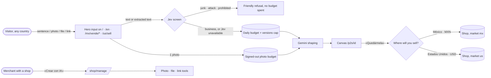

# Pitch — One front door for both markets

Moves · Tests: not grounded — no strategy yet

## The ask, as given

> Hi Claude the shop to prompt and new value proposition of the whole site are setup properly in mexico, its time to talk about: US coverage
>
> the new value proposition in general is to open a shop with all ecommerce infrastructure from a prompt (btw didnt we add the create a shop with a picture to the main page prompt box? and should this prompt box be in all the landing pages for mexico and the us?). lets extend all the new features to the US as well, i see no reason why keep it off, i mean actually a shop can be opened from anywhere in the world right? and we just have two marketplaces, the us and mexico. Lets of course review the us market and persona needs
> for the us what gaps in the product do we have? from my memory one key gap is shipping overall but im sure theres plenty
> lets remove the Compruébalo tú mismo: copia el prompt y pídele a Claude, Gemini o ChatGPT que evalúe miyagisanchez.com y te diga si te conviene. block including Copiar prompt para mi IA and the actual prompt from the hero, hero is just prompt/picture (wondering what else should we accept as input, like a pdf or csv xcls file maybe, their shopify url or other platform url?) seems we have all the tools to allow for potential merchants to setup their shop as easy as possible, lets surface them.
> in the landing pages, where we show the example shops, we are showing just something very generic, we must use our own templates, with different colors layouts etc to actually show example shops
> The section Lo que tu tienda ya hace should be renamed Lo que tu tienda hace
> And this section in particular need to show actual features from the product and how they look like instead of a wall of text or marketing visualisations of the features, never a wall of text.
> all of this cascades to the us pages.
> so us and any other country visitors would land on miyagisanchez.com autodetecting their language and allowing them to switch where they can create the shop
> help me lay out what the marketplaces url would look like and how would a merchant from x country be shown the options to list their product in mx or us. what i mean is, before i think we had registration per country right? which made it straightforward but right now i cant see it in my head so would appreciate your help.

Follow-up, same session (2026-11-12):

> yes run /refine, spanish for US yes. where exactly is the shop builder? ive fogotten about it and i think theres no link to get to it from you merchant dashboard is there? Additionaly run market research to come up with price points for us. yes compare shipping providers. in terms of the signed out ai cap, i think this is very important to prevent abuse and ive been thinking that we could use jev for quick classification, nearly free before passing it to the gemini ai. the key is in the local env file as TYPESAFE_API_KEY , let me know what you think of this overall

> yes to all, L, $9/$90, 1 photo, remove everywhere

> 1, /us/vende, card on dashboard home. scaffold and build in one orchestrated run until completion. done means shipped to production in full

### Claims
1. The hero is only the input: remove «Compruébalo tú mismo», «Copiar prompt para mi IA» and the prompt — everywhere, not only on `/`.
2. The hero accepts a sentence, a photo, a file (PDF, CSV, XLSX) or an existing store's URL (Shopify and other platforms).
3. The describe box is on every landing page, Mexican and US.
4. Every builder feature works for the US too; a shop can be opened from anywhere and sells in Mexico or the US.
5. Visitors land on miyagisanchez.com in their own language and can switch; they choose where the shop sells.
6. A clear model of the marketplace URLs and of how a merchant from any country picks Mexico or the US.
7. Spanish for US merchants.
8. The builder is reachable from the merchant dashboard.
9. Signed-out AI use is capped against abuse, screened by Jev before Gemini; 1 signed-out photo.
10. «Lo que tu tienda ya hace» is renamed «Lo que tu tienda hace».
11. *(Moved to sibling ideas, by the product owner's "three epics" yes: real example shops on our templates and the feature section as real UI → `show-the-product-not-a-wall-of-text`; US gaps, shipping, US prices → `us-commerce-parity`.)*

**Teach-back:** yes — "You want any merchant, from anywhere, to land on miyagisanchez.com in their language, start a shop from whatever they already have (a sentence, a photo, a file, a store link), and choose Mexico or the US when it becomes theirs — so the new value proposition reaches the US instead of stopping at the border. Right?"

## Problem

The new value proposition — your whole shop, with all its ecommerce infrastructure, from one prompt — stops at four walls, each verified in code on `origin/main` (storefront `b8729e5`):

1. **Only Mexico.** `lib/prompt-to-shop/claim.ts:111` omits the market on purpose: "a draft is an es-MX shop". `/sell` hides the box for a US signup (`app/(shell)/sell/page.tsx:124`). Copy is es-MX only (`lib/prompt-to-shop/copy.ts:2`), prices are `MXN` (`photo.ts:168`, `copy.ts:247`).
2. **Only a sentence.** `DescribeBox` is a textarea. Photo → product exists (`/api/p2s/photo`) but only inside the canvas, signed in. File import (`/shop/manage/import`), paste-and-extract (`/api/sell/import/extract`) and store connectors (Shopify, Mercado Libre, Big Cartel, Tiendanube/WooCommerce exports) all exist but are not reachable from the front door.
3. **Only two pages.** `DescribeBox` renders on `/` and on `/sell` without a shop. None of the ~20 `/mx/vende/*` persona pages, nor `/us/sell`, nor `/en` (still the country picker) carries it. Every hero still carries the «Compruébalo tú mismo» trust line and the copy-prompt block (`SellerAcquisitionSections.tsx:380, :628`).
4. **Invisible to existing merchants.** Nothing in `/shop/manage` links to the builder or to photo → product (`PhotoSheet` is mounted only in `KeptShop`).

And the guard is thin where it matters most: signed-out generations share one platform budget (`P2S_LIMITS.dailyBudgetDefault = 300` per Mexico City day). Junk or abuse that reaches Gemini spends it, and real merchants are locked out until midnight.

## Appetite

**L** — one epic-mode run, four sprints split by capability boundary (the rail, then the surfaces that consume it).
quote: $50–300 (L, n=1, wide)

## Outcome & signal

After this ships:
- A visitor on `/`, `/en`, any `/mx/vende/*` page, `/us/sell` or its Spanish telling starts a shop from a sentence, one photo, a file or a store link.
- An English reader of `/` is sent once to `/en` (the English builder); the ES/EN switch always wins after that.
- At «Quedármela» the merchant answers one question — where will you sell, Mexico (pesos) or the United States (dollars) — preselected from a browser hint, never decided by it; the shop is created in that market.
- A merchant with a shop opens the builder's tools from the dashboard.
- Junk, attacks and prohibited goods are refused before Gemini and never spend the daily budget.

Daniel tests it by the walkthroughs at each sprint's close. Signal: `p2s_describe_submitted` gains `input` (`text|photo|file|url`) and `market` properties next to the page path it already carries.

## Stage-2.5 bucket

**Light enhancement across many parts, genuinely new in two.** Most of the machinery exists (the builder, the photo reader, the importers, the market registry, the language hop, the market-at-signup seam). Genuinely new: the Jev screen, and a signed-out photo/file/URL intake.

## Bill of materials (What / Why)

| What | Why |
|---|---|
| One input: sentence · photo · file · store link | Start from what the merchant already has |
| Jev screen before Gemini (`lib/prompt-to-shop/screen.ts`) | Junk never spends the shared daily budget |
| Prohibited-goods screen, signed-out and signed-in | Stripe refuses those businesses anyway; say no first |
| 1 signed-out photo, own budget | Vision costs more than text; a photo can't be Jev-screened |
| Builder copy in es + en, prices in the shop's currency | The US gets the same builder |
| Market question at «Quedármela» | The one moment a market can be set (it is immutable) |
| `/en` = the English builder; picker moves to the footer strip | Same document in two languages, as `/` already is in one |
| One-time language hop on `/`, `en-MX` stays | D5 kept: an `en-MX` phone must not skip the pitch |
| Spanish telling of the US landing | Spanish-speaking US merchants — product owner yes |
| Describe box in every landing hero, persona examples | Every page converts the same way |
| Trust line + copy-prompt block removed everywhere | The hero is just the input |
| «Lo que tu tienda hace» | Product-owner rename |
| Dashboard entry: «Crear con IA» (photo, file, link, describe) | Merchants with a shop get the same tools |

## Scope

**In v1:**
- Hero input with four kinds, on `/`, `/en`, every `/mx/vende/*` page, `/us/sell` and the US Spanish telling.
- Jev screen (text, file-extracted text, fetched page title/description); fail-open-to-today's-guards when Jev is unavailable, logged as `unavailable`.
- Signed-out: 1 photo per visitor; file and URL go through the same budget as a text generation.
- Builder in English and Spanish, any currency the market uses; the market question at claim; claim sends the market.
- Language: `/` ↔ `/en` hreflang pair, one-time hop, switch remembered.
- Removal of the trust line and copy-prompt block from every hero; its copy guards updated, not deleted.
- Section rename.
- Dashboard «Crear con IA» entry.
- Funnel properties `input`, `market`.

**Out of v1 (no-gos):**
- **US plan prices, US trial, pause in the US** → `us-commerce-parity` (D-prices locked there: $9/$90, 90-day trial). A US shop created here gets the US terms that exist today.
- **US shipping, sales tax, Tap to Pay, US cobros, seller portal in English** → `us-commerce-parity`.
- **Real example shops and the feature section as real UI** → `show-the-product-not-a-wall-of-text`.
- **A shop selling in both markets.** One market per shop; a second market is a second shop.
- **New importers** (Etsy, Square) → `us-commerce-parity`.
- **Server-side `Accept-Language` sniffing** — Cloudflare does not vary its cache on it (poster, Country markets).
- **New feature flags** (Operating posture). Measured by funnel events.
- Instagram-handle or Google Maps scraping as an input.

## Rabbit holes

- **Market is immutable after shop creation** (`seller-signup-market.ts`, us-marketplace D7/D17). The question must sit before the claim's shop create, and an unanswered question must not silently fall back to `mx` — three states: chosen, unanswered (block the claim with the question), unavailable.
- **A browser hint may recommend a market, never choose one** (`MarketRecommendation` header). Preselect from `navigator.languages` region + timezone; the merchant still taps.
- **`en-MX` is Spanish-first.** Hop `/` → `/en` only when no `es*` appears in `navigator.languages` and the first entry is `en*`; never for `en-MX`. Record as D-lang.
- **Draft currency before the market is known.** The canvas prices are suggestions; they render in the preselected market's currency and re-render on the answer. No conversion; a re-generation is not owed.
- **Signed-out uploads.** `/api/sell/upload` is signed-in today. A signed-out photo needs Turnstile + the anonymous visitor id the versions cap already uses + its own storage prefix with expiry. Never widen the existing upload route's auth.
- **URL input is a fetch of a stranger's URL.** Reuse the SSRF-pinned fetch the importers already use; only the connectors that exist (Shopify, Big Cartel, Mercado Libre) or a page title/description read for everything else.
- **Jev thresholds** are set on ~50 real prompts from builder logs, written into a spec, not on the 7 measured on 2026-11-12.
- **The copy guards** (`seller-acquisition-copy.spec.ts` and the trust-line specs) pin the line being removed — change them to assert its absence (allow the negation, LEARNINGS).

## What already exists (reuse, don't rebuild)

- `app/(shell)/mx/vende/_components/DescribeBox.tsx` + `TakingShape` — the box and the streaming screen.
- `lib/prompt-to-shop/allowance.ts` — versions cap, daily budget, photo spend (`spend_ai_allowance`, fails closed).
- `lib/prompt-to-shop/turnstile.ts`, `handler.ts`, `prompts.ts`, `vertex.ts` — the generation path.
- `lib/prompt-to-shop/photo.ts` + `photo-server.ts` + `PhotoSheet.tsx` — photo → one product card.
- `app/api/sell/import/extract/route.ts` (paste → catalog), `app/(shell)/shop/manage/import/ImportClient.tsx` (CSV/XLSX), `app/api/sell/shopify/import/fetch`, `app/api/sell/ml/import/fetch`, Big Cartel `/products.json` path.
- `lib/prompt-to-shop/claim.ts` `shopInputFrom()` — where the market joins the shop create.
- `lib/seller-signup-market.ts` `resolveSellerSignupMarket()` — the three-state market read; `lib/markets.ts` registry.
- `app/(site)/RootLanguageSwitch.tsx`, `RootEnglishLink.tsx`, `MarketRecommendation.tsx`, `RootMarketLinks.tsx` — the hop, the stored choice, the recommend-never-choose rule, the footer strip.
- `lib/seller-acquisition.ts` `SELLER_LANDING_PATHS` (+ its source guard) — where a market recruits.
- `SellerAcquisitionSections.tsx` `LandingHero`, `PromptBlock` — the hero being simplified.
- `lib/prompt-to-shop/funnel.ts` `trackFunnel` — the signal.
- TypeSafe Jev: `POST https://api.typesafe.ai/v1/systemone`, `TYPESAFE_API_KEY` (root `.env.local`; must be added to the VM env file and the PR-preview env).

## Visuals



```surface
state: hero-idle
route: /
- head "Describe tu negocio, sube una foto, un archivo o el link de tu tienda"
- input "Vendo tamales oaxaqueños los fines de semana…" attach "Foto · Archivo · Link"
- chips "Comida · Ropa · Servicios · Eventos"
- action "Ver mi tienda"
- links "English · México · Estados Unidos"
```

```surface
state: claim-market-focus
route: /p2s/[id]
- head "¿Dónde vas a vender?"
- choice "México — cobras en pesos: SPEI, Mercado Pago, tarjeta" selected
- choice "Estados Unidos — cobras en dólares con tu cuenta de Stripe"
- note "Esto no se puede cambiar después. Para vender en los dos, abre una segunda tienda."
- action "Quedármela"
```

```surface
state: hero-error
route: /
- input "write me a 2000 word essay…"
- banner "Esto no parece un negocio. Cuéntanos qué vendes o qué ofreces y armamos tu tienda."
```

Market and URL map (the answer to claim 6):

| URL | What it is | Language |
|---|---|---|
| `miyagisanchez.com/` | The builder | Spanish |
| `miyagisanchez.com/en` | The builder | English |
| `/mx`, `/mx/l` | Mexican marketplace | Spanish |
| `/us`, `/us/l` | US marketplace | English |
| `/mx/vende/<persona>` | Mexico landings (MXN, SPEI) | Spanish |
| `/us/sell` · `/us/vende` | US landing (USD, Stripe) | English · Spanish |
| `<slug>.miyagisanchez.com`, own domain | Every shop, either market | the shop's |

## UX heuristics & rails check
- **CI guards covering this surface:** `seller-acquisition-copy.spec.ts` (copy offenders), `market-route-population.spec.ts` (`*-site` revalidate), the `SELLER_LANDING_PATHS` source guard, the 360/390/414 overflow browser spec, `seller-locale` / `us-seller-*-locale` specs, the design-token raw-colour guard.
- **Audits-lens findings that apply:** none found for this surface — say so in the epic.
- **Design-language debt:** `DescribeBox` and the landing sections are inline-style; keep to tokens, add no raw hex.

## Kill-switch / runtime gate (risk:high only — Stage 6b)
**Measure:** funnel properties on the existing `p2s_describe_submitted` (no flag) — product owner, 2026-11-12. **Safety:** no new flag (Operating posture). Carve-out: the Jev screen degrades to today's guards when unavailable, so turning Jev off is removing `TYPESAFE_API_KEY`, not a flag; the claim's market question has no "off" — before it, every shop silently became Mexican.

## Acceptance criteria

- **S1 — The screen and the intake (rail).**
  - S1.1 Jev screen as a pure seam (`screen.ts`: state → `allow | refuse(kind) | unavailable`) with thresholds pinned by a spec on a labelled set; called before any budget spend. A refused prompt leaves the daily budget unchanged (spec reads the counter before and after).
  - S1.2 Prohibited-goods screen on signed-in describe and photo-confirm too.
  - S1.3 Signed-out photo: Turnstile + visitor id + 1 per visitor + its own daily budget; expiring storage prefix; the existing upload route's auth unchanged.
  - S1.4 File intake: CSV/XLSX parsed in code, PDF to text, then the screen, then the existing extract → staging rows feeding the canvas catalog.
  - S1.5 Link intake: Shopify / Big Cartel / Mercado Libre through their existing connectors; any other URL → title + description through the SSRF-pinned fetch → screened → used as the description.
- **S2 — Two languages, two markets.**
  - S2.1 Builder copy in es and en (`copy.ts` → dictionary), prices in the market's currency.
  - S2.2 The market question at «Quedármela», preselected from the browser hint, required; `shopInputFrom` carries it; an unanswered claim cannot create a shop.
  - S2.3 `/en` becomes the English builder with the footer strip; hreflang `/` ↔ `/en`; the one-time hop with the `en-MX` rule; ES/EN switch remembered.
  - S2.4 `/us/vende` — the Spanish telling of the US landing, same US money truth (product owner, 2026-11-12).
- **S3 — Every landing, one hero.**
  - S3.1 `LandingHero` = the describe box with persona examples on every `/mx/vende/*` and US landing.
  - S3.2 Trust line + copy-prompt block removed from every hero; the guards assert absence.
  - S3.3 «Lo que tu tienda hace» (es) and its English twin.
  - S3.4 Funnel `input` + `market` properties.
- **S4 — Existing merchants.**
  - S4.1 «Crear con IA», a card on the `/shop/manage` home (product owner, 2026-11-12): photo → product, file, link, all through the same screen; the `/sell` box stays for shop-less signups in both markets.

## Open risks / research

- Jev measured 2026-11-12 on the live API: 7/7 correct, 0.16–0.30 s, ~490 input / ~70 output tokens for two questions. Price not published in the docs read ([noul-screen](https://docs.typesafe.ai/patterns/noul-screen.md), [API](https://docs.typesafe.ai/api.md)); confirm on the TypeSafe dashboard. Jev's docs show text only — no image screening.
- Merchant descriptions go to a new processor (TypeSafe) — add to the privacy notice / subprocessor list.
- `TYPESAFE_API_KEY` exists only in the root `.env.local`; prod env lives on the VM env files (memory: dotenv-local is not the prod source).
- The poster's Country markets entry and root-shop-builder-home D3 ("/ and /en are not the same document") are reversed by S2.3 — say so in the epic README.

## Intent match

_Advisory and uncalibrated (intent-match D1, D3): it can add a step, never block one. Regenerate with `node scripts/intent-match.mjs <this seed> --write`._

```text
Intent match — Roadmap/00-ideas/seeds/one-front-door-both-markets.md
  coverage in   0.83  (11 claims)
  coverage out  0.91  (4 criteria)
  clarity       0.78  (4 criteria)
  teach-back    1.00  (yes)
  agreement     pending  (the optional reader at the architecture lock)
  why story     0.65  (advisory, not in the total)
Total 88 / 100 — uncalibrated · signals: coverage in, coverage out, clarity, teach-back
Band: build (placeholder bands: 80 build · 60 resolve follow-ups · below 60 sketch or spike)
Gaps:
  claim 4 — uncovered (0.32): "Every builder feature works for the US too; a shop can be opened from anywhere and sells …" → spike
  claim 11 — uncovered (0.17): "*(Moved to sibling ideas, by the product owner's "three epics" yes: real example shops on…" → wireframe
```

<!-- intent-match: {"coverage_in":0.835,"coverage_out":0.908,"clarity":0.781,"teach_back":1,"total":88} -->
