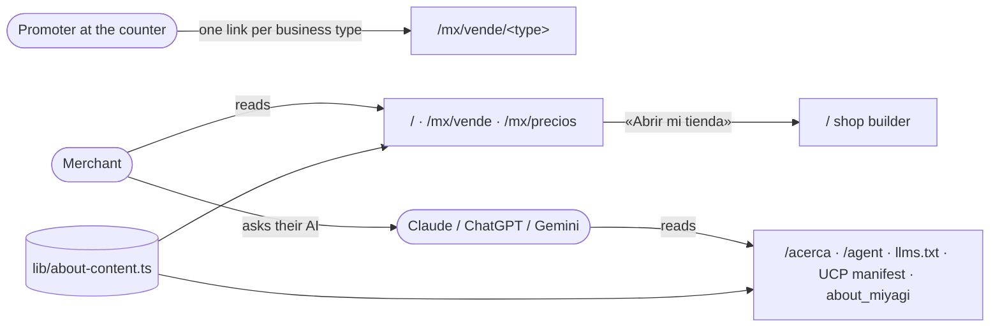

# Pitch — Own-shop positioning: the site says what Miyagi Sánchez is now

Moves · Tests: not grounded — no strategy yet

## The ask, as given

> Recorded as decided in the decision doc «Positioning and pricing — step 1»
> (https://claude.ai/artifact/LEkv6u3uop8u6wEGFoTGMb), 2026-11-09, decision 11: «The marketplace in the messaging: a
> benefit inside every plan, out of the main navigation and the company definition.» Plus Daniel's 2026-11-11 kit
> review: say omnichannel, financial intelligence, offers, AI and «get your business online» in our own words, and
> match business-type pages to the promoters' first zones. Refine asked on 2026-11-11: «refine the seeds:
> own-shop-positioning.md and merchant-features-surfaced-by-promoter-kit.md».

### Claims
1. The company definition is the merchant's own shop, built with them, 0% commission; the Vecindario is a benefit.
2. The marketplace leaves the main navigation, `/acerca` and every agent surface that renders from it.
3. «Publicar gratis», «Vende gratis» and «Empieza gratis» become «Abrir mi tienda».
4. A named human-support promise, including the promoter visit.
5. The undersold features are named in our own words: omnichannel, financial intelligence, offers and haggling, AI
   (including the merchant's own agent as a support channel), sorteos, «get your business online».
6. Pages by business type, with proof from real shops.

**Teach-back:** yes — "You want every page and agent surface to say «your own shop, built with you, 0% commission»
and show what the shop already does, so that the site backs the promoter's pitch instead of contradicting it. Right?"
(Recut confirmed by Daniel 2026-11-11: all site copy from the kit seed moves here.)

## Problem

Promoters started selling Plan Tienda on 2026-11-11 as «your own shop». A merchant who then opens the site or asks
their AI reads the opposite. On storefront `main` (`b7a4862`), read 2026-11-11:

| Where | What it says today | Source |
|---|---|---|
| `/acerca` lead | «Un marketplace nativo para agentes, hecho para México» | `locales/es.json` `acerca.page.lead`, `lib/about-content.ts` |
| `/acerca` definition | «un mercado multi-vendedor entre particulares (P2P)» | `acerca.sections.what_is.body.0` |
| Agent surfaces | the same definition, plus «P2P» in `/agent`, `lib/ucp/schema.ts`, `public/.well-known/ucp-agent-profile.json` | rendered from `lib/about-agent.ts` |
| Header CTA | «Publicar gratis» | `buyerShell.publishFree` |
| Footer | «Vende gratis» | `buyerShell.footer.sellFree` |
| `/mx/vende` | «Empieza gratis», «Empieza gratis y déjalo si no te gusta», «¿Vienes a comprar? Explora el marketplace» | `sellerAcquisition.anchor.*` |

No runtime copy overrides exist for these keys (`platform_copy_overrides`, read 2026-11-11), so the code is what is live.

**Already done, out of this pitch:** `/mx/precios` no longer leads with «gratis para siempre». Plan Tienda changed it to
«Tu propia tienda en línea, sin comisión por venta.» (`precios.heroTitle`).

## Appetite

**M.** Copy, navigation and pages on surfaces that already exist. No new data, no money path. If the business-type pages
don't fit, cut the kit zones down to the three with the most promoter visits. The appetite stays M.
quote: $27–40 (M, n=3, p25–p75)

## Outcome & signal

- Ask Claude, ChatGPT or Gemini «¿qué es miyagisanchez.com?». It answers «your own shop, 0% commission» and mentions the
  Vecindario only as a benefit.
- No header, footer, `/acerca` or `/mx/vende` CTA says «gratis» or «publicar». Every one says «Abrir mi tienda».
- A promoter can send a merchant one link for their business type: a print shop, a bridal shop, a plumber.
- Every page states the support promise: your promoter is your person, on their own WhatsApp, from the visit that sets
  the shop up onward; between visits, your own AI agent answers. (Daniel, 2026-11-11: there is no platform support
  line; the promoter is the point of contact.)

## Stage-2.5 bucket

**Light enhancement, mostly.** Every feature to advertise already ships (omnichannel, Tu plan, Analíticas, Ganancias,
offers, sorteos, shop chat, MCP). The work is the words and where they appear. The business-type pages reuse the
`/mx/vende/<vertical>` page-config system, which already powers `autos`, `creadores` and `migracion`.

## Bill of materials (What / Why)

| What | Why |
|---|---|
| New company definition in `lib/about-content.ts` | One source feeds `/acerca` and the four agent surfaces. Fix it once, all five agree |
| Remove «P2P» from the UCP schema/profile and `/agent` | AI assistants read these first |
| Main navigation for merchants; marketplace links move to the footer | Decision 11 |
| Every CTA becomes «Abrir mi tienda» | «Publicar» is a classifieds word |
| One home line: «tus productos también aparecen en el Vecindario» | Keeps the benefit and drops the identity |
| Support promise block (your promoter, on their WhatsApp · your AI agent) | The promoter visit is the selling point and the site never mentions it |
| Six feature stories, as sections and in `about_miyagi` | They are built and merchants never see them |
| Business-type pages from `page-config.ts` | Gives the promoter one link per zone |
| Demo shop labelled «ejemplo» on each page, plus a slot for real-shop proof | No real shop has agreed to be shown yet (Daniel, 2026-11-11) |

## Scope

**In v1:**
- **S1 · The definition.** `about-content.ts` plus the agent fan-out (`/agent`, UCP manifest/profile, `llms.txt`,
  `about_miyagi`). Main navigation and footer. Every CTA becomes «Abrir mi tienda». The home and `/mx/vende`
  marketplace lines shrink to one. The support promise block.
- **S2 · What the shop already does.** Six stories in our own words, on `/mx/vende` and in `about_miyagi`:
  1. Omnichannel: «un inventario para cada mostrador» (shop, WhatsApp, catalog PDF, Meta catalog, Mercado Libre, the
     in-person counter).
  2. Financial intelligence: Tu plan, Analíticas and Ganancias as one story, «cuánto ganas, no sólo cuánto vendes».
  3. Offers and haggling: buyer offers, counters, automatic rules.
  4. AI: shop chat, Import, and the merchant's own agent as a support channel.
  5. Sorteos for Buen Fin and Christmas.
  6. «Pon tu negocio en línea» for businesses with no presence beyond Google Maps.

  `/mx/precios` gets a short «Qué incluye tu tienda» list that links to them.
- **S3 · Pages by business type.** From the decision doc: inmuebles, servicios con reservas, comida (autos exists; give it
  the new copy). From the promoters' first zones: imprentas, vestidos de novia, plomería y baños, ropa interior por
  mayoreo, materiales e interiorismo, bazar y artesanos. Each page has a demo shop labelled «ejemplo» and an empty
  proof slot that renders nothing until a consenting shop is attached.

**Out of v1 (no-gos):**
- No price or plan changes. Plan Tienda owns those.
- The marketplace (`/mx`, Vecindario, buyer flows) is not removed or redesigned. It only leaves the main navigation and
  the definition.
- No real merchant's shop, name or words shown without their written consent.
- No custom static pages for merchants (seed `custom-static-pages`).
- The US market is unchanged. English copy for `/en` and `/us` follows only where it shares a source with `/acerca`.
- No new feature flags (operating posture).

## Rabbit holes

- **The agent fan-out is the definition.** `about-content.ts` renders onto five surfaces. A spec already asserts the
  content plus the «relay in the user's own language» directive. Extend that spec; don't fork the text.
- **`acerca` is bilingual (`locales/en.json`).** An es-only edit leaves English agents reading «P2P marketplace».
  Change both locales in the same story.
- **The static `/` must stay static.** Home edits must not add a dynamic read (LEARNINGS, static-page CDN). After deploy,
  purge the CDN and check `x-nextjs-cache`.
- **Hand-typed prices.** A spec fails on any hand-typed MXN price in public copy, so the feature stories read
  `pricing-catalog.ts`.
- **Copy quality is the deliverable.** Merchant-facing copy gets polished and logged in the copy bank (standing rule,
  2026-11-03). Ten business-type pages could eat the appetite. That is the cut lever named under Appetite.
- **The «own agent as support» claim must be true.** The MCP personal URL has `about_miyagi`, `compare_costs` and
  `send_feedback`. The copy must not promise the agent fixes things it cannot reach.

## What already exists (reuse, don't rebuild)

- `lib/about-content.ts` → `lib/about-agent.ts`: one source projected onto `/acerca`, `/agent`, the UCP manifest,
  `llms.txt` and the MCP `about_miyagi` tool/resource.
- `locales/es.json` and `en.json` keys: `acerca.*`, `buyerShell.publishFree`, `buyerShell.footer.sellFree`,
  `sellerAcquisition.anchor.*`, `precios.*`.
- `app/(shell)/mx/vende/_components/page-config.ts` with `SellerAcquisitionSections.tsx`, the vertical-page system
  behind `/mx/vende/autos`, `creadores`, `migracion/*`, plus the per-page OG (`lib/marketing-og.tsx`).
- `lib/pricing-catalog.ts`, the single price source.
- `/admin/contenido` (`platform_copy_overrides`): after launch, Daniel can tune any line without a deploy.
- CI: the no-JS agent-readability spec (`/`, `/vende`, `/acerca`, `/agent`, `/llms.txt`, manifest), the hand-typed-price
  spec and `market-route-population`.

## Visuals



```surface
state: vende-type-idle
route: /mx/vende/imprentas
- head "Tu imprenta, en línea y con pedidos por WhatsApp" action "Abrir mi tienda"
- block "Ejemplo: Imprenta Ejemplo" tag "ejemplo"
- list "Un inventario para cada mostrador · Cuánto ganas · Ofertas · Tu agente de IA"
- block "Te acompañamos: tu promotor te arma la tienda y te atiende por su WhatsApp; tu agente de IA, a cualquier hora"
- action "Abrir mi tienda"
```

## UX heuristics & rails check
- **CI guards covering this surface:** the agent-readability no-JS spec, the hand-typed MXN price spec,
  `market-route-population`, `emoji-guard`, the bilingual `/acerca` checks.
- **Audits-lens findings that apply:** none checked yet. The locking pass reads `Roadmap/00-ideas/audits/`.
- **Design-language debt:** the business-type pages inherit `SellerAcquisitionSections`. No new components.

## Flags (Stage 6b)
- **Measure:** no flag. Operating posture: no new feature flags unless the product owner asks. The signal is the AI
  ask-test above, read by hand.
- **Safety:** none. Copy only, and reversible from `/admin/contenido`.

## Acceptance criteria
- **S1:** no public surface calls Miyagi Sánchez a marketplace or P2P (sweep `app/`, `lib/`, `locales/`, `public/`).
  `about_miyagi` and `llms.txt` lead with the own-shop definition in es and en. The header CTA and every `/mx/vende`
  primary CTA read «Abrir mi tienda». The marketplace sits in the footer, not the header. The support block names the
  promoter as the merchant's contact, on the promoter's WhatsApp, and the merchant's AI agent. No platform phone number. Every new spec is seen red once by a mutation.
- **S2:** each of the six stories appears on `/mx/vende` and in `about_miyagi` and links to the real feature. No
  hand-typed price.
- **S3:** each business-type page renders without JS, has its own OG card and canonical, shows the demo shop labelled
  «ejemplo», and renders no proof block while no consenting shop is attached.
- **Every sprint** closes with a phone walkthrough. It is owed to Daniel and lists real URLs.

## Open risks / research
- **Decided 2026-11-11:** the contact is the promoter's own WhatsApp; no platform number, no promised hours. A shop with
  no promoter (self-serve) reads the agent line only. Business-type pages: all ten, the three-zone cut only if S3
  overflows the appetite.
- **Order against the kit-gaps epic:** independent. Only S2's omnichannel story names Canales, and it links to the
  public catalog and share links, not the panel page.
- Competitor framing was already researched for the decision doc (Tiendanube, Shopify, T1, read 2026-11-09). No new
  research is needed for copy.

## Intent match

_Advisory and uncalibrated (intent-match D1, D3): it can add a step, never block one. Regenerate with `node scripts/intent-match.mjs <this seed> --write`._

```text
Intent match — Roadmap/00-ideas/seeds/own-shop-positioning.md
  coverage in   0.94  (6 claims)
  coverage out  0.84  (4 criteria)
  clarity       0.78  (4 criteria)
  teach-back    1.00  (yes)
  agreement     pending  (the optional reader at the architecture lock)
  why story     0.70  (advisory, not in the total)
Total 89 / 100 — uncalibrated · signals: coverage in, coverage out, clarity, teach-back
Band: build (placeholder bands: 80 build · 60 resolve follow-ups · below 60 sketch or spike)
Gaps: none
```

<!-- intent-match: {"coverage_in":0.938,"coverage_out":0.835,"clarity":0.775,"teach_back":1,"total":89} -->
