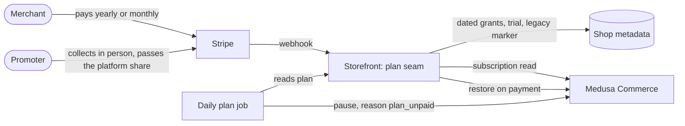
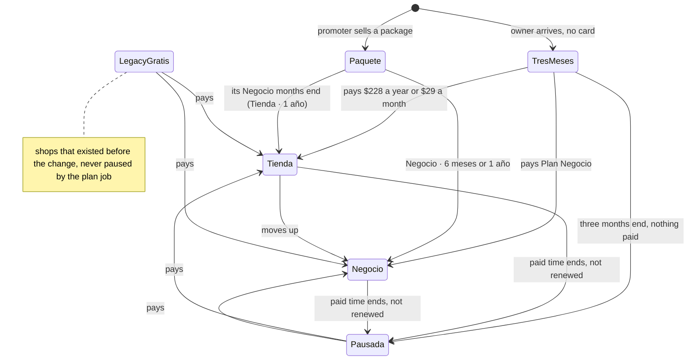

# Pitch — Plan Tienda, three free months, and the promoter packages that follow

Moves · Tests: not grounded — no strategy yet

## The ask, as given

> As such and as I start working with field promoters, i want your help evaluating how to turn the free tier into a 19 pesos (price to be discussed and evaluated as per market research, go online and check tiendanube, shopify etc to see where we should be) per month. starting with 3 free months all included from negocio (promotion period and overall strategy also to be discussed and evaluated fully).
>
> - Minimum 19 pesos a month, would include the ai support for shops. first 3 months free, promoters could sell a full year at a discount or 3 months or 6 months, lets evaluate the strategy for the packages, tiers, upgrades etc, from the top actually rather than taking any of my comments as requirements.

Daniel's answers to the twelve numbered decisions in the decision document
(https://claude.ai/artifact/LEkv6u3uop8u6wEGFoTGMb), 2026-11-09:

> 1. yes
> 2. yes sounds good, but what about the self serve route for this tier? if we do allow for monthly 19 pesos charges are we still not making money cos of transaction fees?  whats the suggestion here?
> 3. Plan tienda sounds ok
> 4. Three months of Plan Negocio, no card
> 5. Paused, nothing deleted, restored on payment
> 6. why extend their current allowance? but yes legacy classic forever is good.
> 7. Yes as suggested
> 8. as suggested
> 9. yes as suggested
> 10. yes as suggested
> 11. exactly
> 12. arent cars and real state fully available now?
>
> approved across the board continue as planned

### Claims
1. The free plan closes to new shops; shops that already exist keep Plan Gratis for good.
2. A new entry plan, Plan Tienda, costs $228 a year, shown as «desde $19 al mes».
3. Self-serve can also pay Plan Tienda month to month, at $29.
4. Plan Tienda includes the AI help for shops, at today's Plan Gratis amounts (50 answers, 20 photos).
5. Every new shop gets three months of Plan Negocio free, with no card.
6. A shop with no paid plan after the three months is paused: nothing deleted, restored on payment.
7. The 18 shops whose 30-day trial ends 2026-12-05 are not extended; they move to legacy Plan Gratis.
8. Promoters sell three packages: Tienda for a year, Negocio for six months, Negocio for a year.
9. A promoter earns 10% of Plan Tienda renewals, and a one-time share when a Tienda shop moves up to Negocio in its first year.
10. Plan Negocio stays at $149 a month and $1,490 a year.
11. The AI cost per shop is measured for a month.

**Teach-back:** yes — "You want every new shop to start with three free months and then be on a paid plan, with a
low entry plan a promoter can sell for a year, so the field program has something to sell and free shops stop
costing money. Right?" (Daniel: "approved across the board continue as planned")

## Problem
Measured in the code and on the live site on 2026-11-09:
- **The entry plan is free with no end.** `/mx/precios` leads with «Tu tienda en línea, gratis para siempre». A free
  shop still spends AI: 50 chat answers and 20 photos a month.
- **A promoter's cheapest sale is a $250 setup that earns the platform $50 once,** and the next step up is three
  months of Plan Negocio for $600, which the new strategy gives away.
- **The trial is 30 days.** Shopify charges $20 a month for three months; three free months with no card is a longer
  runway than any competitor in the comparison.
- **A shop a promoter sells a package to never gets the trial.** `canStartTrial` refuses any shop that already holds
  a Negocio grant, and the package writes the grant before the merchant claims the shop.
- **Nobody knows what the AI costs per shop.** `lib/plan-allowances.ts` says so in its own header.

## Appetite
M — one run of four sprints. The plan seam, the yearly payment, the monthly subscription, the trial, the notices,
the pause and the packages all exist; this adds one plan to each of them.
quote: $27–40 (M, n=3, p25–p75)

## Outcome & signal
After this ships:
- A shop opened today starts with three months of Plan Negocio and no card.
- At the end it is on Plan Tienda or Plan Negocio, or it is paused until someone pays.
- A promoter sells one of three packages, each with the three months on top.
- A shop that existed before the change is on Plan Gratis as before, and its owner sees no difference.

**Daniel's test:** open a new shop, see «3 meses gratis», move its trial end to yesterday with the admin tool, watch
it pause, pay Plan Tienda for a year with a test card, and see it back on line within a minute.

## Stage-2.5 bucket
**Light enhancement over existing parts.** One new plan name in a seam built to hold plans, one more Stripe price,
one more daily job that calls a pause route that already exists, and new numbers in the package table.

## Bill of materials (What / Why)

| What | Why |
|---|---|
| `tienda` as a plan in `lib/plan.ts` (`derivePlan`), with `lib/tienda-pricing.ts` as the one home of $228 and $29 | Every gate already asks the plan seam; a second paid plan belongs there and nowhere else |
| A legacy marker on every shop that exists on the day of the change | «Gratis, para siempre» was promised on the live pricing page. Without a marker, an old shop with an ended trial looks exactly like a new unpaid one and would be paused |
| Plan Tienda yearly: one payment of $228 that grants 12 months | A $19 card charge loses 22% to the processor; one yearly charge loses 6% |
| Plan Tienda month to month at $29: a Stripe subscription on a new Medusa Commerce plan | Self-serve merchants who will not pay a year at once. $29 keeps $292 a year after fees (Daniel, 2026-11-09) |
| Trial of 90 days for shops that start it after the change | Daniel's decision 4. Trials already stamped keep their own end date |
| A 15-day notice, next to the 5-day one that exists; the end notice says «tu tienda quedó en pausa» for new shops | A merchant about to be paused has to hear it twice, with the way to pay in the message |
| A daily job that pauses an owned, unpaid, non-legacy shop whose three months ended, with the reason `plan_unpaid` | Daniel's decision 5. It calls the existing pause route, which removes nothing |
| A paid Plan Tienda or Plan Negocio payment restores a shop paused for `plan_unpaid`, and only for that reason | A shop an admin paused for another reason must not come back because someone paid |
| The paused owner still reaches «Tu plan» and can pay | Otherwise a paused shop can never be restored by its owner |
| Packages: `tienda_anual` ($500, keep $300), `negocio_semestral` ($1,100, keep $600), `negocio_anual` (unchanged). Each grants three months of Plan Negocio from the payment day, then its paid time | Daniel's decision 7. Counting from the payment day avoids the trial, which a packaged shop cannot get |
| `negocio_arranque` and `setup_gratis` stop being sold; what was already sold keeps working | Three free months make both pointless |
| `tienda_renewal` at 10%, and `negocio_upgrade` at 20% when a Tienda shop pays Plan Negocio in its first year | Daniel's decision 8. The promoter has a reason to come back |
| `/mx/precios`, the pricing catalog, «Tu plan», the promoter panel's «Cobra», the promoter page, the sell sheet and the agent surfaces read the new plan and prices | A price is stated in one module and reaches every page through a token, as today |
| A script that reports a month of chat answers and photos per shop, with their cost where it is logged | Daniel's decision 9 depends on a number nobody has |

## Scope
**In v1:** everything in the table above, for the Mexico market, in es-MX with the existing en copy kept in step.

**Out of v1 (no-gos):**
- Any change to Plan Negocio's price or what it includes.
- A limited free plan for new shops.
- Extending the 18 trials that end on 2026-12-05.
- A third plan above Plan Negocio.
- The repositioning of the home page, navigation and `/acerca` (its own idea: `own-shop-positioning`). This epic
  changes plan names, prices and plan facts wherever they appear, and no other copy.
- Deleting a paused shop or its data after any length of time.
- The United States market's plans.
- A feature flag: the operating posture is no new flags unless Daniel asks, and he has not.

## Rabbit holes
- **Legacy first, pause second.** The legacy marker is written and verified on every existing shop BEFORE the pause
  job is deployed. The pause job refuses to run when it cannot read the marker, and treats "could not read" as "do
  not pause". Re-count the shops at apply time; the count from planning day will be stale.
- **Three states for a shop with no paid plan:** legacy (Plan Gratis), unpaid (to pause), and could-not-read (leave
  alone). Never two.
- **Why a pause, and whose.** The backend's status route already requires a reason. The plan job writes
  `plan_unpaid` and a payment restores only that reason. A manual admin pause stays paused after a payment.
- **Validate, then claim, then apply** on both the pause and the restore, each write conditional and read back. A
  webhook replay must restore nothing twice and pause nothing that just paid.
- **Unclaimed shops are never paused by this job.** The trial starts when the owner arrives; a promoter's unclaimed
  shop and an imported shop nobody owns have no trial and no owner to notify.
- **Packages do not use the trial.** A package writes its own dated grants from the payment day: three months of
  Plan Negocio, then the paid months. `canStartTrial` stays as it is.
- **Precedence in `derivePlan`:** Negocio (comp, dated grant, subscription), then the trial, then Tienda (dated
  grant, subscription), then legacy Gratis, then unpaid. A shop holding both a Tienda year and a Negocio month is on
  Negocio, and its Tienda months are not consumed faster because of it. Decide and test what an upgrade does to the
  remaining Tienda time: the proposal is that it stays and resumes when Negocio ends.
- **$600 of $1,100 is not a round percentage.** The split is computed from `rate_pct`. Check the column's precision
  first; if it cannot hold a rate that gives exactly $600, stop and ask before changing a price.
- **The two retired packages stay in the vocabulary.** Their rows, transfers and receipts must still render. Only
  the sale is refused.
- **The monthly subscription is a second Medusa Commerce plan,** seeded through an internal route like
  `setup-negocio-plan`. `medusa exec` cannot reach production.
- **Prices in copy are tokens.** `e2e/pricing-source-sweep.spec.ts` fails on a typed MXN price. Specs that read
  production turn green only after the deploy.
- **The AI cost script must say "not logged" when cost is not logged,** never zero.

## What already exists (reuse, don't rebuild)
- **The plan seam:** `lib/plan.ts` (`derivePlan`, `decideNegocioPayment`, `extendNegocioGrant` with `startAfter`,
  `guardFor`), `lib/plan-server.ts` (`resolvePlan`, `ensureNegocioTrial`), `lib/plan-by-slug-server.ts`,
  `lib/plan-agent.ts`, `lib/plan-allowances.ts`.
- **Prices and pages:** `lib/negocio-pricing.ts`, `lib/pricing-catalog.ts` and its server shell,
  `app/(shell)/mx/precios/page.tsx`, `lib/negocio-page.ts`.
- **Buying:** `lib/negocio-checkout.ts` and `lib/negocio-checkout-rules.ts` (yearly one payment, monthly
  subscription), `lib/stripe-subscriptions.ts`, `lib/negocio-subscription.ts`, the invoice handlers, the Stripe
  portal route `POST /api/sell/negocio/manage`.
- **Backend:** `src/api/internal/setup-negocio-plan/route.ts`, `src/api/internal/negocio-subscription/route.ts`,
  `src/lib/negocio-plan.ts`, and the pause route `POST /internal/sellers/:id/status { status, reason }` with its
  ledger (`src/lib/seller-channel-ledger`, `src/api/internal/_utils/seller-status-plan.ts`).
- **Pause on the storefront:** `lib/admin/tenant-status.ts`, `lib/admin/tenant-actions.ts`, `lib/seller-status.ts`.
- **Notices:** `lib/negocio-trial-notices.ts` and its server shell (claim through `merge_shop_metadata`, send through
  `dispatchToSeller`), `sendNegocioTrialNotice` in `lib/email.ts`, `lib/notifications/catalog.ts`.
- **Promoter:** `lib/promoter-packages.ts`, `lib/promoter-skus.ts`, `lib/promoter-commission.ts`,
  `lib/promoter-renewal-server.ts`, `lib/promoter-transfer.ts`, `app/api/promoter/close/package/[sku]/route.ts`,
  `app/(shell)/promotor/cerrar/CobraStep.tsx`, the receipt reads in `lib/promoter-receipt-read.ts`,
  `marketplace_promoter_commission_rates`, the two 2026-11-05 migrations as the pattern.
- **Scripts:** `scripts/backfill-negocio-trial.ts` as the pattern for the legacy marker; the recipe for running a
  bundled script inside the production web container.

## Visuals

System context: who pays whom, and what decides the plan.



The life of a shop's plan.



The three packages.

| Package | Merchant pays | Promoter passes | Promoter keeps | Shop gets, from the payment day |
|---|---|---|---|---|
| Tienda · 1 año | $500 | $200 | $300 | 3 months of Plan Negocio, then 12 of Plan Tienda |
| Negocio · 6 meses | $1,100 | $500 | $600 | 9 months of Plan Negocio |
| Negocio · 1 año | $2,000 | $900 | $1,100 | 15 months of Plan Negocio |

## UX heuristics & rails check
- **CI guards covering this surface:** `e2e/pricing-source-sweep.spec.ts` (no typed prices),
  `e2e/revalidate-truth.spec.ts` (no `revalidate` on `app/(shell)` routes), `e2e/seller-status-vocabulary.spec.ts`,
  the money-path CI gate on the backend.
- **Audits-lens findings that apply:** none found for these pages.
- **Design-language debt (if any):** none expected; «Tu plan» and `/mx/precios` already use the site's components.

## Kill-switch / runtime gate (risk:high only — Stage 6b)
None. Operating posture: no new flags unless Daniel asks. The pause job is the one part that can hurt, and it is
guarded by the legacy marker and by refusing to act on a plan it could not read. It runs on a timer Daniel enables
by hand, like the trial notices and the check-in.

## Acceptance criteria

**Sprint 1 — Plan Tienda exists**
- S1.1 (high) A shop with a live Tienda grant or subscription resolves to `tienda`; the precedence in *Rabbit holes*
  holds for every combination. Pure spec on `derivePlan`.
- S1.2 (high) Every shop that exists on the day of the change carries the legacy marker, written by a script with a
  dry run that prints the count. A marked shop with an ended trial resolves to Plan Gratis; an unmarked one resolves
  to unpaid.
- S1.3 (low) Plan Tienda's allowance is 50 answers and 20 photos; every gate that asks «¿Negocio?» still answers the
  same for Negocio and the trial.
- S1.4 (low) A script reports chat answers and photos per shop for a month, with cost where logged and «no
  registrado» where not.

**Sprint 2 — Buying Plan Tienda**
- S2.1 (high) Paying $228 writes a 12-month Tienda grant once; a replayed webhook adds nothing; paying during the
  three free months starts the year when they end.
- S2.2 (high) $29 a month is a subscription on a new Medusa Commerce plan; cancelling it from «Tu plan» ends Plan
  Tienda at the period end.
- S2.3 (low) `/mx/precios`, «Tu plan», the manifest, the MCP tools and `llms.txt` show Plan Tienda and Plan Negocio,
  and no longer offer Plan Gratis to a new shop. A legacy shop's «Tu plan» still says Plan Gratis.

**Sprint 3 — Three free months, then a pause**
- S3.1 (high) A shop whose owner arrives after the change gets 90 days; a trial already stamped keeps its end date.
- S3.2 (low) The owner gets a notice at 15 days and at 5 days, each claimed once.
- S3.3 (high) The daily job pauses an owned, unmarked, unpaid shop whose three months ended, with reason
  `plan_unpaid`. It pauses nothing it could not read, no legacy shop and no unclaimed shop. Dry run prints the list.
- S3.4 (high) A Plan Tienda or Plan Negocio payment restores a shop paused for `plan_unpaid` and no other. The
  paused owner can sign in, open «Tu plan» and pay.

**Sprint 4 — The promoter's three packages**
- S4.1 (high) The three packages are sold at the prices and splits in the table; each grants three months of Plan
  Negocio from the payment day and then its paid time. The two retired packages are refused with a plain message,
  and their old receipts still open.
- S4.2 (high) A Plan Tienda renewal 12 to 24 months after a promoter's package accrues 10% to that promoter, once
  per payment.
- S4.3 (high) A Tienda shop's first Plan Negocio payment inside its first year accrues the upgrade share (20% of
  that payment) to the promoter who opened it, once.
- S4.4 (low) «Cobra», the promoter page, the sell sheet, the receipt and `/admin/promoter` name the three packages
  with «Cobras… Le pasas… Te quedas…» from the same numbers.

**QA stage per sprint:** pure-logic specs on the extracted seams (`lib/plan.ts`, the checkout rules, the pause
decision, `lib/promoter-packages.ts`), each seen failing once by breaking the implementation. Browser smokes owed to
Daniel: the test-card payments for Plan Tienda yearly and monthly, a pause and restore on a test shop, and one
package sold by card and one by transfer with a test promoter.

## Open risks / research
- **Competitor prices, read from the live pages on 2026-11-09:** Tiendanube México Gratis and Básico $149 with 2% on
  outside gateways (https://www.tiendanube.com/mx/planes-y-precios); Shopify México 3 days free then $20 a month for
  3 months, Basic $399 (https://www.shopify.com/mx/precios); T1 Gratuito capped at 30 orders a month, Básico $399
  (https://www.t1.com/mx/precios).
- **IVA is included** in $228, $29 and $149 (Daniel, 2026-11-09). The pages say «IVA incluido»; no price shows
  «más IVA».
- **The upgrade share is 20%** of the Tienda shop's first Plan Negocio payment inside its first year (Daniel,
  2026-11-09).
- **Three migrations are likely** (the transfer SKU check, the commission rates, possibly the attribution kind).
  The orchestrator applies them before the code that needs them merges; never `supabase db push`.
- **AI cost may make 1,000 answers on a promoter-sold Negocio year unprofitable** ($900 over 15 months is $60 a
  month). S1.4 gives the number; the allowance changes in one constant if it has to.

## Intent match

_Advisory and uncalibrated (intent-match D1, D3): it can add a step, never block one. Regenerate with `node scripts/intent-match.mjs <this seed> --write`._

```text
Intent match — Roadmap/00-ideas/seeds/plan-tienda-three-free-months.md
  coverage in   0.86  (11 claims)
  coverage out  0.89  (15 criteria)
  clarity       0.79  (15 criteria)
  teach-back    1.00  (yes)
  agreement     pending  (the optional reader at the architecture lock)
  why story     0.59  (advisory, not in the total)
Total 89 / 100 — uncalibrated · signals: coverage in, coverage out, clarity, teach-back
Band: build (placeholder bands: 80 build · 60 resolve follow-ups · below 60 sketch or spike)
Gaps: none
```

<!-- intent-match: {"coverage_in":0.863,"coverage_out":0.89,"clarity":0.793,"teach_back":1,"total":89} -->
