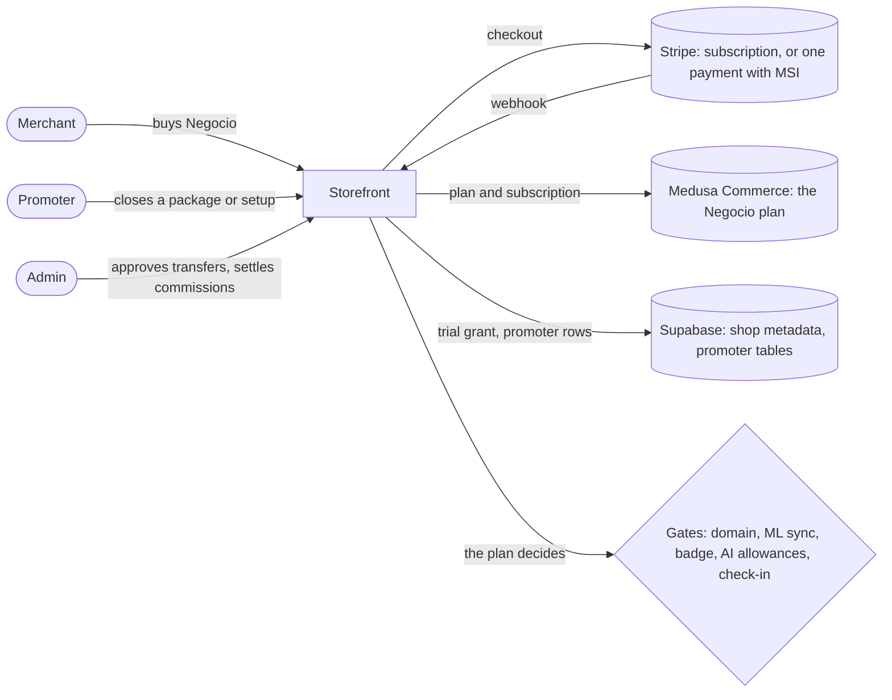
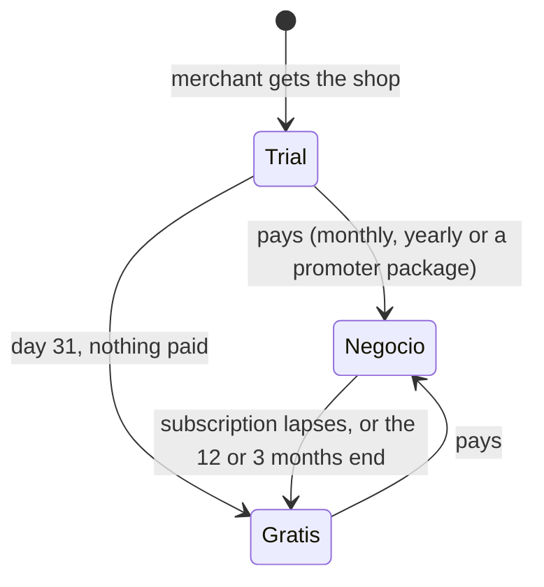

# Pitch — Two plans, a trial, and promoter packages

Moves · Tests: not grounded — no strategy yet

## The ask, as given

> hi claude help me figure out the next ask. We recently implemented many changes to this site, shifting the value
> proposition. The paid tiers are still a bit confusing overall and havent been worked out on their own strategically
> from a business perspective. So lets work them out at that level first. Lets lay out what we currently have vs a
> suggested version. Particulrly the ai support will also cost us so maybe thats also behind a paywall? lets define
> what each tier gets users, from the free tier and upwards, lets define those tiers actually. and should we offer a
> full 30 day trial with everything included then downgrade to always free? Furthermore, lets consider that im
> starting to send promoters in the field, i want to make it as simple as you install it you charge x, pay us the
> platform y and they keep z. hope im able to explain what im looking for

> im thinking of integrating the addons to negocio already: custom domain, Mercado Libre sync, at today's prices. then
> on gratis include the subdomain again for free […] the yearly deal makes sense but we have to earn trust and these
> micromerchants will be reluctant to pay a whole year in advance at least at the beginning. Also, the imain goal of
> promoters right now would be to get volume, so even if they didnt sell the yearly or monthly negocio plan, their
> last resource is to at least setup the merchant on the free tier. If thats the case they can also charge a low fee
> to the merchant to set it up in person on the free tier, then theyd keep such merchants as leads and follow up with
> promotions to upgrade.

> 250 sounds a good starting point, but we wouldnt pay promoters 50 on top of that. They still need to pay us back
> part of that setup as we will be providing training, leads and uniforms. So i was thinking from 250 theyd pay the
> platform 50 or also fifty if the price is set at 200. […] Lets figure out their user jouney as i think its mostly
> setup but the prompt to shop didnt exist, so lets ensure its clear how theyd work.

### Claims
1. Define the plans from free upwards: what each one gets a merchant.
2. Put the AI that costs us money behind the paid plan.
3. A 30-day trial with everything, then down to free forever.
4. Custom domain and Mercado Libre sync move into Negocio, at today's prices; the subdomain is free on Gratis.
5. A lower first payment than a whole year, to earn trust.
6. Promoters can say the deal in one line: you charge X, pay the platform Y, keep Z.
7. A free-plan setup the promoter charges for ($250, $50 to the platform, no bonus on top).
8. Merchants a promoter sets up stay their leads, to follow up and upgrade.
9. The promoter's day is clear, including building the shop from photos (prompt-to-shop).

**Teach-back:** yes — "You want two plain plans and a promoter deal anyone can say in one sentence, so the shops
promoters open can turn into paying ones. Right?"

## Decisions already made (Daniel, 2026-11-04)

- Two plans: Gratis and Negocio. No Pro until there is value only Pro would have.
- Gratis, forever: shop, URL and **subdomain**, 0% commission, every payment method, marketplace, messages, agents
  (UCP/MCP), the AI that builds the shop, a small chat allowance, and a «Hecho con Miyagi Sánchez» badge.
- Negocio, $149/mo or $1,490/yr: custom domain, Mercado Libre sync, no badge, a large chat allowance, the monthly
  check-in, more AI drafts and photos.
- A 30-day Negocio trial for every new shop, no card; on day 31 it drops to Gratis and stays live. The custom
  domain is not part of the trial.
- AI is limited by amount, never switched off.
- Meses sin intereses through Stripe card installments, not Mercado Pago.
- Existing paid merchants keep what they paid for.
- Promoter packages: Anual $2,000 → $900 to the platform, $1,100 to the promoter; Arranque $600 → $300 / $300;
  setup Gratis $250 → $50 / $200. No bonus on top.
- A promoter earns 10% of a merchant's year-2 renewal.
- For the first promoter, settlement is manual: SPEI or card, then a message to Daniel.
- `subdomain.paywall_enabled` switched OFF in all three environments (verified with `frijoles`).
- **Plan gate (2026-11-04):** (a) shops that exist today get the 30-day Negocio trial on launch day; (b) the paid
  subdomain subscriptions are cancelled at the end of their period, with an email saying the subdomain is free now;
  (c) no Measure flag — paying shops are counted from Stripe and Medusa Commerce.

## Problem

What a merchant can buy today is a menu, not a ladder: a free shop plus five separate add-ons (subdomain $199/yr,
custom domain $499/yr, Mercado Libre sync $299/yr, print ad, migration). Every price is small, and a promoter's
commission is a percentage of those small prices; in the code every rate defaults to 0%
(`lib/promoter-commission.ts` `DEFAULT_COMMISSION_RATES`). The AI that runs every month (shop chat) is free for every
shop, up to 200 answers a day each, so its cost grows with use and earns nothing. And the promoter about to go into
the field builds a shop by typing products one at a time, because prompt-to-shop does not know promoters exist.

Facts checked on 2026-11-04:

- `/mx/precios`, the promoter rate card and the subdomain sale routes still sell the subdomain at $199/yr, although
  its paywall is now off.
- `domain.paywall_enabled` and `ml.sync_paywall_enabled` are ON. Those two paywalls stay; Negocio becomes what opens
  them.
- The platform bills its own products only through Stripe (`lib/stripe-subscriptions.ts`): a subscription
  (`mode: 'subscription'`) or one year paid up front (`mode: 'payment'`, `createOneTimeCheckout`).
- A promoter's sale works by card (the promoter pays at Stripe checkout) or by net transfer (the promoter keeps their
  commission and sends the rest by SPEI, DiMo or CoDi; `promoter.transfer_enabled` is ON).
- The monthly check-in (`lib/business-plan/checkin.ts`) is an email built without a model; only the plan's
  explanation (`explain-server.ts`, cached by inputs) and the shop chat call a model.
- The promoter workspace adds products by hand (`ListingStep.tsx`); prompt-to-shop has no promoter awareness, and a
  promoter's code is recorded only when a paid item is sold.

## Appetite

**L.** This is the platform's business model: the plan underneath, what each plan gets, the price page, the
promoter's packages and the promoter's day. It is worth a large bet because nothing else lets the platform earn
from the shops promoters open. It fits L only by reusing the paid-item machinery whole (see the reuse list).

quote: $50–300 (L, n=1, wide)

## Outcome & signal

After this ships, a merchant sees two plans on `/mx/precios`, every new shop runs on Negocio for 30 days and then
drops to Gratis without breaking, a merchant can buy Negocio monthly or yearly (yearly in meses sin intereses), and a
promoter can sell Anual, Arranque or the setup Gratis in `/promotor/cerrar`, filling the shop from photos. Daniel tests
it by opening a shop, watching the trial show, buying Negocio in test mode, and closing each promoter package with a
test promoter.

**Target (proposal):** shops paying for Negocio, from 0 to 5, read 60 days after it ships.

## Stage-2.5 bucket

**Genuinely new, built almost entirely from parts that already work.** Negocio is a fourth platform subscription
plan cloned from the three that exist; the trial is a dated grant like the `one_time` grant that exists; the promoter
packages are three new items on the promoter's existing price, commission and transfer rails; the photo step is
prompt-to-shop's own.

## Bill of materials (What / Why)

| What | Why |
|---|---|
| Negocio plan: a Medusa Commerce subscription plan, monthly $149 and yearly $1,490 | One thing to buy instead of five |
| `lib/plan.ts`: Gratis · trial · Negocio, decided in one pure function | Every gate reads one answer; none can drift |
| Trial: a dated grant, 30 days, stamped when the merchant gets the shop | Ends by itself on read; no timer to fail |
| Custom domain and ML sync open for Negocio | They are in the plan; their paywalls already exist |
| Yearly as one payment, with Stripe meses sin intereses | A lower monthly cost without a recurring card mandate |
| «Hecho con Miyagi Sánchez» on Gratis white-label shops | A reason to upgrade, and a link back on every free shop |
| AI allowances by plan: chat answers per month, drafts and photos | The AI that costs money grows with the plan |
| Chat over its allowance → «Deja tu mensaje» | A buyer never meets a broken chat |
| Monthly check-in for Negocio and trial shops | The plan's monthly value, shown each month |
| Trial emails: 5 days left, and «ya estás en Gratis» | No surprise on day 31 |
| `/mx/precios` rebuilt: Gratis vs Negocio; catalog, `/acerca`, agents | One price list everywhere, as today |
| MCP: read the plan, start Negocio | Agents can do what a merchant can |
| Promoter items: Anual $2,000/55%, Arranque $600/50%, setup Gratis $250/80% | The one-sentence deal, on the rails that exist |
| Package list price separate from Negocio's price | The promoter price clamp would cut $2,000 to $1,490 |
| Year-2 renewal: 10% to the promoter | They keep looking after the merchant |
| Photo step in `/promotor/cerrar` (prompt-to-shop's) | A shop filled in minutes, still linked to the promoter |
| Subdomain sold nowhere; existing subdomain subscriptions cancelled at period end | It is free now; charging for it is wrong |

## Scope

**In v1:** everything in the table above, in Mexico (MXN).

**Out of v1 (no-gos):**

- No Pro plan.
- No Mercado Pago for the platform's own billing (Stripe installments instead).
- No US plans or USD prices (`/us` keeps today's behaviour).
- Print ad and migration stay separate one-off items, unchanged.
- No change to the 0% commission or to how merchants get paid.
- No automated payout to promoters: the admin settles, as today.
- No new feature flags (Daniel, Plan gate c).

## Rabbit holes

- **The word «plan» is taken.** «Tu plan» (`/shop/manage/plan`) is the business plan. The billing page must be called
  something else; proposal: «Negocio» at `/shop/manage/negocio`, and «tu suscripción» in copy.
- **When the trial starts.** A promoter opens an unclaimed shop days before the merchant claims it. Proposal: the
  trial starts when the merchant gets the shop (at claim for promoter shops, at creation otherwise), so a promoter's
  shop never burns its trial unclaimed.
- **Stripe installments only work on one payment, not on a subscription.** Yearly is therefore a one-time payment that
  grants 12 months (the dated `one_time` shape), with installments offered at checkout; monthly is a subscription.
  Check the Stripe account is eligible for installments in Mexico before S1 builds; if it is not, yearly ships without
  installments and the gap is reported, never faked.
- **The promoter price is clamped to the list price** (`resolveSkuPromoterPriceCents`). A $2,000 package over a
  $1,490 plan would be cut. Packages need their own list price.
- **A renewal is a new one-time payment.** Year 2 of a yearly Negocio is a second purchase, so the rule "first payment
  only" must learn "a second Negocio payment for an attributed shop earns 10%". Decide it in the pure
  `decideAccrual`, never in the webhook.
- **Allowance spend has a CHECK constraint.** `spend_ai_allowance` allows only the kinds version, photo and
  daily_budget. A monthly chat allowance either reuses a kind with a monthly period or needs a CHECK migration — lock
  which in the architecture pass, against the live DB (the orchestrator applies any migration).
- **Grandfathered shops.** 179+ shops hold permanent grants for the subdomain or the custom domain. Grants keep
  working; the plan never removes something a shop already holds.
- **Existing paid merchants keep what they paid for:** a standalone custom-domain or ML-sync subscription keeps
  renewing at its price; the subdomain subscriptions are cancelled at period end, with an email (Daniel, Plan gate b).
- **The badge on a custom domain.** A Gratis shop cannot have a custom domain (Negocio only), so the badge only ever
  shows on a subdomain or the embed.

## What already exists (reuse, don't rebuild)

- **Entitlement seam:** `lib/domain-entitlement.ts` (`deriveDomainEntitlement`, grant types grandfather · comp ·
  one_time, lapse on read), cloned by `lib/subdomain-entitlement.ts` and `lib/ml-sync-entitlement.ts`, each with a
  `*-entitlement-server.ts` composer.
- **Platform plans in Medusa Commerce:** Backend `src/modules/subscriptions/`, `src/api/internal/setup-*-plan/` and
  `*-subscription/` routes (one plan per item, told apart by `metadata.kind`, monthly price on plan metadata, no
  migration). Storefront bridges: `lib/{domain,subdomain,ml-sync}-subscription.ts` and `*-subscription-checkout.ts`.
- **Stripe:** `lib/stripe-subscriptions.ts` (`createSubscriptionCheckout`, `createOneTimeCheckout`,
  `cancelSubscriptionAtPeriodEnd`, the billing portal), and the existing webhook lapse handlers.
- **Grandfather backfill planner:** `lib/paywall-grandfather.ts`.
- **White-label shell:** `app/(shell)/s/[slug]/ChannelLayout.tsx` (where the badge goes).
- **AI limits:** `lib/prompt-to-shop/allowance.ts` (`P2S_LIMITS`), `lib/shop-chat/handler.ts` (`CHAT_PER_SHOP_PER_DAY`
  200, global 3,000), the `spend_ai_allowance` RPC, the chat's «Deja tu mensaje» handoff (`lib/shop-chat/handoff*.ts`).
- **Check-in:** `lib/business-plan/checkin.ts` + `checkin-server.ts` on the daily VM timer.
- **Prices:** `lib/pricing-catalog.ts` + `pricing-catalog-server.ts`, `{token}` copy, `e2e/pricing-source-sweep.spec.ts`.
- **Promoter rails:** `lib/promoter-skus.ts`, `lib/promoter-pricing.ts`, `lib/promoter-commission.ts`
  (`decideAccrual`), `lib/promoter-transfer*.ts`, `/api/promoter/close/*`, `/promotor/cerrar`
  (`PromoterCloseClient.tsx`, `ListingStep.tsx`), `/api/promoter/rate-card`, `/admin/promoter`.
- **Prompt-to-shop photo step:** `lib/prompt-to-shop/photo*.ts`, `lib/seller-product-create.ts`.
- **Emails:** `lib/shop-notify.ts`.
- **MCP:** the seller tools in `app/api/ucp/mcp/route.ts`, including `get_subdomain_entitlement` and
  `start_subdomain_subscription`.

## Visuals





| Shop | Plan read | Why |
|---|---|---|
| tacos-don-beto (opened 2026-11-10, claimed 11-12) | trial | 30 days from claim, until 2026-12-12 |
| panaderia-lupita (yearly paid 2026-11-20) | negocio | one-time grant until 2027-11-20 |
| estetica-sol (opened 2026-09-01, never paid) | gratis | no trial running, no grant, no subscription |

```surface
state: negocio-page-idle
route: /shop/manage/negocio
- head "Tu suscripción" action "Pasar a Negocio"
- card "Estás en tu prueba de Negocio: te quedan 12 días"
- list "Incluye: dominio propio · Mercado Libre · 1,000 respuestas del chat al mes · revisión mensual · sin el sello"
- action "$149 al mes" action "$1,490 al año (hasta 6 meses sin intereses)"
```

## UX heuristics & rails check

- **CI guards covering this surface:** `e2e/pricing-source-sweep.spec.ts` (no typed MXN prices), the revalidate-truth
  spec, and the full `npm run test:e2e` (a new route trips cross-cutting specs — run it whole, per the pricing-page
  retro).
- **Audits-lens findings that apply:** none found for billing.
- **Design-language debt:** reuse `components/ui/Button` and the existing card patterns of `/shop/manage`.

## Kill-switch / runtime gate (risk:high only — Stage 6b)

- **Measure:** none (Daniel, Plan gate c). The signal (paying Negocio shops) is counted from Medusa Commerce and
  Stripe.
- **Safety:** the runtime seams already have switches: `domain.paywall_enabled` and `ml.sync_paywall_enabled` (ON)
  open everything if switched off. No new kill switch.

## Acceptance criteria

- A new shop shows «prueba de Negocio, te quedan N días» and has every Negocio feature; on day 31 it is on Gratis and
  its shop, products and subdomain keep working.
- A merchant buys Negocio monthly or yearly in Stripe test mode; the custom domain and ML sync open; the badge goes.
- Yearly checkout offers meses sin intereses when the account is eligible (or the gap is reported).
- A Gratis shop's chat stops answering after its monthly allowance and offers «Deja tu mensaje».
- `/mx/precios` shows Gratis and Negocio from the catalog; no typed price anywhere.
- A promoter closes Anual, Arranque and the setup Gratis, by card and by transfer; the shop gets 12 months, 3 months
  or nothing, and the admin sees $900, $300 and $50 owed.
- A second yearly payment by a promoter's shop accrues 10% to that promoter.
- A promoter fills a new shop from photos in `/promotor/cerrar`, and the shop appears among their relationships.

## Open risks / research

- Stripe card installments in Mexico (meses sin intereses) apply to one-time payments, not subscriptions; account
  eligibility to be checked by the builder in S1 (<https://docs.stripe.com/payments/meses-sin-intereses>).
- The AI cost per shop is not measured yet. Allowances start at the proposal (Gratis 50 chat answers a month,
  Negocio 1,000) and change in one module after a month of real use.

## Sprints (proposal)

1. **The plan underneath** — the Negocio plan in Medusa Commerce, `lib/plan.ts`, the trial grant, monthly and yearly
   checkout with installments, webhooks and lapse, domain and ML sync open for Negocio. *(high)*
2. **What each plan gets** — badge, AI allowances, check-in for Negocio, trial emails, the subdomain sold nowhere and
   its subscriptions cancelled at period end. *(high)*
3. **The price page and agents** — `/mx/precios`, the catalog, `/acerca`, `llms.txt`, MCP plan tools, the «Negocio»
   page. *(low, except the MCP start tool: high)*
4. **Promoter packages** — Anual, Arranque and setup Gratis on the promoter rails, package list prices, the 10%
   renewal, rate card and handbook. *(high)*
5. **The promoter fills the shop from photos** — prompt-to-shop's photo step in `/promotor/cerrar`, linked to the
   promoter. *(high: writes to an unclaimed shop)*

## Intent match

_Advisory and uncalibrated (intent-match D1, D3): it can add a step, never block one. Regenerate with `node scripts/intent-match.mjs <this seed> --write`._

```text
Intent match — Roadmap/00-ideas/seeds/plans-gratis-negocio-and-promoter-packages.md
  coverage in   0.94  (9 claims)
  coverage out  0.86  (8 criteria)
  clarity       0.77  (8 criteria)
  teach-back    1.00  (yes)
  agreement     pending  (the optional reader at the architecture lock)
  why story     0.60  (advisory, not in the total)
Total 89 / 100 — uncalibrated · signals: coverage in, coverage out, clarity, teach-back
Band: build (placeholder bands: 80 build · 60 resolve follow-ups · below 60 sketch or spike)
Gaps: none
```

<!-- intent-match: {"coverage_in":0.941,"coverage_out":0.861,"clarity":0.77,"teach_back":1,"total":89} -->
