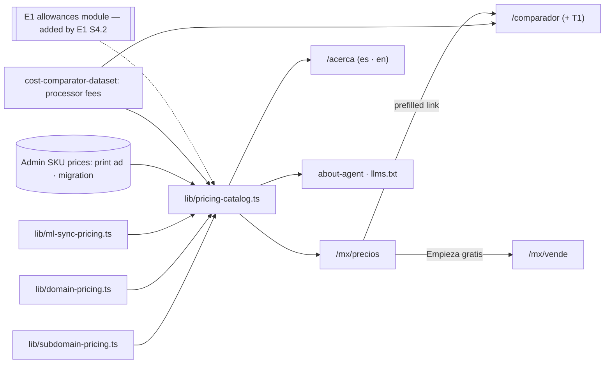

# Pitch — Pricing page

Moves · Tests: not grounded — no strategy yet

> **Source:** the v2 T1 strategy review (<https://claude.ai/artifact/7cAUeEp16jVNLigE9tkUVj>), section 9 (parity
> ledger: "Pricing page — tiers and a comparison table. None; /comparador exists. Build") and section 10 (E2 ·
> Pricing page and positioning, low, parallel with E1).

## The ask, as given

> Then lets do a feature parity check, including landing pages and communications.

> merged, lets refine e2

> (Plan questions, 2026-10-27) Hero line: Ship it with E1 · T1 compare: Yes, add T1 · AI row: When E1 ships ·
> Appetite: M

### Claims
1. A pricing page exists, as T1 has one (the parity ledger's "Pricing page" row).
2. It links to the comparador we already have.
3. T1 is added to the comparador with its public rates, sourced and dated.
4. The new hero line ships with E1's describe box, not here.
5. The AI allowances appear on the page only once E1 ships photo → product.
6. Every surface that states a price reads one source: the page, `/acerca`, agents, the comparador.

**Teach-back:** yes — "You want a public `/mx/precios` page so a merchant comparing us against T1 sees, in one
place, what's free, what costs extra and what the payment processor charges — reading one price source, with T1
added to the comparador. Right?" (Daniel answered the four plan questions that follow from it.)

## Problem

T1 has a pricing page with tiers (Gratis, Básico $399/mes, Avanzado $1,499/mes, Enterprise) and a comparison
table; we have none. A merchant who heard "0% comisión" has to find `/acerca` to learn what anything costs, and
even there the copy is **typed by hand** (`lib/about-content.ts` re-types "$199 MXN/año" and "$499 MXN/año"
instead of reading `lib/subdomain-pricing.ts` / `lib/domain-pricing.ts`) and **leaves out** Mercado Libre sync,
the print ad and the migration. Agents are worse off: `lib/about-agent.ts` tells them premium services are
"priced TBD". The comparador, our strongest pricing argument, compares four platforms and not the one this whole
wave answers.

## Appetite

**M** — two capability sprints (WAYS-OF-WORKING → *Betting & appetite*). Fixed appetite, variable scope: if it
runs out, cut the FAQ and the JSON-LD offers first, never the one-source rule or T1 in the comparador.

quote: $20–120 (M, n=1, wide)

## Outcome & signal

**After this ships:** `miyagisanchez.com/mx/precios` says, in plain es-MX and on a phone: selling is free with 0%
platform commission; here is everything that's free forever; here are the optional extras with their real
monthly and yearly prices; here is what your payment processor (not us) charges, money straight into your
account; and here is how that compares with T1 and the others, one tap into the comparador already prefilled.
`/acerca`, the agent "about" surfaces and the comparador's Miyagi column all read the same numbers.

**How Daniel tests it:** the smoke walkthrough at the end of each sprint (real URLs).

**Measured by (GTM `dataLayer` via `lib/analytics-events.ts`):** `precios_viewed` → `precios_comparador_clicked`
→ `precios_signup_clicked`; the comparador's existing `ComparadorAnalytics` events carry on, and a T1 comparison
is visible as its platform value.

## Stage-2.5 bucket

**Light enhancement on top of existing pieces.** The prices already have single-source modules, the comparador
exists with a cited dataset, and `/acerca` already has a pricing section. What's new is the dedicated page, one
catalog that every surface reads, and a fifth platform in the comparador.

## Bill of materials (What / Why)

| What | Why |
|---|---|
| `lib/pricing-catalog.ts`: one pure assembly of every price row from the existing sources | One truth; a price change in one file reaches every surface |
| `/mx/precios` page: free · extras · processor fees · compare | The parity gap T1's tier page exposes |
| Live admin prices for the print ad and the migration, hidden when unset | They're admin-configured; never a "$0" or a placeholder |
| Processor-fee block (Stripe, Mercado Pago, SPEI) with sources | "Sin comisión" means no platform cut, not free cards: say so plainly |
| `/acerca`, `lib/about-agent.ts`, `llms.txt` read the catalog | Fixes the hand-typed copy and the agents' "priced TBD" |
| A source-sweep spec for hand-typed SKU prices | The drift happened once already; a guard keeps it from recurring |
| T1 in the comparador dataset + `computeT1Cost` + picker | The comparison this wave is about |
| Footer «Precios», sitemap entry, links from `/mx/vende` and the comparador | People and crawlers can find it |
| Funnel clicks | Know whether the page sends people onward |

## Scope

**In v1:**
- `/mx/precios`, es-MX, mobile-first, indexable, in the sitemap, with its own OG image.
- One pricing catalog read by the page, `/acerca` (both locales, it is on the bilingual allow-list), the agent
  about surfaces and `llms.txt`.
- T1 as a fifth comparador platform: tiers, card and SPEI fees, the free tier's monthly order cap, the extra fee
  on external methods, all cited with `verifiedAt`.
- A footer link, a sitemap entry, a link from the `/mx/vende` page sections and a back-link from the comparador.

**Out of v1 (no-gos):**
- **No new prices, tiers or plans.** This page shows what we charge today; pricing changes are a separate call.
- **The hero line** — moved into E1 S2.2 (Daniel, 2026-10-27).
- **The AI allowance row** — added by E1 S4.2 when photo → product is live (Daniel, 2026-10-27).
- **No US / English pricing page** (`/us` is a follow-up); `/acerca`'s English copy is updated only because it
  already exists.
- **No invented proof numbers**, no "X tiendas" counters, no testimonials.
- **No grandfathered-shop mention** (the subdomain grandfathering stays silent, per `lib/subdomain-pricing.ts`).
- **No checkout changes**: every "Contratar" link goes to the existing upsell or sign-up path.
- **No feature flag** (WAYS-OF-WORKING default; rollback is `git revert`).

## Rabbit holes

1. **Hand-typed prices drift.** They already did (`/acerca`, agents). The catalog is the only place copy gets a
   number from; a source-sweep spec fails on a `$<n> MXN` literal in public copy (`locales/*.json`,
   `lib/about-content.ts`, `/mx/vende` page config) that the catalog doesn't produce. **Allow the negation:**
   competitor figures in the comparador dataset and interpolated catalog values pass, so the guard never rejects
   correct output.
2. **Admin-configured prices.** The print ad (per tier) and the migration (flat or quoted) come from
   `getPromoterSkuPrices()`. Unset shows «Precio a cotizar» with a contact path, never "$0" — the same degrade
   pattern `/mx/vende/migracion` already uses.
3. **Caching a page that reads admin prices.** A dataless page without `revalidate` was pinned for a year at the
   CDN (team memory). `/mx/precios` sets an explicit `revalidate` (one hour) so an admin price change appears
   without a deploy, and the no-JS spec checks the served HTML.
4. **"Sin comisión" honesty.** Card fees exist and sit in the same band as T1's 3.5% + $1. The processor block
   names who charges what and that the money lands in the merchant's own account; it never implies cards are
   free.
5. **T1's rates change.** Every T1 figure carries its source URL and `verifiedAt` like the other four; the
   comparador's footnote already tells people to confirm. Model only public rates (tiers, card %, fixed fee, SPEI,
   the extra on external methods, the free tier's order cap); never T1's negotiated freight or fleet.
6. **The comparador is 824 lines of per-platform branches.** Adding T1 touches the picker, the label switch, the
   URL codec and the analyze route; follow the Tiendanube addition's shape and extend `comparador*.spec.ts`
   rather than refactor.
7. **Collision with E1 on `/mx/vende`.** E1 S2.2 rewrites the hero; this epic only adds a pricing link in the
   page sections and the footer. Keep the edits in different components so either merges first cleanly.
8. **JSON-LD.** `Offer` entries only for fixed-price SKUs; variable-price ones are left out rather than given a
   made-up price.

## What already exists (reuse, don't rebuild)

| Primitive | Where | Use |
|---|---|---|
| Subdomain price | `lib/subdomain-pricing.ts` ($199/yr, $25/mo, labels) | Catalog row |
| Custom domain price | `lib/domain-pricing.ts` ($499/yr, ~$42/mo, labels) | Catalog row |
| Mercado Libre sync price | `lib/ml-sync-pricing.ts` ($299/yr, $30/mo, labels) | Catalog row |
| Admin-set SKU prices | `getPromoterSkuPrices()` (print ad per tier, migration) — as `/mx/vende/migracion` reads it | Live catalog rows |
| SKU vocabulary | `lib/promoter-skus.ts` (`PROMOTER_SKUS`) | The catalog's completeness check |
| Comparador dataset + compute | `lib/cost-comparator-dataset.{json,ts}`, `lib/cost-comparator.ts`, `lib/cost-comparator-url.ts`, `app/api/comparador/analyze` | T1 as a fifth platform |
| Comparador UI | `app/(shell)/comparador/_components/ComparadorTool.tsx` | The T1 picker |
| Processor fees | dataset `miyagi.payment.pct` / `fixedMxn` (Stripe MX, cited) | The processor block |
| About pricing section | `lib/about-content.ts` (`pricing`), `lib/about-agent.ts` | Re-pointed at the catalog |
| Page shell + OG pattern | `/mx/vende/*` (`opengraph-image.tsx`, metadata, JSON-LD) | `/mx/precios` structure |
| Sitemap | `lib/market-sitemap.ts` (`PLATFORM_SITEMAP_ENTRIES`) | New entry |
| Footer | `app/components/PlatformShell.tsx` | «Precios» link |
| Specs | `e2e/comparador*.spec.ts`, `e2e/seller-acquisition-seo.spec.ts`, `e2e/about-acerca.browser.spec.ts` | Extended, not rewritten |
| Analytics | `lib/analytics-events.ts` | Funnel clicks |

**AGENTS rules check:** no commerce data moves (rule 1); no Supabase table (rule 2); agents gain correct pricing
through the about surfaces and `llms.txt` (rule 3, a fix); no auth change (rule 4); es-MX page, with `/acerca` kept
bilingual because it already is on the allow-list (rule 5).

## Visuals

**System context**



**The page (one block per state)**

```surface
state: precios-default
route: /mx/precios
- head "Vender es gratis. Pagas solo lo que tú eliges."
- lead "0% de comisión de la plataforma. Tu dinero llega directo a tu cuenta."
- section "Gratis, siempre": tu tienda y su URL · publicar sin límite · el marketplace · ofertas y mensajes · agentes de IA · entrega acordada y Correos de México
- section "Extras opcionales": cards for Subdominio · Dominio propio · Sincronizar con Mercado Libre · Anuncio impreso · Migración con consultor — each with monthly/yearly price and one line on what it does
- section "Lo que cobra tu pasarela (no nosotros)": Stripe · Mercado Pago · SPEI, each with its rate, source and date
- section "¿Y contra T1 y los demás?": a short line + action secondary "Compara con tus números" → /comparador?platform=t1
- action primary "Empieza gratis" → /mx/vende
- faq (short): ¿Hay planes? · ¿Qué pasa si cancelo un extra? · ¿Por qué no cobran comisión?
```

```surface
state: precios-admin-price-unset
route: /mx/precios
- the Anuncio impreso / Migración card shows "Precio a cotizar" + "Escríbenos" instead of a number
```

```surface
state: comparador-t1
route: /comparador?platform=t1
- picker gains "T1" with tier chips Gratis · Básico · Avanzado
- lines: suscripción · comisión por tarjeta (3.5% + $1) · SPEI · cargo extra por métodos externos (planes de pago)
- the Gratis tier notes its monthly online-order cap
- every figure shows its source and verified date, editable like the other platforms
```

## UX heuristics & rails check
- **CI guards covering this surface:** the no-JS SEO/marketing specs (`seller-acquisition-seo.spec.ts` pattern:
  substantive server HTML + OG), the comparador `api` specs, the Tailwind JIT arbitrary-value guard, the emoji
  guard, es-MX copy completeness, the new price source-sweep spec.
- **Audits-lens findings that apply:** none found for pricing; the v2 review's parity ledger is the source.
- **Design-language debt:** the comparador page uses inline styles; the new page uses the shared `Card` / `Button`
  / `badge` classes and Iconoir, no emoji.

## Kill-switch / runtime gate (risk:high only — Stage 6b)

**None — low risk, carve-out.** WAYS-OF-WORKING → *Feature flags — OFF by default*: no flag unless the product
owner names one; rollback is `git revert`. Measure: product-analytics clicks above, not a Golden measurement.

## Decisions at plan time (Daniel, 2026-10-27)

- **Hero line → E1 S2.2**, so the claim goes live with the describe box.
- **T1 joins the comparador**, cited and dated like the other four.
- **AI allowances row → E1 S4.2**, once photo → product is live.
- **Appetite M.**

## Slices

| Sprint | Capability | Stories (risk) |
|---|---|---|
| **S1 · One price source + `/mx/precios`** | Every surface reads one catalog; the page is live | S1.1 `lib/pricing-catalog.ts` + source-sweep spec (low) · S1.2 `/mx/precios` page, OG, JSON-LD, sitemap (low) · S1.3 `/acerca`, `about-agent`, `llms.txt` read the catalog (low) · S1.4 footer, `/mx/vende` and comparador links + funnel clicks (low) |
| **S2 · T1 in the comparador** | The comparison this wave answers | S2.1 T1 figures in the dataset + `computeT1Cost` + URL codec + analyze route (low) · S2.2 T1 picker in `ComparadorTool` + the prefilled link from `/mx/precios` (low) |

## Acceptance criteria

- **S1** — `/mx/precios` returns server HTML with all four sections and real prices (no JS needed); each extra's
  price equals its source constant (a pure spec over the catalog); an unset admin price shows «Precio a cotizar»,
  never $0; the page has `revalidate` set and is in the sitemap; `/acerca` (es and en) and the agent about text
  show the same prices, and "TBD" is gone; the source-sweep spec fails when a hand-typed `$199 MXN` is added to
  public copy and passes on the catalog-interpolated one (observed both ways); the footer shows «Precios» on
  every shell page; the three funnel clicks fire once each.
- **S2** — `/comparador?platform=t1&tier=basico&volume=100&aov=500` renders T1's totals in the initial HTML;
  every T1 figure has a source URL and `verifiedAt`; switching T1's tier changes the subscription line; the
  Gratis tier states its order cap; a shared "Copiar enlace" restores a T1 comparison exactly; the link from
  `/mx/precios` opens the comparador on T1.

**QA stage per sprint:** pure specs on `lib/pricing-catalog.ts` and `computeT1Cost`, each observed failing under a
mutation; `api`-project specs for `/mx/precios` server HTML and the T1 prefill; a phone browser smoke per sprint
(owed to Daniel, no money or auth steps).

## Open risks / research

- **T1's public rates** were read on t1.com/mx on 2026-10-27 (v2 review): Gratis with 30 online orders a month,
  Básico $399/mes, Avanzado $1,499/mes, cards 3.5% + $1, SPEI $3, +2% on external methods for paid tiers. The
  builder re-verifies each against T1's pricing page on build day and records `verifiedAt`.
- **Mercado Pago's MX rates** aren't in the dataset yet; S1.1 adds them with source and date.
- **Mercado Libre sync, print ad, migration** may have promoter-only prices; the page shows the regular price only.

## Intent match

_Advisory and uncalibrated (intent-match D1, D3): it can add a step, never block one. Regenerate with `node scripts/intent-match.mjs <this seed> --write`._

```text
Intent match — Roadmap/00-ideas/seeds/pricing-page.md
  coverage in   0.86  (6 claims)
  coverage out  0.90  (2 criteria)
  clarity       0.86  (2 criteria)
  teach-back    1.00  (yes)
  agreement     pending  (the optional reader at the architecture lock)
  why story     0.68  (advisory, not in the total)
Total 90 / 100 — uncalibrated · signals: coverage in, coverage out, clarity, teach-back
Band: build (placeholder bands: 80 build · 60 resolve follow-ups · below 60 sketch or spike)
Gaps: none
```

<!-- intent-match: {"coverage_in":0.865,"coverage_out":0.895,"clarity":0.857,"teach_back":1,"total":90} -->
