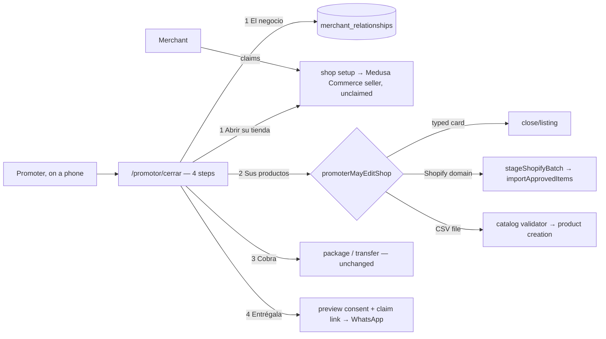
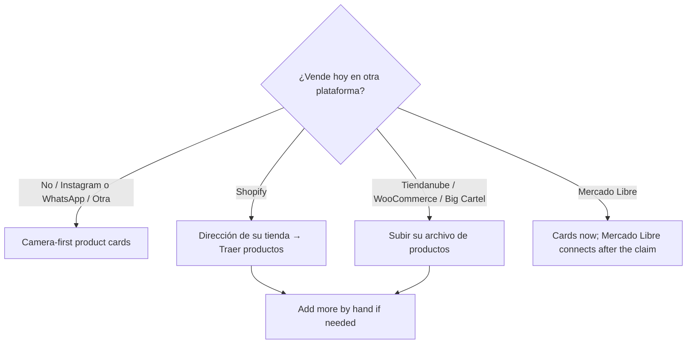

# Pitch — El panel del promotor: open a shop in one visit, manual-first, in four steps

Moves · Tests: not grounded — no strategy yet

## The ask, as given

> ok thats was great, it looks fantastic. now lets focus on the promoter experience, i'll go back to each of your items afetr that or if something is related let me know. Please walk me through the promoter experience once they are on /promotor/cerrar and enter their code. They get two forms one seemengly for lead capturing and the other to open a shop by manually entering the details, if they do fill out shop details they can click the button to continue and now they are shown the agregar anuncios form which allows for them to upload a picture and generate the shop from it. but im not sure at all about this process now. Remind me where did we land on enabling the prompt to shop feature for promoters? and if we are providing inference to build the shop from a picture might as well be easier to have the prompt to shop feature expanded to use both, i mean allow users to upload a picture of their shop or describe it in the main landing page for the selve serve route, seems like we have both capabilities just on two different places. But, in fact what i want to discuss is about the promoter flow, if we do facilitate the new prompt/picture for them then we would be paying for that labor in tokens. Im thinking of letting them create the shop more manually via the forms, what do you think? obviously if larger catalog, enable file import. This form also has fields for url de origen and plataforma de origen, both free text, do they have any automated effect? i seem to remember at some point we implemented some sort of auto migration from shopify, maybe im fully wrong and im remembering something else, just refresh my mind and if is in fact a feature do promoters have access to it or how would the handle migrations from other platforms? Validate the rest of the process to create the shop isnt as cumbersome since we are making it manual for promoters this way. Only specific fields fully needed for open text should be left like that, the rest should have always options available to select from, even at lead capture form and beyond, all to make the process easier and aligned with the patform. The ui feels a bit off, like the buttons dont seem clickable, they dont change the pointer on hover either for example, the upload a picture button was almost invisible.
>
> oh i just noticed that the buttons that seem unclickable also show on /admin/promoter , not sure whats up. and btw the /promotor/cerrar copy overall was written without much care, lets polish it up as many words dont make sense and the language throughout and how things are explained need polish and intention behind
>
> 1. yes 2. keep it blocked

### Claims
1. The promoter flow after entering the code is simpler: no duplicated lead and shop forms.
2. Promoters create shops manually through forms; we don't pay tokens for a promoter's labour.
3. A larger catalog can be brought in by file import (and Shopify, which already exists).
4. The «URL de origen» / «Plataforma de origen» fields are explained, and removed or made useful.
5. Every field that isn't truly free text is a selection, from lead capture onwards, aligned with the platform's own options.
6. The buttons look and act clickable, and the photo upload is clearly visible, in the workspace and in /admin/promoter.
7. All the /promotor/cerrar copy is rewritten with care and intention.
8. A promoter may never sell a package to a shop they own (self-close stays blocked).

**Teach-back:** yes — "You want a promoter at the counter to open a merchant's shop in one visit, typing as little as possible and choosing from the platform's own options, so the packages actually get sold. Right?" (Daniel approved planning it: "1. yes")

## Problem
The workspace is the only place the promoter packages get sold, and it was built step by step across five epics.
Measured in the code on 2026-11-05, with all four promoter flags ON in production:
- **Six steps**, two of which ask for the same name, location and email («Datos del comercio», then «Abrir la tienda»).
- **Free text where the platform has options:** business category (never filled in any of the 29 lead rows), municipality, and «Plataforma de origen». That last one is pre-filled with "shopify", so every promoter product is labelled as coming from Shopify, and neither origin field does anything.
- **Products one at a time**, with an image-URL box nobody uses at a counter and the browser's bare file picker.
- **No import for a merchant who already sells online.** The Shopify connector and the file import work only in the merchant's own panel. The migration guide sends promoters there, but an unclaimed shop has no panel.
- **Copy written as an internal tool:** «Captura lo que sepas del comercio ahora mismo», «Notas de encaje», «Vista previa privada y activación», «Guardar anuncio privado».
- **Raw Tailwind instead of the site's components.** The pointer cursor was fixed site-wide in #478; the washed-out outline buttons and the bare file picker remain, here and in /admin/promoter.
- **An open authorization gap:** `/api/promoter/close/listing` checks only that a shop exists. Any promoter account could add products to any merchant's live shop with a hand-made request (pr-reviewer, #475).

## Appetite
M — one epic run of four sprints. This is a rebuild of one workspace on top of what exists, not a new system.
quote: $27–40 (M, n=3, p25–p75)

## Outcome & signal
A promoter at a counter opens a shop in four steps:
- **El negocio:** one form, mostly dropdowns.
- **Sus productos:** typed quickly with the camera, or imported from Shopify or an export file.
- **Cobra:** take the payment.
- **Entrégala:** hand over the shop.

**Daniel's test:** open a test shop on his phone in under 10 minutes, with 3 products, choosing instead of typing wherever there is a choice. Every screen should read like the promoter page.

## Stage-2.5 bucket
**Light enhancement over existing parts.** Nothing new is invented:
- The forms, the shop setup, the product creation, the Shopify staging, the file validator, the postal lookup, the business types and the catalog categories all exist.
- The work is merging, replacing free text with existing option lists, letting promoter routes call the import primitives on shops they opened, the ownership guard, the copy, and the components.

## Bill of materials (What / Why)

| What | Why |
|---|---|
| One «El negocio» form (replaces «Datos del comercio» + «Abrir la tienda») | The promoter types the merchant's data once |
| Dropdowns from the platform's own lists: postal code → colonia/municipio/estado, `BUSINESS_SHAPES`, catalog categories, channels, qualification, «¿Vende hoy en otra plataforma?» | Choosing is faster than typing, and the data lines up with the rest of the platform |
| «¿Vende hoy en otra plataforma?» stored in `merchant_relationships.current_channels` (existing column) | It decides step 2's path, and the lead records where the merchant sells today |
| Remove «URL de origen» / «Plataforma de origen» | They did nothing and mislabelled every product as Shopify |
| Camera-first product cards (one big «Tomar foto» button, then name, price, stock, category) | Manual and quick, with no tokens spent |
| «Llenar los datos con la foto» kept as an optional small link | It costs about a tenth of a cent a photo, capped at 60 a day, and saves the promoter's minutes. It is one switch away from removed |
| Promoter Shopify import into the shop they opened (reuses `stageShopifyBatch` + internal product creation) | A merchant on Shopify has their whole catalog in one step, at no token cost |
| Promoter file import (CSV from Tiendanube, WooCommerce, Big Cartel) through the existing validator | A larger catalog arrives without typing, and without the AI extractor |
| `promoterMayEditShop` guard: opened by this promoter and not yet claimed, on the listing, photo and import routes | Closes the gap where any promoter could write to any shop, and makes imports safe |
| Stepper «1 El negocio · 2 Sus productos · 3 Cobra · 4 Entrégala», built with the site's `btn` / `card-panel` | The promoter always knows where they are, and buttons look like buttons |
| Import rule: up to 150 products included in every package; more than 150 (or a «muy personalizada» store) → the paid «Migración con consultor» with its quote, as today | Importing while opening the shop is part of «le armas su tienda»; the paid service stays for done-for-you big catalogs (Daniel, 2026-11-05) |
| «El recibo del negocio»: at Cobra, «Mandarle su recibo» opens WhatsApp with a written message to the owner's number, the email goes out at the same moment, and both link to a receipt page with the status (Activo / Pendiente: Miyagi Sánchez está confirmando el pago) and «¿Algún problema? Escríbenos» | Today the owner gets nothing when they hand over the money, the only receipt is an email sent when OUR share settles (days later by transfer), and they can't see whether a promoter paid us (Daniel, 2026-11-05) |
| The copy below, every label, hint, button and error | Daniel: "words don't make sense… need polish and intention" |
| /admin/promoter rebuilt on the same components | Same washed-out buttons today |

## Scope

**In (v1):**
- The four-step panel at `/promotor/cerrar` (the address stays), with all copy rewritten.
- The merged form, dropdowns, origin fields removed.
- Camera-first product cards.
- Shopify and CSV import for the shop the promoter opened.
- The ownership guard.
- The private preview and consent kept, folded into «Entrégala».
- `/admin/promoter` component pass.
- The «Mis negocios» link (`/promotor/relaciones`) reworded to match.

**Out:**
- Describe-your-business AI for promoters.
- A photo/describe choice on the self-serve landing (its own seed: `landing-photo-or-describe`).
- Mercado Libre import by promoters: it needs the merchant's own Mercado Libre login, so it happens after the claim, from the merchant's panel.
- Renaming the `/promotor/cerrar` address.
- Offline-first saving beyond what exists.
- Any change to commissions, packages or payments (the «Cobra» step logic is untouched).
- A merchant paying by card through Miyagi Sánchez: saved as its own idea, `merchant-pays-promoter-by-card` (Daniel, 2026-11-05).
- Self-close: it stays blocked (Daniel, 2026-11-05).
- Writing to claimed shops: after the claim, the merchant adds products from their panel.

## Rabbit holes
- **Lead vs shop records.** Today the relationship row and the shop are created by two routes and linked later. Keep both records and both routes; only the FORM merges. «Guardar para después» writes the relationship; «Abrir su tienda» writes the relationship, then the shop, and links them, exactly as today in sequence.
- **Import review.** The seller flow stages a batch, then imports the rows the user selects. For promoters, show the count and the first few products and import all of them on one confirm. No per-row editing: the merchant can edit after the claim.
- **CSV columns differ per platform.** Use the existing validator and its column mapping only. A file it can't read gets «No pudimos leer este archivo. Pídele que lo descargue otra vez desde su plataforma.», never a guess.
- **Private preview.** Imported products are private until consent, like typed ones (`shopMustStayPrivate`).
- **Copy drift.** All copy goes in `locales/es.json` under one `promotorPanel` block, mirrored in `en.json`. No strings in components, so the next polish is one file.

## What already exists (reuse, don't rebuild)
- **The workspace:** `app/(shell)/promotor/cerrar/{page,PromoterCloseClient,RelationshipStep,ListingStep,PreviewStep}.tsx`.
- **Lead:** `/api/promoter/relationship*`, `merchant_relationships` (has `category`, `current_channels`, `preferred_channel`, `qualification` with CHECKs), `lib/preferred-channels.ts`, `lib/relationship-access.ts`.
- **Shop:** `/api/promoter/shop/setup` (mints an unclaimed Medusa Commerce seller with a `promoter://` source), `/api/checkout/postal-lookup`, `lib/mx-locations.ts`.
- **Products:** `/api/promoter/close/listing` (`createSellerProductViaInternal`, `syncSupabaseListingMirror`), `/api/promoter/close/photo`, `lib/promoter-listing-contract.ts`, `CATALOG_CATEGORY_KEYS`.
- **Imports:** `lib/shopify-import-bridge.ts` (`stageShopifyBatch(shop, domain)`, SSRF-guarded in `lib/shopify-mcp-client.ts`), `lib/supply-import.ts` (`importApprovedItems`), the file validator behind `/api/sell/import` (`lib/catalog-import.ts`), the export guides at `/vende/migracion`.
- **Lists:** `lib/business-shape.ts` (`BUSINESS_SHAPES`), catalog categories, `PREFERRED_CHANNEL_LABEL`, `QUALIFICATION_LABEL`.
- **Access:** `lib/promoter-shop-access.ts` (`promoterMayCloseShop`), `lib/promoter-close.ts` (`promoterOpenedShop`, `isSelfOwned`).
- **Components:** `.btn`, `.card-panel`, `Banner`, the design tokens in `app/globals.css`.
- **Pay and hand-off:** the «Cobra» step, `PreviewStep`, `/api/promoter/claim/link`.

## Visuals

System context: who touches what.



Step 2's path follows the answer to «¿Vende hoy en otra plataforma?»:



## The copy (es-MX, the voice of the promoter page)

**Header:** «Tu panel de promotor» · «Abre la tienda de un negocio en una sola visita.» · `PRM-XXXX · Nombre`
**Stepper:** «1 El negocio · 2 Sus productos · 3 Cobra · 4 Entrégala»

**Code screen**
- Title: «Pon tu código de promotor»
- Hint: «Te lo mandamos por correo cuando te aprobamos. Empieza con PRM-.»
- Button: «Entrar a mi panel»
- Error: «Ese código no existe o ya está en otra cuenta. Revísalo o escríbenos.»

**1 · El negocio**
- Lead: «Lo que te cuente el dueño. Solo necesitas el nombre del negocio y su WhatsApp.»
- **Fields:**
  - «Nombre del negocio»
  - «Nombre del dueño (opcional)»
  - «WhatsApp del dueño»
  - «Código postal» → «Colonia» (the municipality and state fill themselves)
  - «¿Qué vende?» Productos · Servicios · Comida · Hecho a pedido · Rentas · Digital
  - «Categoría principal» (the catalog categories)
  - «¿Vende hoy en otra plataforma?» No, solo en su local · Instagram o WhatsApp · Mercado Libre · Shopify · Tiendanube · WooCommerce · Big Cartel · Otra
  - «¿Por dónde prefiere que le hablen?» WhatsApp · Llamada · Correo · Instagram · En persona
  - «¿Qué tan interesado está?» Muy interesado · Lo está pensando · Poco interesado · No le interesa
  - «Notas», placeholder «Lo que te dijo: dudas, horarios, lo que le preocupa»
- **«Más datos» (folded):** «Correo del dueño», «Instagram»
- **Buttons:** «Abrir su tienda» (primary) · «Guardar para después»
- **Messages:**
  - Saved: «Guardado. Lo encuentras en Mis negocios cuando vuelvas.»
  - Same WhatsApp found: «Ya tienes un negocio con ese WhatsApp: «{nombre}». ¿Es el mismo?», with «Sí, seguir con ese» · «No, es otro»
  - Shop created: «Listo, la tienda de {nombre} ya existe. Está en privado hasta que el dueño la apruebe.»

**2 · Sus productos**
- **Typed (no other platform):**
  - Lead: «Toma la foto, pon el precio y guarda. Con 3 productos su tienda ya se ve viva.»
  - Upload buttons: «Tomar foto» (big, opens the camera) · «Elegir de la galería»
  - Fields: «Nombre del producto» · «Precio» · «¿Cuántos tiene?» · «Categoría»
  - Optional link: «Llenar los datos con la foto»
  - Button: «Guardar producto»
  - Counter: «{n} productos en su tienda»
  - After saving: «Guardado. ¿Otro?»
- **Shopify:**
  - Lead: «Trae su catálogo de Shopify completo. Solo escribe la dirección de su tienda.»
  - Field: «Dirección de su tienda» (ej. mitienda.com)
  - Button: «Buscar sus productos»
  - Result: «Encontramos {n} productos.», with button «Agregar los {n} a su tienda»
  - Error: «No pudimos leer esa tienda. Revisa la dirección con el dueño.»
- **Tiendanube / WooCommerce / Big Cartel:**
  - Lead: «Pídele que descargue su lista de productos (un archivo .csv) desde su plataforma.»
  - Link: «Cómo descargarla»
  - Button: «Subir el archivo»
  - Result: «Leímos {n} productos.», with button «Agregar los {n} a su tienda»
  - Error: «No pudimos leer este archivo. Pídele que lo descargue otra vez desde su plataforma.»
- **Mercado Libre:** «Su catálogo de Mercado Libre se conecta después, desde su propio panel, cuando la tienda ya sea suya. Por ahora sube aquí sus productos principales.»
- **A claimed shop (the guard):** «Esta tienda ya es de su dueño. Pídele que agregue productos desde su panel.»

**3 · Cobra.** Keeps the copy shipped in #476: Cobras / Nos pasas / Te quedas, transfer first. Then the receipt:
- After «¿Ya te pagó?» → «Sí, ya me pagó», the button «Mandarle su recibo» opens WhatsApp with:
  «Hola {dueño}, soy {promotor} ({código}) de Miyagi Sánchez. Recibí {monto} por {opción} de {negocio}. Aquí ves tu
  recibo y el estado de tu plan: {enlace}»
- **Receipt page** (`/recibo/{token}`), for the owner:
  - Title: «Recibo de {negocio}»
  - Lines: «Pagaste {monto} a {promotor} ({código}) el {fecha}.» · «Por: {opción}.»
  - Status:
    - «Activo: tu Plan Negocio está encendido hasta el {fecha}.»
    - «Pendiente: Miyagi Sánchez está confirmando el pago de tu promotor. Te avisamos cuando quede activo.»
    - «Listo: tu tienda en el Plan Gratis ya está armada.»
  - Help: «¿Algún problema con tu pago? Escríbenos» (WhatsApp/correo de Miyagi Sánchez).

**4 · Entrégala**
- Lead: «Enséñale cómo quedó y mándale su enlace. Con un toque, la tienda queda a su nombre.»
- Buttons: «Ver su tienda» · «Mandar por WhatsApp» · «Copiar enlace»
- Consent: «El dueño vio su tienda y está de acuerdo» → «Aprobada: ya puede publicarse.»
- Done: «Listo. Cuando abra el enlace, la tienda queda a su nombre, y tú ves cómo va en Mis negocios.»

**Errors (everywhere):** «No se pudo guardar. Revisa tu conexión e intenta otra vez.» Never a raw status or English.

## UX heuristics & rails check
- **Mobile-first, one hand:** primary actions full width at the bottom of each step, camera as the first control in step 2, and inputs with the right `inputMode` (`tel`, `numeric`, `url`).
- **Choose over type:** every closed set is a `<select>` or chips. Free text stays only for the business name, the owner's name, the product name and notes.
- **Rails:**
  - The pointer-cursor rule (#478).
  - The design tokens.
  - `e2e/pricing-source-sweep.spec.ts`, so no typed prices.
  - The dictionary contract, so es/en stay in shape parity.
  - The no-cerrar copy spec from #476, extended to `promotorPanel`.
- **Accessibility:** labels on every input (not placeholder-only, as today), visible focus, and buttons as real `<button>`s.

## Kill-switch / runtime gate (risk:high only — Stage 6b)
- **Measure:** no flag. Daniel's operating posture adds no new flags unless he asks. Adoption is read from existing data: products per promoter-opened shop on day 0, from `marketplace_listings` + `merchant_relationships`.
- **Safety:** `promoter.enabled` already gates the whole workspace (ON). The import routes sit behind it plus the existing `migrations.connector_enabled` (ON). No new switch.

## Import rule (Daniel, 2026-11-05)
- Up to `MIGRATION_FLAT_LISTING_CAP` (150) products: imported while opening the shop, included in every package.
- More than 150: the panel imports the first 150 and says «Encontramos {n} productos. Agregamos aquí sus 150
  principales; para traer todo, ofrécele la Migración con consultor en el paso Cobra.» The paid migration, with its
  stored quote, stays the path for the rest.
- The merchant can always bring in the rest for free from their own panel after the claim.

## Acceptance criteria
1. After entering the code, the promoter sees four steps with a stepper, and never types the business name, location or email twice.
2. In «El negocio», only the business name, the owner's name and notes are free text. Location fills from the postal code, and the rest are dropdowns from the platform's lists. The answer to «¿Vende hoy en otra plataforma?» is saved on the lead.
3. «URL de origen» and «Plataforma de origen» are gone. New promoter products carry no `source_platform: shopify` unless they really came from Shopify.
4. «Tomar foto» opens the phone camera, and a product saves with a name, price, stock and category. «Llenar los datos con la foto» is optional.
5. A Shopify merchant's catalog is brought into the shop the promoter just opened in one confirm. A Tiendanube / WooCommerce / Big Cartel CSV is read by the existing validator and imported in one confirm. Both stay private until consent.
6. A promoter can add products, use the photo fill or import ONLY on a shop they opened that no merchant has claimed. Any other shop gets 403 and the copy above. A spec proves a hand-made request to another shop is refused.
7. A promoter still can't sell a package to a shop they own.
8. Every visible string in the panel comes from `promotorPanel` in the locales and reads like the copy above. No «cerrar / cierre», no English, no raw errors.
9. The panel and `/admin/promoter` use the site's buttons and cards. The upload is a visible button.
10. Daniel opens a test shop on his phone with 3 products in under 10 minutes.
11. An import of more than 150 products adds 150 and points to the paid migration, and never imports more without it.
12. At Cobra, «Mandarle su recibo» opens WhatsApp to the owner's number with the written message and a receipt link,
    and the email (when there is one) goes out at that moment. The receipt page shows the amount, the option, the
    promoter, and the status (Activo / Pendiente / Listo), with a way to reach Miyagi Sánchez. It never shows another
    shop's receipt (an unguessable signed token), and it moves from Pendiente to Activo when the transfer is approved.

## Open risks / research
- **Shopify through promoters.** The connector reads public Shopify stores; promoter use widens who can trigger a pull. Mitigations:
  - the existing SSRF guard;
  - a per-promoter rate limit;
  - the import lands only in the promoter's own unclaimed shop.
- **CSV export formats change.** Rely on the validator's mapping; unknown files fail clearly.
- **Merging the forms.** The relationship's `stage` and `intake_complete` rules must keep working. Read `lib/merchant-stage.ts` at the lock.

## Intent match

_Advisory and uncalibrated (intent-match D1, D3): it can add a step, never block one. Regenerate with `node scripts/intent-match.mjs <this seed> --write`._

```text
Intent match — Roadmap/00-ideas/seeds/promoter-panel.md
  coverage in   0.95  (8 claims)
  coverage out  0.83  (10 criteria)
  clarity       0.80  (10 criteria)
  teach-back    1.00  (yes)
  agreement     pending  (the optional reader at the architecture lock)
  why story     0.66  (advisory, not in the total)
Total 90 / 100 — uncalibrated · signals: coverage in, coverage out, clarity, teach-back
Band: build (placeholder bands: 80 build · 60 resolve follow-ups · below 60 sketch or spike)
Gaps: none
Untraced (trace it to the ask or cut it):
  criterion 6 (0.45): "A promoter can add products, use the photo fill or import ONLY on a shop they opened that…"
```

<!-- intent-match: {"coverage_in":0.954,"coverage_out":0.827,"clarity":0.801,"teach_back":1,"total":90} -->
