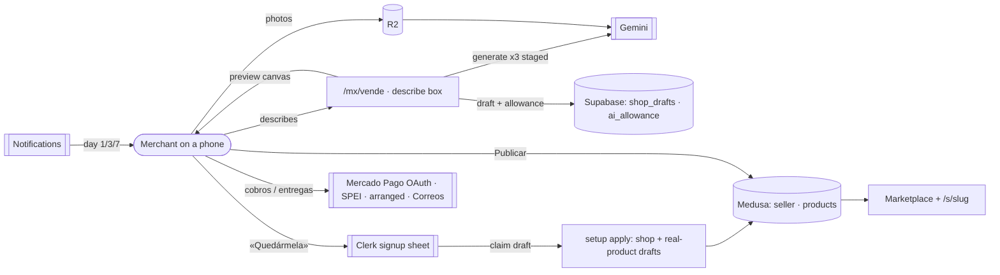
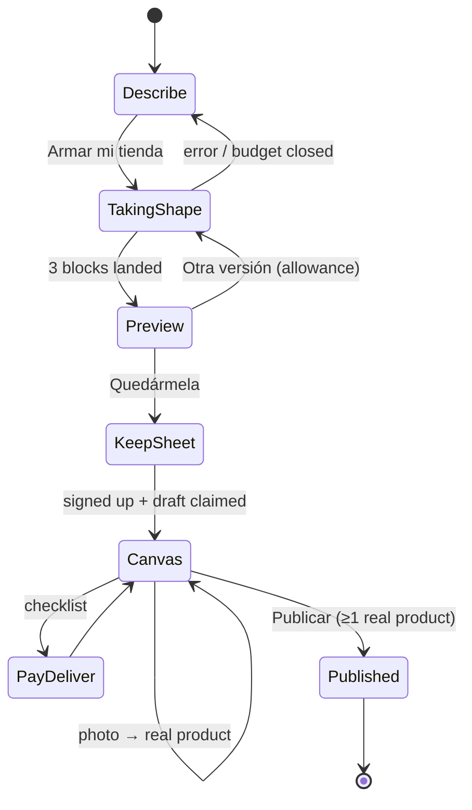

# Pitch — Prompt-to-shop

Moves · Tests: not grounded — no strategy yet

> **Source of the locked UX:** the v2 strategy review, section 3 "The merchant journey, screen by screen"
> (<https://claude.ai/artifact/7cAUeEp16jVNLigE9tkUVj>). The seven screens below are the **UX contract**:
> a builder may change implementation, never the sequence, the copy intent, or the rules in
> *UX contract — rules for the whole flow*.

## The ask, as given

> Hi Claude, i need to work as my product and design partner for the next project. We are matching the value proposition found in: https://www.t1.com/mx
> […] This means we would provide inference as one of the key features is from prompt to shop. Which is something we have already half made from the past, you'll see.

> 1. yes, show it before signup · 2. include samples · 3. i like the meter like t1, what do you think? · 4. gemini is fine for now
> What we must ensure in that merchant journey is making it as seamless and visual as possible so they see it shaped, even some default placeholders. Lets really nail the experience and what they see at each step. As you mentoned, reusing what we have is great, but some of the components might not have the best UX possible for this flow, all the way around, from language, feedback and overall ui.

> Yes — run refine on E1 prompt-to-shop, using the v2 journey (section 3) as the locked UX contract and the allowances in Q1 as defaults.

### Claims
1. We provide the inference ourselves: a merchant describes their business and we generate the shop (prompt to shop).
2. It builds on what we already half made (the agent-native setup pipeline) instead of starting over.
3. The shop is shown before signup.
4. The preview includes sample products / default placeholders.
5. Usage is metered, like T1 — as plain counts (3 versions before signup; 10 versions + 20 photo→product a month after).
6. Gemini is the model.
7. The journey is seamless and visual: the merchant sees the shop take shape at every step.
8. Language, feedback and UI are redone where today's components don't fit — reuse is welcome, but not at the cost of the experience.
9. The v2 journey (7 screens) is the locked UX contract.

**Teach-back:** yes — "You want a merchant to type what they sell and, within seconds and before any signup, see their own shop forming, keep it with one signup, make it real with photos, connect payments and delivery, and publish — all on one visual canvas in plain es-MX, reusing our setup pipeline underneath — so we match T1's front door and win on what happens after. Right?" (Daniel approved the journey that states this, then asked to refine it.)

## Problem

T1 (t1.com/mx) leads every product page with a free "Describe tu negocio y crea tu tienda con IA" box. Our AI
setup is **bring-your-own-agent**: we hand the merchant a prompt to paste into Claude/ChatGPT, then a JSON file
to paste back. That works for the agent-literate and loses everyone else at step one. And our first run does
the work before the value: signup → two intake questions (`/sell/bienvenida`) → a choice of three doors
(`/sell/puertas`) → "Arrastra tu CSV o JSON aquí" → a review **table** (`SetupClient`) — the merchant approves
data without ever seeing their shop. Photos, the way a micro-merchant thinks of a product, aren't accepted
("fotos y capturas llegan pronto").

## Appetite

**L** — a multi-wave epic (WAYS-OF-WORKING → *Betting & appetite*): an architecture-locking pass, then five
capability-bounded sprints. Fixed appetite, variable scope: if it runs out, cut from S5's nudges and the
`/mx` secondary entry first, never from screens 1–5.

quote: $50–300 (L, n=0, wide)

## Outcome & signal

**After this ships:** on a phone, a stranger types one sentence on `/mx/vende`, watches a shop named and
coloured for them assemble block by block, edits it, taps «Quedármela», signs up in a sheet over the shop,
replaces the example products by uploading photos, picks how they get paid and deliver from visual choices,
and publishes — then sees their shop inside the marketplace and shares it in one tap. No JSON, CSV, prompt,
agente or borrador on that path.

**How Daniel tests it:** the smoke walkthrough at the end of each sprint (real URLs), ending with a full
blind run on a phone: describe → publish in under 10 minutes without reading any help.

**Measured by (product analytics, GTM `dataLayer` via `lib/analytics-events.ts`):** `p2s_describe_submitted`
→ `p2s_preview_rendered` → `p2s_version_requested` → `p2s_kept` → `p2s_real_product_added` →
`p2s_payments_connected` → `p2s_published` (first sale is already observable on orders).

## Stage-2.5 bucket

**Genuinely new surface on an already-possible pipeline.** Creating a shop + config + catalog from one setup
file in one pass is shipped (agent-native setup, three-doors onboarding). What's new: hosted inference, an
anonymous draft that renders as a real shop, the keep-it signup, photo → product, and a single visual canvas
that replaces the forms.

## Bill of materials (What / Why)

| What | Why |
|---|---|
| Hosted generation (Gemini) that writes the **existing** `MiyagiSetupFile` | We do the inference; one schema, one set of validators — no fork |
| Generation in **three staged calls** (identity → words → example catalog), each landing as a block | "Watch it take shape" without partial-JSON parsing |
| Anonymous **shop draft** (Supabase, outside Medusa, 7-day life, device cookie) | Show before signup without bots creating Medusa sellers |
| **Allowance ledger** with a conditional increment | Metering in plain counts; a double tap can't spend twice |
| Per-device + per-IP rate limits + Cloudflare Turnstile on generate | Inference costs money; the box is public |
| **Preview canvas** rendering the real storefront components from the draft | The merchant sees *their shop*, not a form |
| **EJEMPLO** example products: illustrated, suggested price, never in Medusa | Honest placeholders; nothing fake is ever buyable |
| Inline edits: name, colours (3 alternates), tone, another version | Shaping feels like play, not configuration |
| «Quedármela» signup **sheet** over the shop + draft → shop on auth | Signup is the reward, not the toll; no intake detour |
| Owner **canvas checklist** driven by `lib/setup-guide.ts` | One progress truth, already shared with Resumen |
| **Photo → product** (Gemini vision) replacing examples one by one | Micro-merchants think in photos |
| Visual **cobros / entregas** chooser + buyer-checkout preview | Logos and minutes, not settings |
| **Publish** moment: shop shown inside a marketplace card + one-tap shares | Our edge over T1: a shop with buyers, not an empty storefront |
| `/mx/vende` hero box + `/sell` first-run = the describe box | The front door, everywhere a merchant starts |
| Day 1/3/7 nudges on the merchant's chosen channels | Drafts that stall get a reason to come back |

## Scope

**In v1:**
- Screens 1–7 of the UX contract, mobile-first, es-MX, on the **MX market** (`/mx/vende`, `/sell`).
- Hosted generation, anonymous draft, allowance metering (3 pre-signup versions per device; 10 versions + 20
  photo→product per calendar month signed in), rate limits + Turnstile.
- Keep-it signup, draft → shop + real-product drafts on auth, owner canvas, photo → product, visual cobros/
  entregas (existing rails only), publish, shares (WhatsApp, IG story image, QR, short link), day 1/3/7 nudges.
- `/sell/bienvenida` and `/sell/puertas` leave the main path (routes redirect to the new first run);
  `SellWizard` stays reachable as «Armar a mano»; the file/agent import stays reachable as
  «¿Ya tienes tu catálogo en un archivo?».

**Out of v1 (no-gos):**
- **No AI-generated product photos**, ever. Decorative brand art is a later idea, not this epic.
- **No example product is ever written to Medusa**, purchasable, indexed, or visible in the marketplace.
- **No new payment or shipping rails.** BYO Envía is its own epic (E3); the chooser shows only what exists.
- **No US market / English** surface (the `/us` front door is a follow-up).
- **No new MCP tool for generation** — agents already have the better path (the published setup spec);
  AGENTS rule 3 is satisfied by it, unchanged.
- **No paid top-up packs** — the ledger is shaped to allow them later; selling them is not in scope.
- **No feature flag** (WAYS-OF-WORKING default; rollback is `git revert`).
- **No catalog PDF / Meta feed / POS** (E4/E5).

## Rabbit holes

1. **Partial JSON streaming.** Don't parse a half-written JSON stream. Lock: three sequential structured calls
   (identity · words · example catalog) each validated with the existing validators, pushed to the client as
   server-sent block events. The narration ("Nombre: Masa Viva ✓") is the per-block event.
2. **Storefront components that fetch their own data.** `ShopHeader`, `ShopHero`, `ShopIndexBody`, `WallFeed`
   may read Medusa/Supabase internally. The locking pass must check each; render through a pure adapter
   (`draft → view props`) and, where a component fetches, extract its presentational half rather than mock I/O.
3. **Draft theft via a link.** Keeping a draft must require the **device cookie that created it** plus a
   conditional claim (`UPDATE … WHERE id = ? AND device_id = ? AND claimed_by IS NULL RETURNING`) — the
   *a-read-is-not-a-claim* learning. Any shareable view link (Decision a) is a different, read-only token.
4. **Clerk redirect after the sheet.** `NEXT_PUBLIC_CLERK_AFTER_SIGN_IN_URL` is dead config in Clerk v7 — use
   `signInFallbackRedirectUrl` / `signUpFallbackRedirectUrl` (fallback, never force) back to the draft.
5. **Examples vs. real products.** Generated catalog rows are always examples. An example becomes a real product
   only when the merchant adds a photo and confirms the price; only then is a Medusa product created (as a
   **draft** listing). «Publicar» publishes ready real products; it is disabled with a reason while zero real
   products exist.
6. **Double create on auth.** Draft → shop must be idempotent: a reload or two tabs after signup must not
   create two sellers (claim first, then `planSetupApply`; the seller's `clerk_user_id` is unique).
7. **Metering races.** The allowance check and the increment are one conditional write (a Postgres function
   returning the new count or nothing); never read-then-write.
8. **Cost runaway.** A global daily generation budget (env) that closes the box with a friendly message when
   exceeded; per-IP and per-device limits via a new `LimitKey` in `lib/ratelimit.ts`.
9. **The nudges need a scheduler.** Memory records a reminder cron with **no scheduler entry**. Confirm the
   Oracle VM schedules `app/api/cron/*` (or add the entry — infra, orchestrator-owned) before S5's nudges.
10. **Static caching of the new pages.** A dataless page without `revalidate` was pinned 7 days at the CDN.
    The draft routes are per-visitor: `dynamic`, `noindex`, `Cache-Control: private`.
11. **Slug race.** Show availability live in the preview, but reserve only at keep; on conflict, offer the next
    free variant inline, never an error page.

## What already exists (reuse, don't rebuild)

| Primitive | Where | Use |
|---|---|---|
| Setup file schema + validator + example | `lib/setup-spec.ts` (`MiyagiSetupFile`, `validateSetup`, `EXAMPLE_SETUP`) | The generation target; examples for prompt grounding |
| Catalog row schema + validators | `lib/catalog-import.ts` (`CatalogImportRow`, `validateRows`, `CATALOG_CATEGORY_KEYS`) | Example catalog + photo→product rows |
| Store config manifest | `lib/settings-import.ts` (`StoreConfigManifest`: profile, accent, announcement, hero, `theme_preset`, sections) | Identity + words blocks |
| One-pass create plan | `lib/setup-apply.ts` (`planSetupApply`, `aggregateSetupReport`) + `POST /api/sell/shop` + `/api/sell/import` + `/api/sell/settings-import` | Draft → shop on keep |
| Gemini call shape + key | `app/api/sell/import/extract/route.ts` (`GEMINI_API_KEY`, `GEMINI_MODEL` = `gemini-3.5-flash`, REST `generateContent`) | Same provider, add structured output + vision |
| Storefront render | `app/(shell)/_shop-chrome/*`, `_shop-sections/*` (`ShopThemeShell`), `_wall/*`, theme presets (contrast-guarded) | The preview canvas |
| Setup progress | `lib/setup-guide.ts` (`computeShopCompletion`, `getSetupSteps`) | The canvas checklist + % |
| Payments connect | three-doors cobros mini-wizard (Mercado Pago OAuth, untouched), SPEI, cash/arranged | Screen 6, wrapped visually |
| Delivery options | arranged delivery, Correos económico, manual carrier | Screen 6 |
| Share | `components/SuccessCard.tsx`, `lib/share-link.ts`, `mschz.org` short links | Screen 7 |
| Rate limit | `lib/ratelimit.ts` (`checkRateLimit`, `getClientIp`, `LimitKey`) | Generate + photo endpoints |
| Uploads | `/api/sell/upload` → R2 | Product photos |
| Analytics | `lib/analytics-events.ts` (GTM `dataLayer`) | Funnel events |
| Notifications | `lib/notifications/*` (preferences, dispatch, email, Telegram, push) | Day 1/3/7 nudges |
| Welcomes | `sendShopCreatedWelcome` (fires once per new owned shop) | Unchanged; must still fire exactly once |
| First-run routes | `/sell/(onboarding)/{bienvenida,puertas,agente}`, `/sell/setup` | Redirected off the main path; agente/setup reachable as the file path |

**AGENTS rules check:** drafts and the allowance ledger are non-commerce staging → Supabase (rule 2, like
`supply_batches`); real products, the seller and publishing stay in Medusa (rule 1); Clerk stays the auth
(rule 4); es-MX only (rule 5); agents keep the setup spec (rule 3, no regression).

## Visuals

**System context**



**The journey (state flow)**



**Screens — the UX contract (one block per state)**

```surface
state: describe-idle
route: /mx/vende
- head "¿Qué vendes? Te armamos la tienda."
- textarea placeholder rotates real examples · counter "0/500"
- chips "+ Panadería" "+ Ropa" "+ Belleza" "+ Servicios" "+ Comida" (append words to the box)
- action primary "Armar mi tienda"
- note "Gratis · sin tarjeta · nada se publica sin ti"
- strip "Tiendas armadas así" (3 real shop thumbnails)
```

```surface
state: describe-error
route: /mx/vende
- textarea keeps the text
- inline "Cuéntanos un poco más: qué vendes y dónde."
```

```surface
state: shaping-loading
route: /mx/vende/armar/[draft]
- narration "Armando tu tienda…" with per-block checks: "Nombre: Masa Viva ✓" · "Colores ✓" · "Escribiendo tu bienvenida…" · "6 productos de ejemplo"
- shop skeleton fills block by block (header → hero words → product placeholders)
- after 20 s "Seguimos armando…"; on failure "No pudimos terminar. Inténtalo de nuevo — no cuenta como versión."
```

```surface
state: preview-success
route: /mx/vende/armar/[draft]
- device frame (Celular | Computadora) rendering the real storefront
- toolbar "Otra versión · 2" "Colores" "Nombre" "Tono"
- product cards tagged "EJEMPLO" with illustration + "$95 sugerido"
- sticky "miyagisanchez.com/s/masa-viva ✓ disponible" + primary "Quedármela — es gratis"
```

```surface
state: preview-disabled
route: /mx/vende/armar/[draft]
- toolbar "Otra versión · 0" disabled
- note "Ya usaste tus 3 versiones. Quédatela y tendrás 10 más este mes."
```

```surface
state: keep-sheet-focus
route: /mx/vende/armar/[draft]
- shop blurred behind
- sheet head "Guarda Masa Viva"
- url "miyagisanchez.com/s/masa-viva ✓ disponible"
- action primary "Continuar con Google" · secondary "Usar mi correo"
- note "Nadie la ve hasta que tú la publiques."
```

```surface
state: canvas-loading
route: /sell/armar
- ring "40% · Masa Viva casi lista"
- checklist "Diseño y textos ✓" · "Productos · 2 de 6 son tuyos" · "¿Cómo te pagan?" · "¿Cómo entregas?"
- card filling "Leyendo tu foto…" → "Concha de cacao · $28 · Pan dulce" (confirm price)
- action "+ Subir fotos de mis productos"
- footer link "Armar a mano" · "¿Ya tienes tu catálogo en un archivo?"
```

```surface
state: canvas-disabled
route: /sell/armar
- action "Publicar" disabled
- reason "Agrega al menos un producto tuyo con foto. Los de ejemplo no se publican."
```

```surface
state: pay-deliver-idle
route: /sell/armar/cobros
- head "¿Cómo te pagan?"
- option recommended "Mercado Pago · Tarjeta, OXXO, meses · ~4 min"
- option "Transferencia (SPEI) · Solo tu CLABE · 1 min"
- option "Efectivo al entregar · Sin configurar nada"
- head "¿Cómo entregas?" options "En persona o punto de encuentro" · "Correos de México · económico"
- preview "Así lo ve tu cliente al pagar"
```

```surface
state: published-success
route: /sell/armar/listo
- head "Masa Viva ya está publicada"
- marketplace card "Así te ven en Miyagi"
- shares "WhatsApp" "Historia IG" "Código QR" · url "mschz.org/masa-viva"
- note "Te avisamos cuando alguien la visite."
- link advanced "Deja que tu agente la lleve" (shop-clerk handoff)
```

## UX contract — rules for the whole flow

- **One canvas.** From describe to publish the merchant looks at their shop; every step is an overlay that
  visibly changes it. No step is a standalone form.
- **No jargon on the main path:** JSON, CSV, prompt, agente, staging, borrador, slug, SKU never appear on
  screens 1–7. Tú, short es-MX sentences; every error says what to do next.
- **Feedback always:** acknowledgement under 100 ms on every tap; generation narrates; edits autosave with
  «Guardado»; never a blank wait over 1 s.
- **Honest examples:** tagged EJEMPLO, illustrated (never photo-like), suggested price, never purchasable,
  never in search/marketplace/sitemaps, `noindex`.
- **Nothing is lost:** the draft lives 7 days behind the device; «Mándame el enlace» emails it; returning
  resumes the same screen.
- **Phone first:** every screen designed at 375 px first.

## UX heuristics & rails check
- **CI guards covering this surface:** the no-JS marketing-surface spec (`/vende` substantive content + OG);
  Tailwind JIT arbitrary-value guard; emoji guard (`lib/emoji-guard.ts`); es-MX copy-completeness; the
  client-JS diet budget (hyper-performant runtime) — the canvas must fit it or justify the budget change.
- **Audits-lens findings that apply:** seller-portal onboarding audit (three-doors) — the jargon on the
  agent door and the table-only review are the findings this epic retires.
- **Design-language debt:** `BienvenidaClient`/`PuertasClient` use inline styles and raw chips; the canvas
  uses the shared `Card`/`Button`/`StatusBadge` and Iconoir, no emoji (one icon language).

## Kill-switch / runtime gate (risk:high only — Stage 6b)

**None — carve-out.** WAYS-OF-WORKING → *Feature flags — OFF by default*: no flag unless the product owner
names one; rollback is `git revert`. The two runtime safety valves are not flags: the **global daily
generation budget** (env) and the per-IP/per-device **rate limits**, both of which close the box gracefully.

## Decisions at the Plan gate (Daniel, 2026-10-27)

- **a. View-only draft link before signup — yes.** A separate read-only token (never the device cookie), 7-day
  life with the draft, `noindex`, `private`; opening it shows the shop with no edit and no «Quedármela» — keeping
  still needs the device that made it. Story **S2.5**.
- **b. Cloudflare Turnstile — yes.** One site key + secret on the VM env (`TURNSTILE_SITE_KEY`,
  `TURNSTILE_SECRET_KEY`); production secrets, so the orchestrator adds them. Story S1.4.
- **c. Daily generation budget — 300/day to start.** An env default (`P2S_DAILY_BUDGET=300`), retuned from
  S1's per-block token logs. Story S1.4.

## Slices

| Sprint | Capability | Stories (risk) |
|---|---|---|
| **S1 · Generation rail** | Anonymous draft + allowance ledger + staged generation + abuse limits, no UI beyond a debug-free API | S1.1 `shop_drafts` + `ai_allowance` migration & RPC (high) · S1.2 pure generation planner + prompts + per-block validation (low) · S1.3 `POST /api/p2s/drafts` + SSE block stream + device cookie (high) · S1.4 rate limits, Turnstile, daily budget (high) |
| **S2 · Describe → shape → preview** | Screens 1–3 | S2.1 draft → view-props adapter + presentational extraction (low) · S2.2 describe box on `/mx/vende` + `/sell` first run (low) · S2.3 taking-shape screen (low) · S2.4 preview canvas, EJEMPLO cards, inline edits, versions counter (low) · S2.5 view-only draft link (high, Decision a) |
| **S3 · Keep it** | Screen 4 | S3.1 keep sheet + Clerk fallback redirect (high) · S3.2 conditional draft claim + idempotent draft → shop apply, examples stay out of Medusa (high) · S3.3 bienvenida/puertas off the main path (low) |
| **S4 · Make it yours** | Screen 5 | S4.1 owner canvas + checklist from `setup-guide` (low) · S4.2 photo → product (Gemini vision, metered 20/mo) creating real draft listings (high) · S4.3 example → real replacement + Publicar disabled reason (low) |
| **S5 · Pay, deliver, publish, return** | Screens 6–7 + nudges + funnel | S5.1 visual cobros/entregas chooser + checkout preview, rails unchanged (high) · S5.2 publish + marketplace-card moment + shares (low) · S5.3 funnel events (low) · S5.4 day 1/3/7 nudges + scheduler check (high) |

## Acceptance criteria

- **S1** — A POST with a description returns a draft id and streams exactly three block events (identity,
  words, catalog), each passing `validateSetup`; a 4th version from the same device is refused with the
  allowance message and no Gemini call; two concurrent requests at count 2 spend at most one; the daily
  budget closes generation with a friendly error; no Medusa write happens in S1. Pure planner/allowance specs
  observed failing under a deliberate mutation.
- **S2** — On a 375 px phone, `/mx/vende` shows the box above the fold; submitting shows narration within
  1 s and the shop skeleton filling; the preview renders with the real storefront components, all products
  tagged EJEMPLO with no Buy affordance; edits persist on reload; the page is `noindex` and `private`; no
  forbidden word (JSON, CSV, prompt, agente, borrador) appears on screens 1–3 (spec-guarded).
- **S3** — «Quedármela» opens a sheet over the shop; after Google or email signup the merchant lands back on
  their shop as its owner; reloading or a second tab does not create a second seller; another device holding
  the draft link cannot keep it; zero example products exist in Medusa afterwards; `/sell/bienvenida` and
  `/sell/puertas` redirect to the new first run; `sendShopCreatedWelcome` fires exactly once.
- **S4** — Uploading a photo shows a filling card and produces a title, description, category and suggested
  price; confirming creates one Medusa **draft** product owned by the shop; the 21st photo in a month is
  refused with the count message; the checklist % matches Resumen's; «Publicar» is disabled with its reason
  until ≥1 real product exists.
- **S5** — Choosing Mercado Pago runs the existing OAuth unchanged; SPEI saves a CLABE; the checkout preview
  shows exactly the chosen methods; «Publicar» makes the real products public and the shop appears in the
  marketplace; WhatsApp/IG/QR/short-link shares work; each funnel event fires once per step; a draft or shop
  left incomplete receives the day-1 nudge on the merchant's chosen channel and none after publishing.

**QA stage per sprint:** pure-logic specs on extracted seams (`lib/prompt-to-shop/*`) every sprint; Playwright
API-level specs for S1/S3 routes; a phone browser smoke per sprint; the money-adjacent S5.1 and the auth S3
steps are owed to Daniel by name in each walkthrough.

## Open risks / research

- **Gemini structured output + vision** on `gemini-3.5-flash` (the model the extract route already uses):
  the locking pass confirms `responseSchema` support and per-call latency against the 20 s narration budget.
- **Cost per generation** is unmeasured; S1 logs tokens per block so allowances can be tuned with numbers.
- **Turnstile** adds one site key + secret on the VM env (production secrets — orchestrator-owned).
- Competitive facts (T1's box, 500 chars, credits) observed on t1.com/mx on 2026-10-27; see the v2 review.

## Intent match

_Advisory and uncalibrated (intent-match D1, D3): it can add a step, never block one. Regenerate with `node scripts/intent-match.mjs <this seed> --write`._

```text
Intent match — Roadmap/00-ideas/seeds/prompt-to-shop.md
  coverage in   0.96  (9 claims)
  coverage out  0.83  (5 criteria)
  clarity       0.85  (5 criteria)
  teach-back    1.00  (yes)
  agreement     pending  (the optional reader at the architecture lock)
  why story     0.75  (advisory, not in the total)
Total 91 / 100 — uncalibrated · signals: coverage in, coverage out, clarity, teach-back
Band: build (placeholder bands: 80 build · 60 resolve follow-ups · below 60 sketch or spike)
Gaps: none
```

<!-- intent-match: {"coverage_in":0.957,"coverage_out":0.834,"clarity":0.848,"teach_back":1,"total":91} -->
