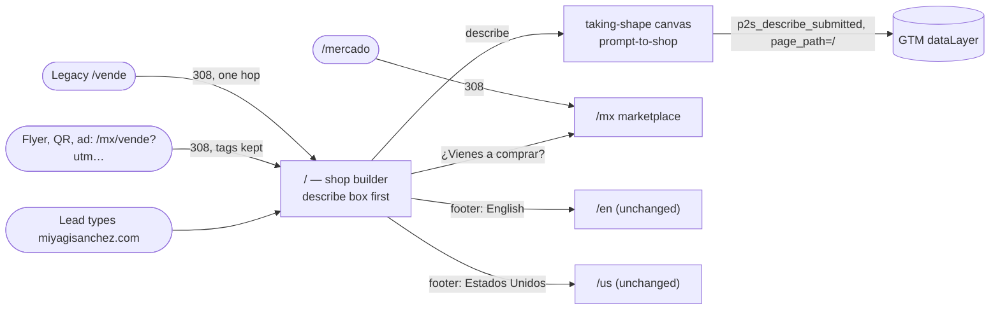

# Pitch — The shop builder opens at miyagisanchez.com

Moves · Tests: not grounded — no strategy yet

## The ask, as given

> Hi claude, ive been thinking of moving what we currently have on mx/vende or a polished and upgraded version of it (where we highlight ecommerce shops/infrastructure over the marketplace value prop as we dont have many site visitors) to the root at miyagisanchez.com , reason is because its very easy to communicate the miyagisanchez.com domain / brand but in there, leads dont really see the value prop or get the build your shop with a prompt. And to get to mx/vende they need to figure t out on their wn or i have to constantly advertise the url /mx/vende
>
> this means also reorganizing the entry door for the two markets. Right now lets focus on mexico to promote the new features and capture shops.
>
> then the marketplace url what could it be?
>
> Let me know what you think of all of this and how could we do it.

Follow-up, 2026-10-29: *"yes, run refine and leave /en as is"*

### Claims
1. Put the `/mx/vende` pitch, polished and upgraded, at the root `miyagisanchez.com`.
2. Lead with ecommerce shops / infrastructure over the marketplace value prop.
3. A lead who types the domain sees the value prop and the build-your-shop-with-a-prompt flow.
4. Nobody has to know or be told `/mx/vende` any more.
5. Reorganize the entry door for the two markets, focused on Mexico for now.
6. Give the marketplace a URL.
7. `/en` stays as it is.

**Teach-back:** yes — "You want the bare domain to sell the shop builder to Mexican merchants, so that saying 'miyagisanchez.com' is the whole pitch and the marketplace becomes a bonus at `/mx`. Right?"

## Problem

`miyagisanchez.com` is the address Daniel can say out loud, print, and hand to a promoter. Today it opens on a
country picker (`app/(site)/MarketSelector.tsx`, Epic 07 decision D7) that never shows what we sell: there is no
describe box and no pitch, just one link to sell at the bottom. The shop builder that shipped on 10-28 lives at
`/mx/vende`, a URL nobody guesses. With few buyer visitors, the marketplace is not yet the draw. The shop is.

## Appetite

**M**: one epic, two sprints (one moves the page, one upgrades it). If the upgraded content does not fit, S2 shrinks.
S1 must ship in full.
quote: $27–40 (M, n=3, p25–p75)

## Outcome & signal

After this ships, someone who types `miyagisanchez.com` on a phone sees "describe your business" as the first thing,
in Spanish, and can start a shop without one more click. `/mx/vende`, `/vende` and every campaign link with tracking
tags land on the same page. The marketplace is one tap away at `/mx` (and `/mercado`).
Signal: `p2s_describe_submitted` events (GTM, already shipped) split by page path, `/` versus `/mx/vende`.

## Stage-2.5 bucket

**Light enhancement.** Everything on the page already exists: the anchor page config, the describe box, the pricing
catalog and the seller-landing path helper. The work is moving it, redirecting, rewriting three specs that pin the
old root, and an upgraded content order.

## Bill of materials (What / Why)

| What | Why |
|---|---|
| `/` renders the Mexico seller page (describe box first) | The domain people can say becomes the pitch |
| `SELLER_LANDING_PATHS.mx` → `/` | One line moves every "Vender" link in the header, footer and persona pages |
| `/mx/vende` and `/vende` → 308 to `/`, tags kept | Flyers, QR codes and ads already printed keep working and keep counting |
| `/mercado` → 308 to `/mx` | A sayable word for the marketplace without a second URL |
| Root auto-hop to `/en` removed from `/` | Otherwise an English-language phone in Mexico skips the pitch |
| Country + language links in the footer | The picker's job, without being the front door |
| What you get: shop, domain, payments, share kit, setup guide | Shop infrastructure before the marketplace |
| Pricing summary from the one catalog | Answers "how much?" with the same numbers as `/mx/precios` |
| Marketplace as a bonus line + "¿Vienes a comprar?" link | Keeps the marketplace without leading with it |
| Specs rewritten for the new root contract | The old D7 specs would fail; deleting them would leave the root ungated |
| Cloudflare purge of `/` after deploy | `/` was pinned at the edge for 7 days in August; a deploy alone does not clear it |

## Scope
**In v1:** everything in the table above, Mexico only, Spanish only.

**Out of v1 (no-gos):**
- **No "real shops" proof section** (product owner, 10-29: ship without it for now).
- **`/en` is untouched**: its page, its metadata and its own hop to `/` for Spanish browsers (product owner, 10-29).
  The US seller landing `/us/sell` is untouched too.
- The marketplace does not move: `/mx`, `/mx/s/<slug>`, `/mx/l/...` stay as they are. No `mercado.` subdomain:
  subdomains are merchant shops in the middleware.
- Persona pages stay at `/mx/vende/<persona>` (live campaign URLs); only their "back to the main page" link changes.
- No new feature flag (operating posture).
- No new copy system: copy goes through the existing dictionary, so `/admin/contenido` can still edit it.
- No redesign of the describe box or the taking-shape canvas (prompt-to-shop owns them).

## Rabbit holes

1. **Static versus dynamic `/`.** `/` is a static page today (`revalidate = 60`) because the old Cloud Run cold start
   took about 30 seconds. `/mx/vende` is dynamic on purpose: the describe box reads `TURNSTILE_SITE_KEY` at request
   time (prompt-to-shop D8), and the page reads `?v=` and UTM tags on the server. **Decided:** `/` becomes dynamic like
   `/mx/vende`. Production now runs on an always-on VM, which has no cold start. The builder records `/`'s time to
   first byte before and after, from the live server. If it gets more than 300 ms slower, the fallback is to keep `/`
   in ISR and read the site key client-side; that one goes back to the product owner.
2. **Which layout.** `/` lives in `(site)`, a static layout with no `headers()` call. The seller page lives in the
   dynamic `(shell)`. The lock decides: either a shared `SellerAnchorPage` server component that both trees render,
   or move the root page into `(shell)`. Never two copies of the markup (the selector's own comment explains why:
   the second copy is the one that goes stale).
3. **The language hop.** `RootLanguageSwitch` / `lib/root-language.ts` move an English browser from `/` to `/en`. That
   must stop on `/`. Otherwise an `en-MX` phone, common in Mexico, lands on the picker and never sees the pitch.
   `/en`'s hop to `/` for Spanish browsers stays, because `/en` is out of scope, and it now lands Spanish readers on
   the pitch, which is right.
4. **hreflang.** `rootSelectorMetadata` pairs `/` (es) with `/en` (en). `/` becomes self-canonical with no `en`
   alternate. `/en` keeps its metadata unchanged (out of scope), so it still names `/` as its Spanish version. That
   wrinkle is accepted, and the retro records it for the day `/en` gets its own decision.
5. **Redirect chains.** Legacy `/vende` already 308s to `/mx/vende`. After this it must go to `/` in one hop, not two
   (`lib/market-url.ts` `platformMarketRedirectPath`). The rule stays below the tenant exits in `middleware.ts`, so
   subdomains, custom domains and embeds never see it.
6. **`/vende/fundadoras` and the promoter routes** are special-cased in the middleware. Only the bare landing moves;
   sub-paths keep resolving exactly as today.
7. **Stale checkout.** The local `apps/miyagisanchez` was 18 commits behind `origin/main` when this was refined. The
   describe box and `/mx/precios` exist only on `origin/main`. Build from a fresh worktree.

## What already exists (reuse, don't rebuild)

- `app/(shell)/mx/vende/page.tsx`: the anchor page (metadata, JSON-LD, `buildAnchorPageConfig`, `DescribeBox` hero).
- `app/(shell)/mx/vende/_components/SellerAcquisitionSections.tsx` + `page-config.ts`: every section, config-driven.
- `app/(shell)/mx/vende/_components/DescribeBox.tsx` + `lib/prompt-to-shop/*`: the describe box and its funnel
  events (`p2s_describe_submitted` … `p2s_published`, `lib/prompt-to-shop/funnel.ts`).
- `lib/seller-acquisition.ts`: `SELLER_LANDING_PATHS` / `sellerLandingPath` / `sellerLandingRedirectPath` (which
  already carries `from`, `v` and UTM through a hop). `PlatformShell` reads it for every "Vender" link.
- `lib/market-url.ts` `platformMarketRedirectPath` + `middleware.ts`: the legacy 308 rule, placed below the tenant exits.
- `app/(shell)/mx/precios/page.tsx` + the one pricing catalog (pricing-page epic): the source for the pricing block.
- `lib/market-seo.ts`, `app/(site)/opengraph-image.tsx`, `lib/marketing-og.tsx`: metadata, canonical and OG.
- `getOverriddenDictionary('es')`: admin-editable copy (`/admin/contenido`).
- Specs that pin today's root: `e2e/market-selector.browser.spec.ts`, `e2e/market-route-population.spec.ts`,
  `e2e/root-language-hop.browser.spec.ts`, `e2e/root-language.spec.ts`, `e2e/market-root-layout.spec.ts`; the source
  guard `e2e/seller-landing-link-population.spec.ts`; the `seller-acquisition-*` family.

## Visuals



```surface
state: root-home-idle
route: /
- head "Tu tienda en línea, lista en minutos" action "Describe tu negocio"
- describe "Cuéntanos qué vendes" examples x3 button "Armar mi tienda"
- list "Lo que te llevas" shop · domain · cobros · catálogo/PDF/feed · guía
- pricing "0% de comisión" link "Ver precios"
- note "Y además apareces en el mercado de Miyagi Sánchez" link "Explora el mercado"
- footer "México · Estados Unidos · English"
```

## UX heuristics & rails check
- **CI guards covering this surface:** `seller-landing-link-population` (stale landing links), the
  `seller-acquisition-copy` accent/ñ guard, the no-hand-typed-MXN-price guard (pricing-page), the agent-readability
  no-JS fetch of `/`. The browser job is non-blocking, so the source-level specs are what gate.
- **Audits-lens findings that apply:** none found specific to `/`.
- **Design-language debt:** `MarketSelector` uses inline styles; the replacement uses the seller page's existing
  components and module CSS, so this removes debt.

## Acceptance criteria

**S1: the shop builder opens at the root**
- S1.1 Opening `miyagisanchez.com` on a phone shows the Mexico seller page with the describe box as the first
  action. No market picker, no products. Title, description, canonical and OG point at `/`. Its JSON-LD `url` is `/`.
- S1.2 An English-language browser opening `/` stays on `/`. A visible footer link reaches `/en`.
- S1.3 `/mx/vende?utm_source=x&v=b&from=y` returns 308 to `/?…` with all three kept. `/vende` goes to `/` in one hop.
  `/mercado` returns 308 to `/mx`. `/mx/vende/creadores` and every other persona or sub-path still returns 200.
- S1.4 Every "Vender" link in the header, footer and persona pages points at `/`. The link-population guard passes,
  and so do the sitemap, `llms.txt` and `/acerca`'s seller link.
- S1.5 The selector specs are rewritten for the new contract, not deleted. Each new spec is seen failing once by a
  deliberate break.
- S1.6 Deployed: the VM container matches the merge SHA, Cloudflare `/` is purged, and a live smoke of `/` on
  `https://miyagisanchez.com/` shows the describe box. `/` time to first byte is recorded before and after.

**S2: the upgraded pitch**
- S2.1 The sections run in this order: describe box, what you get (own shop and domain, payments, catalog link,
  PDF and feed, setup guide), pricing, marketplace as a bonus. Copy comes from the dictionary and can be edited in
  `/admin/contenido`.
- S2.2 Pricing figures come from the one pricing catalog. The hand-typed-price guard passes, and the block links to
  `/mx/precios`.
- S2.3 "¿Vienes a comprar? → Explora el mercado" links to `/mx`.
- S2.4 There is no horizontal overflow at 360, 390 and 414 px. The phone walkthrough is owed to Daniel.

## Kill-switch / runtime gate
None. This is risk low with no money or auth seam. The operating posture adds no flags unless the product owner asks,
and they said none. Rollback is `git revert` plus a CDN purge.

## Open risks / research
- The SEO title for `/` changes from the selector's to the seller pitch. This is intended. Search Console will show
  `/mx/vende` dropping as `/` takes its queries.
- Turnstile on `/` gives a site key to every visitor on the most-visited page. This is already the case on
  `/mx/vende`, and verification happens at submit (prompt-to-shop D8).
- Owed from earlier: `/en`'s seller button sends an `en-MX` visitor to the US market (`seller-signup-market.ts:8`).
  It stays owed because `/en` is out of scope.

## Intent match

_Advisory and uncalibrated (intent-match D1, D3): it can add a step, never block one. Regenerate with `node scripts/intent-match.mjs <this seed> --write`._

```text
Intent match — Roadmap/00-ideas/seeds/root-shop-builder-home.md
  coverage in   0.93  (7 claims)
  coverage out  0.82  (11 criteria)
  clarity       0.84  (11 criteria)
  teach-back    1.00  (yes)
  agreement     pending  (the optional reader at the architecture lock)
  why story     0.62  (advisory, not in the total)
Total 90 / 100 — uncalibrated · signals: coverage in, coverage out, clarity, teach-back
Band: build (placeholder bands: 80 build · 60 resolve follow-ups · below 60 sketch or spike)
Gaps: none
```

<!-- intent-match: {"coverage_in":0.934,"coverage_out":0.821,"clarity":0.838,"teach_back":1,"total":90} -->
