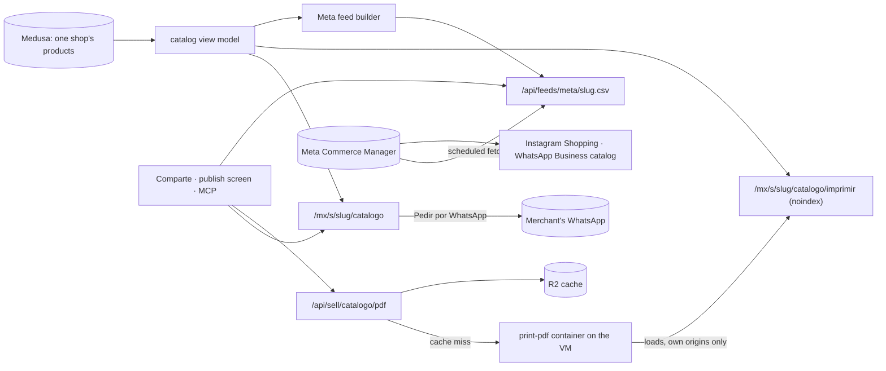

# Pitch — Share kit

Moves · Tests: not grounded — no strategy yet

> **Source:** the v2 T1 strategy review (<https://claude.ai/artifact/7cAUeEp16jVNLigE9tkUVj>), section 8 (what to bring
> over from Despacho Bonsai: the PDF catalog *rebuild*, the catalog link *build light*, the Meta feed *port as a live
> URL*) and section 10 (E4 · Share kit, medium).

## The ask, as given

> Lets check the POS from despachobonsai project folder added, same for Catalog links, shareable pdfs. any other
> commerce capabilities from there we could bring over?

> now refine e4

> (Plan questions, 2026-10-27) PDF engine: Revive it on the VM · Order button: WhatsApp, else buy · Meta feed: Public
> per-shop URL · Appetite: M

### Claims
1. A shareable catalog link, like Despacho Bonsai's, for each shop.
2. A shareable catalog PDF, like Despacho Bonsai's.
3. Other useful Despacho Bonsai commerce capabilities come over: the Meta (Instagram, Facebook, WhatsApp) catalog feed.
4. Everything is scoped to one shop (Despacho's PDF listed every shop's products).
5. The PDF is rendered by reviving our headless-Chrome renderer on the VM.
6. The catalog link's order button opens the merchant's WhatsApp, else buys on Miyagi.
7. The Meta feed is a public per-shop URL.

**Teach-back:** yes — "You want each merchant to have three ways to share their catalog where they already sell — a
WhatsApp-friendly link, a PDF with photos and QR codes, and a feed that fills their Instagram and WhatsApp catalogs —
built on Medusa and scoped to their shop, unlike Despacho's. Right?" (Daniel approved the review's port verdicts and
answered the four plan questions that follow from them.)

## Problem

A micro-merchant's customers are in WhatsApp chats and on Instagram. Today a Miyagi merchant can share one thing: their
shop link (Comparte: WhatsApp, copy link, story image). They can't send a customer a scrollable catalog with an
«ordena por WhatsApp» button, a PDF to forward in a group, or plug their products into Instagram Shopping and the
WhatsApp Business catalog. T1 offers channel catalogs; Despacho Bonsai had early versions of all three, but its PDF
listed **every** published Medusa product (a data leak if ported), had no photos and priced in USD, and its Meta
export was a one-off CSV download. Separately, our only PDF renderer was deleted with GCP on 2026-10-16, so the
print-edition and rate-card PDF exports have returned 503 since.

## Appetite

**M** — three capability sprints (WAYS-OF-WORKING → *Betting & appetite*). Fixed appetite, variable scope: if it runs
out, cut the per-product QR codes in the PDF and the agent tool first, never the shop scoping or the renderer's origin
allow-list.

quote: $20–120 (M, n=1, wide)

## Outcome & signal

**After this ships:** in Comparte, a merchant finds three new tiles. **Catálogo** gives them
`miyagisanchez.com/mx/s/<slug>/catalogo` (and a QR): one fast scroll of their products, each with «Pedir por WhatsApp»
to the merchant's own number with the product named and linked, or «Comprar» on Miyagi when they have no WhatsApp
number. **Catálogo PDF** gives an A4 PDF with photos, MXN prices, their theme colours and a QR per product, ready to
forward. **Instagram y WhatsApp** gives a feed URL and a short guide to paste it into Meta Commerce Manager, so their
Instagram Shopping and WhatsApp Business catalogs fill and stay current. The prompt-to-shop publish screen offers the
catalog link and the PDF beside its other shares. The print-edition PDF export works again.

**How Daniel tests it:** each sprint's smoke walkthrough, ending with a real Meta Commerce Manager feed fetch.

**Measured by (GTM `dataLayer` via `lib/analytics-events.ts`):** `share_catalog_link`, `share_catalog_pdf`,
`share_meta_feed_copied`, plus `catalog_order_whatsapp` / `catalog_order_buy` taps on the catalog page, keyed by shop.

## Stage-2.5 bucket

**Light-to-new on existing rails.** Shop-scoped listings, short links, QR generation, WhatsApp share links, the
Comparte page and a headless-Chrome renderer (source kept, service deleted) exist. New: the catalog page, the catalog
print layout, the feed, and running the renderer on the VM.

## Bill of materials (What / Why)

| What | Why |
|---|---|
| A pure catalog view model built from `getShopListings` | One shop's products only — the leak Despacho had can't happen |
| `/mx/s/[slug]/catalogo`: one scroll, big order buttons | Customers in a WhatsApp chat order in one tap |
| `buildWhatsAppOrderLink(phone, product, url)` | «Pedir por WhatsApp» to the merchant, product named and linked |
| `services/print-pdf` revived as a VM container with an origin allow-list | One renderer for the catalog PDF; print-edition exports come back |
| A catalog print page: A4, photos, MXN, theme colours, a QR per product | A PDF that looks like the shop and leads back to it |
| PDF route with an R2 cache keyed by the catalog's last change | Fast downloads; Chrome runs only when the catalog changed |
| A pure Meta feed builder + a public per-shop CSV URL | Instagram Shopping and the WhatsApp Business catalog, kept current by Meta's scheduled fetch |
| Comparte tiles + a Commerce Manager guide | The merchant finds and uses all three |
| The catalog and PDF tiles in the prompt-to-shop publish screen | Step 7's share tiles are complete |
| An MCP tool returning the shop's share kit | Seller agents can hand out the links (AGENTS rule 3) |

## Scope

**In v1:**
- The catalog page, PDF and Meta feed for **MX shops** (es-MX), each scoped to one shop's published, visible
  products; also reachable on the shop's subdomain and custom domain channel.
- Reviving `services/print-pdf` on the Oracle VM for every existing caller (print edition, rate card, promoter rate
  card) and the new catalog PDF.
- Share tiles in Comparte and prompt-to-shop's publish screen; one MCP tool for seller agents.

**Out of v1 (no-gos):**
- **No Amazon, Mercado Libre or XLSX exports** (ML sync already covers ML; the review skipped the rest).
- **No Meta API integration** (Catalog Batch API, Commerce Manager OAuth): Meta fetches our URL; the merchant pastes it.
- **No AI sales bot** on WhatsApp (the review's "later").
- **No POS** (E5).
- **No US / English** catalog or feed.
- **No price changes or channel-specific prices** for the feed.
- **No feature flag** (WAYS-OF-WORKING default; rollback is `git revert`).

## Rabbit holes

1. **Shop scoping is the whole point.** Every surface reads `getShopListings(slug)` (or its Medusa equivalent) and
   never a global product list. A spec seeds two shops and asserts the catalog page, the PDF's print page and the feed
   for shop A contain zero products of shop B. Paused, draft, deleted, unclaimed-private and «Precio a consultar»
   products follow the public storefront's rules exactly.
2. **The renderer is an SSRF surface.** Headless Chrome loading a URL from a request body is dangerous; it must accept
   **only our own origins** (an allow-list in `server.js`), require `x-internal-secret`, run on the internal Docker
   network with no published port, and time out. Story high-risk; security lens.
3. **Chromium on the VM.** The VM is arm64; Debian's `chromium` package exists for arm64 but the image must build on
   `image-arm64.yml`. Memory headroom is checked before merge (Chromium can take ~1 GB); one render at a time, with a
   queue. Node 24 per team memory, not the Dockerfile's `node:20-slim`.
4. **Admin-only print pages.** The print-edition page is loaded with `?secret=ADMIN_SECRET` today; reviving keeps that
   contract unchanged. The catalog print page needs no secret (public data), is `noindex`, and is not linked anywhere.
5. **Caching the PDF.** Keyed by shop + the catalog's latest product `updated_at` (and theme); a hit streams from R2, a
   miss renders and stores. Rate-limited per shop and per IP so a public download link can't make the VM render all
   day.
6. **Two stores for shop settings.** The public page reads the **Medusa** seller (team memory: a Supabase write
   doesn't change the storefront). The WhatsApp number, theme and name come from where the storefront reads them.
7. **Meta feed fields.** Required per the commonly cited spec: `id`, `title`, `description`, `availability`,
   `condition`, `price` ("199.00 MXN"), `link`, `image_link`, `brand`. Products without an image or a price are left
   out and counted in the guide («3 productos no aparecen: les falta foto o precio»). IDs are stable variant or
   product IDs. The locking pass re-reads Meta's own spec page before building.
8. **Caching the feed and the catalog page.** Both are public and per-shop: explicit `revalidate` (feed: one hour;
   page: as the shop page). A dataless static page without `revalidate` was pinned for a year at the CDN.
9. **WhatsApp numbers.** `wa.me/<digits>` needs a normalized MX number; reuse `SellerTrustCard`'s `whatsappUrl`
   normalization rather than a third builder.
10. **Unclaimed shops.** An unclaimed (gem) shop has no owner to receive WhatsApp orders: its catalog page uses
    «Comprar» only, and it has no feed or PDF tile (no owner to use them).

## What already exists (reuse, don't rebuild)

| Primitive | Where | Use |
|---|---|---|
| Shop-scoped listings | `lib/listings.ts` (`getShopListings`) | The only data source |
| Shop routes + channel layout | `app/(shell)/mx/s/[slug]/*`, `app/(shell)/s/[slug]/ChannelLayout.tsx` | `/catalogo` beside `tienda`, `colecciones` |
| WhatsApp links | `lib/share-link.ts` (`buildWhatsAppShareLink`), `SellerTrustCard`'s `whatsappUrl` | Share + order links |
| Short links | `lib/shortlink.ts` (`shopTarget`, `listingTarget`, `mschz.org`) | QR targets |
| QR codes | `qrcode` dependency, `lib/print-qr.ts` pattern | Catalog and per-product QRs |
| PDF renderer | `services/print-pdf` (Dockerfile, `server.js`, puppeteer-core + Chromium), `lib/print-pdf-client.ts` (`renderPrintPdf`) | Revived on the VM |
| PDF callers | `api/admin/print/editions/[id]/pdf`, `api/admin/print/rate-card/pdf`, `api/promoter/rate-card` | Working again |
| R2 | `lib/r2.ts` (`uploadToR2`) | PDF cache |
| Comparte | `app/(shell)/shop/manage/comparte/*` (WhatsApp, copy link, story image) | New tiles |
| Prompt-to-shop publish screen | prompt-to-shop S5.2 (`/sell/armar/listo`) | Catalog + PDF tiles |
| VM stack | `infra/oci/docker-compose.yml`, `update.sh`, `.github/workflows/image-arm64.yml` | The renderer service |
| Analytics | `lib/analytics-events.ts` | Share and order taps |
| Despacho Bonsai originals | `despachobonsai/lib/catalog-pdf.tsx`, `app/api/commerce/export` | Reference only; nothing ported verbatim |

**AGENTS rules check:** product data stays in Medusa and is only read (rule 1); no Supabase table (rule 2); the MCP
tool gives seller agents the share kit (rule 3); Clerk unchanged (rule 4); es-MX (rule 5).

## Visuals

**System context**



**Screens (one block per state)**

```surface
state: catalogo-default
route: /mx/s/[slug]/catalogo
- header: shop logo, name, one line, theme colours
- one scroll of product cards: photo, name, price (or «Precio a consultar»)
- each card: action primary "Pedir por WhatsApp" (merchant has a number) else "Comprar"
- footer: "Ver la tienda completa" → shop page
```

```surface
state: catalogo-empty
route: /mx/s/[slug]/catalogo
- "Esta tienda todavía no tiene productos publicados." + link to the shop
```

```surface
state: comparte-tiles
route: /shop/manage/comparte
- tile "Catálogo": link + "Copiar" + "Compartir por WhatsApp" + "Descargar QR"
- tile "Catálogo PDF": "Descargar" + "Compartir por WhatsApp"; while rendering "Preparando tu PDF…"
- tile "Instagram y WhatsApp": feed URL + "Copiar" + 4-step guide for Commerce Manager + "3 productos no aparecen: les falta foto o precio"
```

```surface
state: pdf-error
route: /shop/manage/comparte
- "No pudimos preparar tu PDF. Inténtalo en un minuto." (renderer down or rate limit) · the link tile still works
```

## UX heuristics & rails check
- **CI guards covering this surface:** the no-JS SEO/marketing spec pattern (catalog page server HTML), the image-arm64
  build-args spec (`e2e/image-arm64-build-args.spec.ts`), Tailwind JIT arbitrary-value guard, emoji guard, es-MX copy
  completeness, the client-JS diet budget for the catalog page.
- **Audits-lens findings that apply:** none found for sharing.
- **Design-language debt:** `ComparteClient.tsx` uses inline styles; new tiles use shared `Card` / `Button` and Iconoir.

## Kill-switch / runtime gate (risk:high only — Stage 6b)

**None — carve-out.** WAYS-OF-WORKING → *Feature flags — OFF by default*. The epic is high only because the renderer
is shared infra with an SSRF surface; rollback is `git revert` plus removing the container from the compose file.

## Decisions at plan time (Daniel, 2026-10-27)

- **Revive `services/print-pdf` on the VM** (print-edition exports come back too).
- **«Pedir por WhatsApp»** to the merchant's number, else **«Comprar»** on Miyagi.
- **Meta feed at a public per-shop URL.**
- **Appetite M.**

## Slices

| Sprint | Capability | Stories (risk) |
|---|---|---|
| **S1 · The catalog link** | A WhatsApp-friendly catalog page per shop | S1.1 pure catalog view model + WhatsApp order link + two-shop scoping spec (low) · S1.2 `/mx/s/[slug]/catalogo` page on every shop channel (low) · S1.3 Comparte «Catálogo» tile + QR + the prompt-to-shop publish tile (low) |
| **S2 · The catalog PDF** | A forwardable PDF; the renderer is back | S2.1 `services/print-pdf` on the VM: arm64 image, internal network, origin allow-list, secret, queue (high) · S2.2 catalog print page: A4, photos, MXN, theme, QR per product (low) · S2.3 PDF route + R2 cache + rate limits + Comparte and publish tiles (low) |
| **S3 · Instagram and WhatsApp catalogs** | Meta fetches each shop's feed | S3.1 pure Meta feed builder + exclusion reasons (low) · S3.2 `/api/feeds/meta/[slug].csv` + Comparte guide tile (low) · S3.3 MCP `get_share_kit` for seller agents + funnel events (low) |

## Acceptance criteria

- **S1** — `/mx/s/<slug>/catalogo` returns server HTML listing exactly that shop's visible products (a two-shop spec
  finds none of the other shop's); each card's «Pedir por WhatsApp» opens `wa.me/<merchant digits>` with the product
  name and its link, or «Comprar» when the shop has no number or is unclaimed; it works on the shop's subdomain and
  custom domain; the page has `revalidate` and an OG image; Comparte shows the tile with copy, WhatsApp share and a
  downloadable QR; prompt-to-shop's publish screen offers it.
- **S2** — the print-pdf container runs on the VM from the arm64 image with no published port; a request for a URL
  outside our origins is refused (spec); the print-edition PDF download works again; «Descargar» on the catalog tile
  returns an A4 PDF of exactly that shop's products with photos, MXN, theme colours and a working QR per product; a
  second download with no catalog change is served from R2 without a render; rate limits return the friendly error.
- **S3** — `/api/feeds/meta/<slug>.csv` returns a CSV with Meta's required columns for exactly that shop's eligible
  products, prices as "199.00 MXN", and counts the excluded ones; Meta Commerce Manager accepts the URL as a scheduled
  feed (Daniel's step); the guide tile shows the URL, the steps and the excluded count; MCP `get_share_kit` returns the
  three links for the agent's own shop only; each share and order event fires once.

**QA stage per sprint:** pure specs on the view model, the WhatsApp order link and the feed builder (each observed red
under a mutation); `api` specs for the catalog page HTML, the two-shop scoping, the renderer allow-list and the feed;
a phone smoke per sprint owed to Daniel; the renderer deploy verified on `main` after deploy.

## Open risks / research

- **Meta's feed spec:** the commonly cited required fields above come from third-party guides (searched 2026-10-27:
  [adtribes](https://adtribes.io/?p=28339), [Channable](https://helpcenter.channable.com/hc/en-us/articles/360017116939));
  Meta's own help page didn't render for fetching. The locking pass reads Meta's current spec in a browser before S3.
- **VM memory for Chromium** — checked before S2.1 merges.
- **`ADMIN_SECRET` in a renderer URL** (the print-edition contract) stays inside the internal network; unchanged.

## Intent match

_Advisory and uncalibrated (intent-match D1, D3): it can add a step, never block one. Regenerate with `node scripts/intent-match.mjs <this seed> --write`._

```text
Intent match — Roadmap/00-ideas/seeds/share-kit.md
  coverage in   0.98  (7 claims)
  coverage out  0.90  (3 criteria)
  clarity       0.81  (3 criteria)
  teach-back    1.00  (yes)
  agreement     pending  (the optional reader at the architecture lock)
  why story     0.73  (advisory, not in the total)
Total 92 / 100 — uncalibrated · signals: coverage in, coverage out, clarity, teach-back
Band: build (placeholder bands: 80 build · 60 resolve follow-ups · below 60 sketch or spike)
Gaps: none
```

<!-- intent-match: {"coverage_in":0.98,"coverage_out":0.903,"clarity":0.814,"teach_back":1,"total":92} -->
